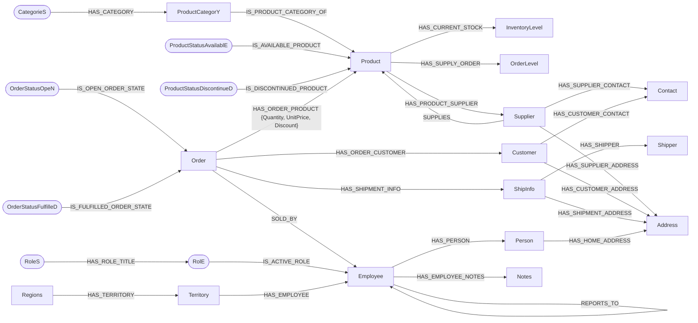

# NorthWind — the classic database, remodeled with a Graph mentality

**The well-known Northwind database, once a reference model for relational databases, rebuilt as a Graph-Native data model following the key principles of the [New Approach](../README.md).**

This is the starting point that [NorthWind PLUS](../NorthWindPLUS) later grows into a full 360-degree business cycle. Here the goal is narrower and very instructive. It takes a model everyone knows in its table form, imports the same data, and shows what changes when you stop thinking in tables:

- State becomes relationships.
- Embedded columns become their own nodes.
- Categories and statuses become explicit Collections.

> If you find yourself filtering on a node property that represents state or context, that's a sign the model needs a relationship instead — it was most likely built with a table mentality.

---

## Contents

- [From tables to a graph](#from-tables-to-a-graph)
- [The v2.1 model](#the-v21-model)
- [Files](#files)
- [Quick start](#quick-start)
- [What's in the script besides the import](#whats-in-the-script-besides-the-import)
- [Version history](#version-history)
- [About the CSV files](#about-the-csv-files)

---

## From tables to a graph

The import does far more than turn rows into nodes. Each step removes a "table habit":

| In the relational Northwind | In the graph model |
|---|---|
| `Products.Discontinued` flag | The product belongs to a **status Collection**: `ProductStatusAvailablE` or `ProductStatusDiscontinueD`. The flag is removed. |
| `Products.CategoryID`, `SupplierID` foreign keys | Relationships to `ProductCategorY` and `Supplier`. The keys are removed. |
| `UnitsInStock`, `UnitsOnOrder` columns, updated constantly | Separate `InventoryLevel` and `OrderLevel` nodes — the *isotopes*, the only values meant to change |
| Address and contact columns repeated on Suppliers, Customers, Employees and Orders | `Address` and `Contact` nodes |
| Employee personal data (name, birth date, home phone…) on the employee row | A separate `Person` node, kept apart from the `Employee` (the role in the company) |
| `Employees.Title` text column | A `RolE` node in the `RoleS` Collection, with an `IS_ACTIVE_ROLE` relationship that carries a start date |
| `Employees.ReportsTo` | `REPORTS_TO` relationship |
| `Orders.ShipVia`, ship address and freight columns | A `ShipInfo` node linked to its `Shipper` and shipment `Address` |
| `Order Details` join table | The `HAS_ORDER_PRODUCT` relationship, carrying `Quantity`, `UnitPrice` and `Discount` |
| Order status inferred from whether `ShippedDate` is null | The order belongs to `OrderStatusOpeN` or `OrderStatusFulfilleD` (`OrderStatusCanceleD` also exists) |

After the import, the script removes the copied columns from the original nodes (`REMOVE …`). Each node keeps only what identifies it — a **Proper Noun Node**.

**Naming convention:** Collection labels start and end with a capital letter (`CategorieS`, `RoleS`, `OrderStatusOpeN`), so they're easy to tell apart from entity nodes like `Product` or `Order`.

---

## The v2.1 model

The relationships created by `NorthWind v2.1.cypher`:



Rounded nodes are Collections. Note that **roles point to employees**, not the other way round. A role is assigned to an employee by another part of the business, so the relationship comes *into* the `Employee` node.

> `Northwind.png` in this folder shows the **original (v1)** model, which used generic `[:HAS]` relationships with a `RelType` property and slightly different labels (`CategorY`, `ProductStatus_AvailablE`, `OrderStatus_OpeN`…). The concepts are the same; the diagram above reflects the current names.

---

## Files

| File | Description |
|---|---|
| `NorthWind v2.1.cypher` | **Current version.** Imports the data into the graph model, then provides analytic query examples, application queries and a recommendation engine. |
| `NorthWind v2.cypher` | The first version with ontology-specific relationship types. It also creates uniqueness constraints, which v2.1 doesn't. |
| `NorthWind.cypher` | The original version, using a generic `[:HAS]` relationship with a `RelType` property. |
| `NorthWind Schema Only.cypher` | The original (v1) model as a schema-only graph with empty properties, created with the Arrows app. Handy for visualizing the model without loading any data. |
| `Northwind.png` | Diagram of the original (v1) model. |
| `Import/` | The cleaned Northwind CSV files — see [About the CSV files](#about-the-csv-files). |
| `NorthWindPlus  v1.cypher`, `NorthWind_PLUS_Graph_Data_Model_Import_v2.1.cypher` | Early iterations of NorthWind PLUS, kept here for history. **The current NorthWind PLUS lives in [`/NorthWindPLUS`](../NorthWindPLUS).** |

---

## Quick start

The scripts load the cleaned CSVs straight from this repo on GitHub, so the same script works on **Neo4j Aura** and **Neo4j Desktop**:

1. Create a database — a free [Neo4j Aura](https://neo4j.com/cloud/aura-free/) instance or Neo4j Desktop.
2. Open `NorthWind v2.1.cypher` in the Query console or Neo4j Browser and run it. ⚠️ It starts with `MATCH (n) DETACH DELETE n`, so use an empty or disposable database.
3. Explore — for example, the whole neighbourhood of one order:

   ```cypher
   MATCH path = (o:Order {OrderID: "10461"})-[*1..2]-()
   RETURN path;
   ```

**Prefer local files?** Copy the files from `Import/` into your database's `import` folder, then replace the GitHub URL in each `LOAD CSV` line with `file:///` (for example, `LOAD CSV WITH HEADERS FROM "file:///categories.csv" AS row`).

---

## What's in the script besides the import

After the import, `NorthWind v2.1.cypher` contains three groups of ready-to-run queries.

**Analytics examples.** These include:

- order totals and order totals by product
- top orders, customers and employees
- sales by region, territory, category and employee
- stock versus supply orders
- the most ordered products
- a simple "customers who bought this also bought" query

**Application queries.** These are the commands an application built on the model would issue:

- creating a new order (new IDs get an `N` prefix so they're easy to tell apart from imported orders)
- checking inventory before fulfilling it
- fulfilling the order
- updating the inventory
- adding a customer with address and contact
- adding a product with its category, supplier, inventory level and status

Updating `InventoryLevel.UnitsInStock` is the one deliberate exception to the read-only-nodes rule. It is an isotope, and the script says so.

**Recommendation engine.** An adaptation of Neo4j's [Northwind Recommendation Engine GraphGist](https://neo4j.com/graphgists/northwind-recommendation-engine/) to this model:

1. Customer–product ratings derived from purchase counts.
2. Cosine similarity between customers.
3. Recommendations from what similar customers rated highly.

It adds a new layer of context without changing the core model.

---

## Version history

| Version | Change |
|---|---|
| **v1** (`NorthWind.cypher`) | The first Graph-Native remodel. Collection membership uses a single generic `[:HAS]` relationship, with a `RelType` property recording its meaning. This was a trade-off: it kept UI components reusable, but hurt edge indexing at scale. |
| **v2** | Removes `[:HAS]` entirely in favour of ontology-specific relationship types (e.g. `IS_DISCONTINUED`, `HAS_PRODUCT`), and adds uniqueness constraints. |
| **v2.1** | Refines the names: `ProductCategorY`, `IS_PRODUCT_CATEGORY_OF`, `IS_AVAILABLE_PRODUCT`, `HAS_CURRENT_STOCK`, Collection labels without underscores. It no longer creates the uniqueness constraints. |
| **NorthWind PLUS** | Continues in [`/NorthWindPLUS`](../NorthWindPLUS): full ontology, GRAPH TYPE schema, procurement workflows and concurrent simulation loops. |

---

## About the CSV files

The CSVs in `Import/` are a cleaned copy of the files published in [neo4j-graph-examples/northwind](https://github.com/neo4j-graph-examples/northwind). Some of the original files contain unescaped commas inside fields — mainly in addresses for Brazil, France and Belgium, and in some description and notes fields. On import this shifts values into the wrong columns and silently corrupts the data. I reported this as issue #53 in that repository. The files here are fixed (including quoted category descriptions), so use them rather than the originals.

---

For the reasoning behind the model, see the [concept article](https://medium.com/@marcospinedo/a-new-approach-to-application-development-using-cypher-gql-graphs-7d191e0c55d3) and the [root README](../README.md). Questions and feedback are welcome on [LinkedIn](https://www.linkedin.com/in/marcospinedo/).
