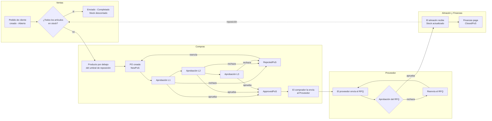

# NorthWind PLUS

🌐 [English](README.md) · [Português (Brasil)](Leiame%28pt-BR%29.md) · **Español**

**Una aplicación de línea de negocio (Line-of-Business) completa que se ejecuta de forma nativa sobre un Labeled Property Graph — portada a Neo4j, Memgraph, FalkorDB, Quine y Ultipa, con un agente de IA que funciona a su lado en Relate by Neo4j.**

NorthWind PLUS reconstruye la clásica base de datos Northwind como una aplicación *Graph-Native* y la amplía a un ciclo de negocio completo de 360 grados: pedidos de clientes, detección de stock bajo, órdenes de compra con tres niveles de aprobación, RFQs de proveedores, recepción en almacén, cierre financiero y preparación de pedidos — todo expresado en Cypher (o, en Ultipa, en ISO GQL), dentro del grafo.

Es la prueba de concepto que acompaña al artículo **[A Labeled Property Graph (LPG) Masterpiece](https://marcospinedo.substack.com/p/a-labeled-property-graph-lpg-masterpiece)** (en inglés) y forma parte del [Nuevo Enfoque](../Leame%28es-ES%29.md), más amplio, de construir aplicaciones de negocio *alrededor* del grafo, en lugar de poner grafos alrededor de las aplicaciones.

La prueba definitiva: seis procesos de negocio independientes, lanzados como procesos separados del sistema operativo, golpeando el mismo grafo vivo a la vez — y el modelo aguantando.

---

## Contenido

- [Por qué existe esto](#por-qué-existe-esto)
- [El ciclo de negocio](#el-ciclo-de-negocio)
- [Compatibilidad por motor, de un vistazo](#compatibilidad-por-motor-de-un-vistazo)
- [Estructura del repositorio](#estructura-del-repositorio)
- [Primeros pasos — Neo4j](#primeros-pasos--neo4j)
- [Primeros pasos — Memgraph](#primeros-pasos--memgraph)
- [Primeros pasos — FalkorDB](#primeros-pasos--falkordb)
- [Primeros pasos — Quine](#primeros-pasos--quine)
- [Primeros pasos — Ultipa](#primeros-pasos--ultipa)
- [Los bucles de simulación](#los-bucles-de-simulación)
- [Esquema y ontología](#esquema-y-ontología)
- [Diferencias entre motores que conviene conocer](#diferencias-entre-motores-que-conviene-conocer)
- [El agente de IA — Relate by Neo4j](#el-agente-de-ia--relate-by-neo4j)
- [Agentes de IA — para reflexionar](#agentes-de-ia--para-reflexionar)
- [Lecturas adicionales](#lecturas-adicionales)

---

## Por qué existe esto

La mayoría de los intentos de ejecutar aplicaciones de negocio sobre un grafo arrastran una mentalidad de tabla: *un registro = un nodo*, con el estado guardado en propiedades. NorthWind PLUS va en la dirección contraria y sigue un pequeño conjunto de reglas:

| Principio | En la práctica |
|---|---|
| **Nodos como Nombres Propios** (Proper Noun Nodes) | Los nodos guardan solo lo que define la identidad de aquello que representan. El estado, la categoría y el contexto *nunca* son propiedades. |
| **Las relaciones mueven el sistema** | Un evento de negocio es un cambio en las relaciones — un nodo pasa de una *Collection* a otra (por ejemplo, `NewPoS` → `ApprovedPoS`). Estado = posición. |
| **Nodos Ligeros / Collections** | Los nodos hub actúan como conjuntos explícitos (Superconjunto, Subconjunto, Elemento de) que representan estados y contextos del dominio. |
| **Nodos de solo lectura, "isótopos" para las excepciones** | Las propiedades no cambian tras la creación. Los pocos valores realmente mutables (recuentos de stock, umbrales) se aíslan en sus propios nodos pequeños, como `InventoryLevel`. |
| **Nunca borrar nodos** | Nada se borra, solo se vuelve a enlazar y se registra con fecha y hora, de modo que todo el historial sigue siendo trazable. |

Una consecuencia se ve en el harness de simulación: no hay umbrales de aprobación, definiciones de máquinas de estados ni reglas de validación en el código Python. Cada umbral (por ejemplo, quién puede aprobar qué importe) está en los nodos de rol, en el grafo, y se lee en el momento de la consulta. El código de la aplicación se reduce a orquestación — elegir un ritmo, ejecutar una sentencia Cypher, reintentar cuando hay contención, registrar el resultado.

El razonamiento completo está en la cabecera de cada script de importación y en el [artículo](https://marcospinedo.substack.com/p/a-labeled-property-graph-lpg-masterpiece).

---

## El ciclo de negocio



El encaminamiento de la aprobación depende del importe de la PO y de los valores `ApprovalBase` / `ApprovalLimit` guardados en los nodos de rol. Los elementos rechazados siempre pueden reenviarse, así que nada se queda atascado para siempre.

---

## Compatibilidad por motor, de un vistazo

| | Neo4j | Memgraph | FalkorDB | Quine | Ultipa |
|---|---|---|---|---|---|
| Versión del modelo | v2.3.1 (v2.3.3 para el agente de IA) | adaptación de la v2.3.1 | adaptación de la v2.3.1 | v2.4 (sin propiedades en las aristas) | adaptación de la v2.3.1 (ISO GQL) |
| Importación | `.cypher` en el Query console | `.cypher` en el Query console | `.sh` mediante `redis-cli` | `.sh` mediante la API REST de Quine | `.gql` mediante `run_gql_script.py` (o Ultipa Manager) |
| Harness de simulación | `NorthwindPlus_Stress_Test.py` | `NorthwindPlus_Stress_Test_MemGraph.py` | `NorthwindPlus_Stress_Test_FalkorDB.py` | `NorthwindPlus_Stress_Test_Quine.py`, **o** la recipe `northwind-plus-simulation.yaml` (sin Python) | `NorthwindPlus_Stress_Test_Ultipa.py` |
| Dependencia de Python | driver `neo4j` | driver `neo4j` (Bolt) | `falkordb` | ninguna (biblioteca estándar) | `ultipa` (se importa como `gqldb`) |
| Esquema GRAPH TYPE | ✅ | — | — | — | — |
| Lógica de negocio en el grafo | Cypher | Cypher | Cypher | Cypher + **Standing Queries** (+ flujos de ingesta en la recipe) | GQL |
| Lanzador para Windows | `PySetup.bat` | `MPySetup.bat` | — | — | `PySetup_Ultipa.bat` |
| Agente de IA | ✅ [Relate by Neo4j](Neo4jRelate/Leame%28es-ES%29.md) | — | — | — | — |

---

## Estructura del repositorio

```
NorthWindPLUS/
├── Import/                                               Cleaned Northwind CSV files (see note below)
├── NorthWind_PLUS_Graph_Data_Model_Import_v2.3.1.cypher   Neo4j import + full 360° initialization + query examples
├── NorthWind_PLUS_Graph_Data_Model_Import_v2.31 (MemGraph).cypher   Memgraph port
├── NorthWind_PLUS_FalkorDB_Import_v2.3.1.sh               FalkorDB port (import | recommend | report | checks | all)
├── NorthwindPlusGraphType_v1.cypher                       Neo4j GRAPH TYPE schema enforcement
├── NorthwindPlusGraph_RDF-turtle_v1.ttl                   RDF/OWL equivalent of the schema
├── NorthwindPlus_Stress_Test.py                           Concurrency harness — Neo4j
├── NorthwindPlus_Stress_Test_MemGraph.py                  Concurrency harness — Memgraph
├── NorthwindPlus_Stress_Test_FalkorDB.py                  Concurrency harness — FalkorDB
├── PySetup.bat                                            Windows: opens 8 loop windows against Neo4j
├── MPySetup.bat                                           Windows: opens 8 loop windows against Memgraph
├── AI_Agents_Food_For_Thought.md                          Ideas for an agentic layer (the first agents are built: see Neo4jRelate/)
├── Neo4jRelate/                                          AI agent on Relate by Neo4j, with model v2.3.3 — see its README
│   ├── README.md
│   ├── NorthWind_PLUS_Agent_Colab.ipynb                 Google Colab front end (knowledge store kept on Google Drive)
│   ├── NorthWind_PLUS_Agent.ipynb                       Local Jupyter front end
│   ├── run_loops_full.bat                               Windows: full mode, all six loops (credentials read from .env)
│   ├── run_loops_agents.bat                             Windows: agents mode, five loops; PO creation and resubmission by the agent
│   ├── run_ui.bat                                       Windows: the Procurement web UI at http://localhost:8000
│   ├── api/                                             The web UI's API (FastAPI), over the same Python and governed Cypher as the agent
│   ├── ui/                                              The web UI: Vite + React + TypeScript
│   ├── model/                                           v2.3.3: import script, GRAPH TYPE, RDF ontology, upgrades from v2.3.1 and v2.3.2, harness
│   ├── kb/                                              The agent's knowledge graph in Relate: build, hybrid search, learning loop, embeddings
│   ├── agent/                                           The agent (Claude + tools, offered by role) and its read-only / governed access to Neo4j
│   ├── sandbox/                                         What-if rehearsals on a subgraph copied from Aura with relate pull
│   └── tests/                                           Offline tests (no API key, no Aura needed)
├── Ultipa/                                                ISO GQL port for Ultipa GQLDB — see its README
│   ├── README.md
│   ├── NorthWind_PLUS_Graph_Data_Model_Import_v2.3.1_Ultipa_GQL.gql   The full model in GQL (sectioned: setup | live_views | recommendation | examples)
│   ├── run_gql_script.py                                 Runs a section of the .gql file, statement by statement
│   ├── NorthwindPlus_Stress_Test_Ultipa.py               Concurrency harness — Ultipa
│   └── PySetup_Ultipa.bat                                Windows: opens 8 loop windows against Ultipa
└── Quine/
    ├── README.md                     Streaming "business day" demo — full walkthrough
    ├── northwind-plus-streaming.yaml Quine recipe: seed + business streams + standing queries
    ├── run-demo-docker.sh            Launcher (Docker, Windows + WSL)
    ├── run-demo.sh                   Launcher (local Quine jar)
    ├── feeds.json                    Graph feeds for the Exploration UI
    ├── DEMO_PLAN.md                  Design decisions and verification runs
    ├── tap-queries-api (3).md        Reference for Quine's tap-query API
    └── Full_NorthWindPLUS/
        ├── Readme.md
        ├── NorthWind_PLUS_Graph_Data_Model_Import_v2.4 (Quine).cypher   The edge-property-free v2.4 model
        ├── northwind-plus-quine-batch.sh                               Builds the full graph through the REST API
        ├── register-standing-queries.sh                                Moves the company's own rules into Standing Queries
        ├── northwind-plus-quine-recommendations.sh                     Optional recommendation layer
        ├── NorthwindPlus_Stress_Test_Quine.py                          Simulation loops (sq | loops | auto modes)
        └── Recipe_Version/
            ├── Readme.md                       The simulation as a recipe — full walkthrough
            ├── northwind-plus-simulation.yaml  Quine recipe: 7 ingest streams, 11 standing queries, 47 sample + 26 quick queries
            ├── northwind-plus-quine-batch.sh   Batch loader with --import-only (load, then switch the simulation on)
            └── Recipe Analyzer Outcome/        thatDot Recipe Analyzer review of the recipe, plus the schema it extracted (Mermaid, GraphML, JSON-LD, Turtle, SHACL…)
```

> **Sobre los ficheros CSV.** Los CSV originales de Northwind publicados en [neo4j-graph-examples/northwind](https://github.com/neo4j-graph-examples/northwind) contienen comas sin escapar en algunos campos (sobre todo direcciones de Brasil, Francia y Bélgica, y algunas observaciones), lo que desplaza las columnas durante la importación. Los ficheros de `Import/` están corregidos. Los scripts de importación los cargan directamente desde las URLs raw de GitHub de este repositorio, así que no necesitas descargarlos para Neo4j, FalkorDB ni Ultipa.

---

## Primeros pasos — Neo4j

Probado por el autor en **Neo4j Aura**. El harness usa `apoc.lock.nodes`, así que APOC tiene que estar disponible en la base de datos de destino.

**1. Construye el grafo**

Abre `NorthWind_PLUS_Graph_Data_Model_Import_v2.3.1.cypher`, lee el bloque **Quick Run Instructions** cerca del principio y ejecuta la sección de importación/inicialización en el Query console de Neo4j. Esta sección:

- vacía la base de datos (`MATCH (n) DETACH DELETE n` — **usa una base de datos vacía o desechable**)
- carga los CSV y construye cada Collection, rol y empleado
- ejecuta una pasada de cada etapa del flujo de trabajo, para que el grafo arranque en un estado realista

El script también contiene una capa opcional de **Motor de Recomendación** (valoraciones de clientes + similitud del coseno) y un conjunto de **consultas de ejemplo y comprobaciones de calidad de datos** para ejecutar mientras los bucles están en marcha.

**2. (Opcional) Aplica el esquema GRAPH TYPE**

Ejecuta `NorthwindPlusGraphType_v1.cypher` para imponer la estructura del modelo a nivel de base de datos. Usa la sintaxis más reciente `ALTER CURRENT GRAPH TYPE` de Neo4j — comprueba que tu versión/edición de Neo4j la admite.

**3. Ejecuta los bucles**

```bash
pip install neo4j

export NEO4J_URI="neo4j+s://<your-instance>.databases.neo4j.io"
export NEO4J_USER="neo4j"
export NEO4J_PASSWORD="<password>"
export NEO4J_DATABASE="neo4j"

# one terminal per loop
python NorthwindPlus_Stress_Test.py --loop customer-order    --rate 6
python NorthwindPlus_Stress_Test.py --loop po-creation       --rate 2
python NorthwindPlus_Stress_Test.py --loop po-vetting        --rate 4
python NorthwindPlus_Stress_Test.py --loop rfq-vetting       --rate 4
python NorthwindPlus_Stress_Test.py --loop warehouse-finance --rate 4
python NorthwindPlus_Stress_Test.py --loop order-fulfillment --rate 4
```

**En Windows:** rellena las cuatro líneas `SET NEO4J_...` al principio de `PySetup.bat` y ejecútalo. Abre ocho ventanas de consola (dos de ellas duplican bucles para generar más contención), cada una esperando a que pulses Intro.

Después vuelve al Query console y observa cómo cambia el grafo en tiempo real.

**4. (Opcional) Añade el agente de IA**

La carpeta [`Neo4jRelate/`](Neo4jRelate/Leame%28es-ES%29.md) añade el modelo **v2.3.3** y un agente de IA que responde a preguntas sobre el negocio en marcha, ensaya y cambia los límites de aprobación bajo gobernanza, aprende nuevas consultas y, en modo *agents*, asume desde los bucles la creación y el reenvío de POs con un Asistente de Compras (Procurement Assistant). Construye el grafo con su script de importación v2.3.3 (o actualiza en el sitio una base de datos v2.3.2 con `NorthWind_PLUS_v2.3.3_Upgrade_from_v2.3.2.cypher`), arranca los bucles con `run_loops_full.bat` o `run_loops_agents.bat` y abre el notebook de Colab o de Jupyter. Su Léame tiene los detalles.

---

## Primeros pasos — Memgraph

1. Ejecuta `NorthWind_PLUS_Graph_Data_Model_Import_v2.31 (MemGraph).cypher` en la consola de consultas de Memgraph (ver el bloque Quick Run Instructions).
2. Ejecuta los bucles con `NorthwindPlus_Stress_Test_MemGraph.py`. Se conecta por Bolt con las mismas variables de entorno `NEO4J_*` que el harness de Neo4j:

```bash
pip install neo4j
export NEO4J_URI="bolt://127.0.0.1:7687"
export NEO4J_USER="<user>"
export NEO4J_PASSWORD="<password>"
export NEO4J_DATABASE="memgraph"

python NorthwindPlus_Stress_Test_MemGraph.py --loop customer-order --rate 6
# ...same six loops as above
```

**En Windows:** edita y ejecuta `MPySetup.bat`, que abre las mismas ocho ventanas contra Memgraph.

---

## Primeros pasos — FalkorDB

Necesitas `redis-cli` en tu path y una instancia de FalkorDB en marcha. El script de importación y el harness en Python leen las mismas variables de entorno, así que solo tienes que definirlas una vez:

```bash
export FALKORDB_HOST=localhost
export FALKORDB_PORT=6379
export FALKORDB_GRAPH=northwind
# optional: FALKORDB_USERNAME, FALKORDB_PASSWORD, FALKORDB_SSL=1
```

**1. Construye el grafo**

```bash
./NorthWind_PLUS_FalkorDB_Import_v2.3.1.sh            # import (default)
./NorthWind_PLUS_FalkorDB_Import_v2.3.1.sh all        # import + recommend + report + checks
```

Subcomandos: `import`, `recommend`, `report` (Informe de Nivel de Stock), `checks` (comprobaciones de calidad de datos), `all`. Por defecto, los CSV se leen desde GitHub; para ficheros locales, colócalos en la carpeta de importación de FalkorDB y define `CSV_BASE=file:/`. El script de importación también admite `QUERY_TIMEOUT_MS` y `REDIS_CLI`, y sigue entendiendo los nombres antiguos `FALKOR_*` / `GRAPH`.

**2. Ejecuta los bucles**

```bash
pip install falkordb
python NorthwindPlus_Stress_Test_FalkorDB.py --loop customer-order --rate 6
# ...same six loops as above
```

---

## Primeros pasos — Quine

Quine es un grafo de streaming y no admite propiedades en las relaciones. Por eso la adaptación a Quine usa el **modelo v2.4**, en el que cada arista que llevaba datos se convierte en un nodo intermedio — líneas de pedido (`OrderItem`, `POItem`, `RFQItem`), rastros de decisión (`VettingDecision`, `WarehouseDelivery`, `FinancePayment`), etc. El principio "estado = posición" no cambia.

Hay tres formas de ejecutarlo.

| | Opción | Quién mueve el negocio |
|---|---|---|
| **A** | [El modelo completo como recipe](#a-el-modelo-completo-como-recipe-quinefull_northwindplusrecipe_version) | Solo Quine: flujos de ingesta + standing queries, sin Python |
| **B** | [El modelo completo con el harness en Python](#b-el-modelo-completo-con-el-harness-en-python-quinefull_northwindplus) | Bucles en Python, con o sin Standing Queries |
| **C** | [La demostración en streaming del "día de negocio"](#c-la-demostración-en-streaming-del-día-de-negocio-quine) | Solo Quine, un día autocontenido de cinco minutos |

### A. El modelo completo como recipe (`Quine/Full_NorthWindPLUS/Recipe_Version/`)

Toda la simulación se ejecuta desde una única recipe de Quine, `northwind-plus-simulation.yaml`:

- **Los flujos de ingesta** hacen de mundo exterior: un comercial registrando pedidos de clientes, el almacén enviándolos, el Asistente de Compras emitiendo POs, proveedores enviando y reenviando RFQs, mercancía llegando al muelle y una recalibración lenta de los umbrales.
- **Las standing queries** aplican las reglas de la empresa en el momento en que aparece un patrón: aprobación de POs en L1/L2/L3, envío por el comprador, aprobación de RFQs, control de lo que está pedido, reevaluación del stock bajo (LowStock) y cierre financiero.

Arranca Quine **primero con la recipe** y después carga los datos:

```bash
cd Quine/Full_NorthWindPLUS/Recipe_Version

# window 1 -- Quine with the recipe (the streams wait until the data is in)
docker run --rm --name northwind-quine -p 8080:8080 -v "$PWD":/demo thatdot/quine -r /demo/northwind-plus-simulation.yaml

# window 2 -- load the graph; its last step switches the simulation on
bash ./northwind-plus-quine-batch.sh --import-only

# window 3 -- watch the company act
docker logs -f northwind-quine 2>&1 | grep --line-buffered -o '"alert":"[^"]*"'
```

Después explora en http://localhost:8080, con las 47 consultas de ejemplo (paneles en vivo, margen bruto, los informes de ventas de Northwind, comprobaciones de calidad de datos) y las consultas rápidas del botón derecho. La recipe se ejecuta sobre un almacenamiento desechable, así que cada ejecución empieza vacía. Consulta el [README de Recipe_Version](Quine/Full_NorthWindPLUS/Recipe_Version/Readme.md) (en inglés) para los flujos, las standing queries, cómo cambiar el ritmo y la resolución de problemas en Windows.

### B. El modelo completo con el harness en Python (`Quine/Full_NorthWindPLUS/`)

```bash
# Quine running WITHOUT a recipe (from WSL on Windows, or any Linux/macOS shell)
docker run -d --name quine -p 8080:8080 thatdot/quine

cd Quine/Full_NorthWindPLUS
./northwind-plus-quine-batch.sh --reset          # builds the whole graph via the REST API
./register-standing-queries.sh                   # optional: let the graph run the company's own rules
./northwind-plus-quine-recommendations.sh        # optional: recommendation layer

python3 NorthwindPlus_Stress_Test_Quine.py --check
```

El harness tiene tres modos:

| Modo | Qué se ejecuta en Python | Qué se ejecuta dentro de Quine |
|---|---|---|
| `--mode sq` | Solo el *mundo exterior*: pedidos de clientes, preparación de pedidos, envío de RFQs por los proveedores, llegada de mercancía, una tarea lenta de recalibración de umbrales | Reposición por stock bajo, aprobación en L1/L2/L3, envío por el comprador, aprobación de RFQs, cierre financiero — como **Standing Queries** |
| `--mode loops` | Los seis bucles originales | Nada más |
| `--mode auto` (por defecto) | `sq` si las standing queries están registradas; si no, `loops` | |

Sin `--loop`, todos los bucles del modo elegido se ejecutan en un solo proceso, con un log combinado. `--check` ejecuta los invariantes de calidad de datos cuando lo detienes; `--check-only` ejecuta solo esas comprobaciones. Consulta `Full_NorthWindPLUS/Readme.md` (en inglés) para todas las opciones.

### C. La demostración en streaming del "día de negocio" (`Quine/`)

Una recipe autocontenida en la que el negocio funciona como un flujo en vivo — un tic por segundo, 300 tics por día de negocio — y las standing queries reaccionan en el momento en que aparece un patrón, incluso escribiendo en el grafo la siguiente etapa del negocio.

```bash
cd Quine
./run-demo-docker.sh            # one ~5-minute business day, then the graph stays up to explore
./run-demo-docker.sh --loop     # a fresh day every ~5½ minutes until Ctrl-C
```

Después abre http://localhost:8080. `Quine/README.md` (en inglés) explica qué observar en cada momento del día, las consultas de ejemplo, los feeds de grafo y las cuatro automatizaciones.

---

## Primeros pasos — Ultipa

La carpeta [`Ultipa/`](Ultipa/README.md) adapta el modelo y los seis bucles a **Ultipa GQLDB** en ISO GQL. Necesitas una instancia de Ultipa GQLDB y Python 3.

```bash
cd Ultipa
pip install --upgrade ultipa

export ULTIPA_HOSTS="<host>:<port>"
export ULTIPA_USER="root"
export ULTIPA_PASSWORD="<password>"
export ULTIPA_GRAPH="NorthWindPLUS"

# 1. create the graph and build it (import + one pass of every workflow)
python run_gql_script.py NorthWind_PLUS_Graph_Data_Model_Import_v2.3.1_Ultipa_GQL.gql --section setup

# 2. one terminal per loop -- same six loops as above
python NorthwindPlus_Stress_Test_Ultipa.py --loop customer-order --rate 6
```

**En Windows:** rellena los ajustes de conexión al principio de `Ultipa/PySetup_Ultipa.bat` y ejecútalo desde esa carpeta.

Consulta el [README de Ultipa](Ultipa/README.md) (en inglés) para todas las opciones, los ajustes de TLS y de tiempo de espera y cómo la adaptación gestiona la concurrencia sin APOC.

---

## Los bucles de simulación

Cada bucle es una etapa del flujo de trabajo que se ejecuta como un proceso independiente y con ritmo limitado, simulando a un actor del mundo real (Ventas, Compras, Proveedor, Almacén, Finanzas) que trabaja sobre el mismo grafo a la vez.

| Bucle | Actor | Qué hace una ejecución |
|---|---|---|
| `customer-order` | Ventas | Crea un pedido de cliente abierto (Open), aleatorio, de 1 a 11 artículos |
| `po-creation` | Compras | Crea una PO por proveedor con productos por debajo de su umbral de reposición |
| `po-vetting` | Aprobadores | Elige una etapa elegible: aprobar, rechazar o pasar en L1/L2/L3, o reenviar una PO rechazada |
| `rfq-vetting` | Comprador ↔ Proveedor | El comprador envía una PO, el proveedor envía un RFQ, el comprador lo aprueba/rechaza/reenvía |
| `warehouse-finance` | Almacén, Finanzas | Recibe una PO entregada (actualiza el stock); después Finanzas la paga y la cierra |
| `order-fulfillment` | Almacén | Envía el pedido abierto más antiguo cuyos artículos estén todos en stock, descontando el stock |

**Opciones comunes**

| Opción | Significado |
|---|---|
| `--loop NAME` | Qué bucle ejecutar (obligatorio en los harnesses de Neo4j, Memgraph y FalkorDB) |
| `--rate N` | Ejecuciones por minuto (por defecto 6) |
| `--duration S` | Se detiene tras S segundos (por defecto: se ejecuta hasta Ctrl+C) |

Ctrl+C detiene un bucle de forma limpia y muestra un resumen: ejecuciones, reintentos, errores y ritmo alcanzado.

Los bucles de aprobación eligen una acción elegible por ejecución, con pesos que hacen que las aprobaciones y los reenvíos predominen sobre los rechazos. Cuando dos procesos compiten por el mismo elemento, el perdedor vuelve a comprobar si el elemento sigue siendo elegible, ve que ya se ha tratado y registra un "lost the race" inofensivo y sin efecto, en lugar de corromper los datos. En Neo4j esto se hace bloqueando el nodo elegido con `apoc.lock.nodes` y volviendo a comprobar la condición de guarda bajo el bloqueo; los docstrings del harness explican los fallos que esto evita (stock negativo, resultados de aprobación contradictorios, entregas duplicadas).

**Corregido: órdenes de compra con cantidad cero (harness de Neo4j).** `po_resubmit` podía crear una línea de PO de **0 unidades** cuando el stock efectivo de un producto quedaba justo en el límite de elegibilidad (`StockThreshold / 2` es división entera). Una PO de coste 0 no coincide con ninguna acción de aprobación, ni siquiera de rechazo, así que se quedaría esperando en `NewPoS` para siempre. El agente de IA lo detectó en su primera ejecución en vivo, cuando informó de una PO de importe 0,00 y la señaló como extraña. `po_resubmit` y `po_creation` ahora omiten las líneas no positivas y las POs vacías. La misma fórmula de cantidad se usa en los harnesses y scripts de importación de los demás motores, que todavía no se han corregido.

Juega con los ritmos para simular cargas distintas — por ejemplo, los lanzadores para Windows ejecutan pedidos de clientes a 60/min contra dos bucles de preparación de pedidos y dos de aprobación.

---

## Esquema y ontología

- **`Neo4jRelate/model/NorthwindPlusGraphType_v2.3.3.cypher`** y **`NorthwindPlusGraph_RDF-turtle_v2.3.3.ttl`** — las versiones del agente. La v2.3.2 añadió el nodo `PolicyChange` y sus relaciones `REQUESTED_BY` / `CHANGED_ROLE`; la v2.3.3 añade un rastro de auditoría para los agentes y personas que actúan junto a los bucles (`Source`, `Justification` y `RecommendedQt`), el estado `CancelledPoS` y franjas de aprobación contiguas. El agente de IA construye su grafo de conocimiento a partir de estos dos ficheros.
- **`NorthwindPlusGraphType_v1.cypher`** — un `GRAPH TYPE` de Neo4j que declara cada etiqueta de nodo, tipo de relación, clave y propiedad obligatoria del modelo, para que la propia base de datos rechace escrituras estructuralmente inválidas.
- **`NorthwindPlusGraph_RDF-turtle_v1.ttl`** — el mismo esquema expresado en RDF/OWL. Dos clases de nivel superior, `:Entity` y `:Collection`, hacen explícito el principio *Nodos como Nombres Propios frente a Collections*, y `owl:hasKey` hace el papel de `REQUIRE … IS KEY`.

Ambos ficheros empiezan con una cabecera de "known issues" que documenta decisiones de modelado, como las Collections por proveedor que no son singletons y la fecha centinela usada para los pedidos no enviados.

**Convención de nombres:** las etiquetas de los nodos Collection (hub) son PascalCase con la última letra en mayúscula — `ApprovedPoS`, `OrderStatusOpeN`, `RoleS` —, para distinguirlas de los nodos de entidad como `PurchaseOrder` o `Product`.

---

## Diferencias entre motores que conviene conocer

El modelo es el mismo en todos (la v2.4 de Quine solo elimina las propiedades de las aristas). Lo que cambia es cómo cada motor gestiona las consultas y la concurrencia:

- **Neo4j** — transacciones de varias sentencias y `ZONED DATETIME` en todas partes; la concurrencia se protege con `apoc.lock.nodes` más una nueva comprobación bajo el bloqueo; los interbloqueos se reintentan automáticamente como `TransientError`.
- **FalkorDB** — las consultas de escritura sobre un grafo se ejecutan de una en una y cada consulta es atómica, así que se han quitado los bloqueos de APOC (las nuevas comprobaciones se mantienen como red de seguridad). No hay transacciones de varias sentencias, así que las comprobaciones de elegibilidad se ejecutan como consultas de solo lectura en paralelo y la acción como una sola escritura. Las fechas usan `localdatetime()` (sin fechas con zona horaria). La cabecera del script de importación enumera cada adaptación del Cypher, incluida una solución provisional para un fallo de `OPTIONAL MATCH` reproducido en FalkorDB 4.22.1.
- **Quine** — sin propiedades en las aristas (de ahí la v2.4), identidad mediante `idFrom()`, contadores mutables actualizados con sumas atómicas y parte de la lógica de negocio trasladada a Standing Queries. En la versión como recipe, hasta la simulación se ejecuta dentro de Quine: el mundo exterior llega como flujos de ingesta, y no interviene Python.
- **Ultipa GQLDB** — el modelo entero se ha reescrito en ISO GQL (`INSERT`, `RETURN … NEXT`, `LET`, `FILTER`, `FOR`). No hay APOC ni bloqueo explícito: GQLDB detecta los conflictos de escritura en el commit (error 3011), así que el harness ejecuta cada acción en una transacción y la reintenta sobre un snapshot nuevo, donde su guarda la convierte en una operación sin efecto. Para que los cambios que solo afectan a aristas también generen conflicto, las acciones con guarda incrementan un contador `OCCVersion` en el nodo que antes bloqueaban (se puede desactivar con `OCC_TOUCH`). Las fechas usan `local_datetime()`. El README de Ultipa enumera los comportamientos de GQLDB encontrados durante la adaptación, como los elementos anónimos de `INSERT` que guardan null.

---

## El agente de IA — Relate by Neo4j

[`Neo4jRelate/`](Neo4jRelate/Leame%28es-ES%29.md) es el primer agente construido sobre NorthWind PLUS. Se ejecuta contra la misma base de datos Neo4j Aura en vivo que los bucles, en uno de dos modos: *full* (junto a los seis bucles) o *agents* (en el que asume parte del trabajo de la simulación):

- **Responde a preguntas de negocio en lenguaje natural** ("Which suppliers get their quotes rejected most often?", "How many POs are waiting for approval?") encontrando una plantilla de consulta Cypher ya probada, adaptando una o escribiendo Cypher nuevo a partir de la ontología, siempre en transacciones de solo lectura.
- **Cambia una regla de negocio bajo gobernanza.** Los límites de aprobación L1/L2/L3 están en los nodos de rol y cada consulta de aprobación los lee en el momento de ejecutarse, así que cambiarlos modifica cómo se aprueba la siguiente PO, sin cambiar código y sin reiniciar nada. El agente solo puede cambiarlos para alguien que tenga el nuevo rol `ProcurementPolicyAdmin`, después de una vista previa y de una confirmación explícita, y cada cambio se registra como un nodo `PolicyChange`.
- **Ensaya antes de cambiar.** Un what-if copia las POs pendientes de aprobación a un almacén Relate de borrador con `relate pull` y repite el propio Cypher de aprobación de la simulación con los límites actuales y los propuestos.
- **Asume un proceso de negocio (modo agents).** Un Asistente de Compras pregunta qué necesita reposición; el agente recomienda POs con la misma regla del bucle; la persona las acepta, cambia cantidades y justifica cada PO; un Cypher gobernado las escribe. Las POs rechazadas se reenvían o se cancelan del mismo modo. Cada PO registra quién, cuándo, por qué, `Source: "agent"` y la cantidad recomendada junto a la pedida.
- **Tiene una interfaz web gemela.** Los mismos trabajos de PO se pueden hacer en una pequeña interfaz web en React + TypeScript, sobre el mismo Python y el mismo Cypher gobernado. Muestra sugerencias a partir de la demanda reciente, puede pedir a Claude un borrador de justificación, y cada PO que escribe registra `Source: "ui"`.
- **Aprende.** Cada pregunta se guarda como una `Interaction`; las consultas nuevas que funcionaron se convierten en plantillas cuando una persona las aprueba, y las preguntas posteriores las encuentran.

Su conocimiento (la ontología construida a partir del GRAPH TYPE y del fichero RDF, la biblioteca de consultas del script de importación, el historial de preguntas) reside en **[Relate by Neo4j](https://relatedb.ai/)**, una base de datos de grafos embebida que se ejecuta dentro del proceso del agente. Los datos del negocio nunca salen de Aura. Esto encaja con los principios del modelo: la semántica que necesita una IA ya está en el grafo, así que el agente la lee directamente, en lugar de depender de un pipeline de ETL.

## Agentes de IA — para reflexionar

[`AI_Agents_Food_For_Thought.md`](AI_Agents_Food_For_Thought.md) (en inglés) explora qué cambia cuando un agente de IA se convierte en un actor más que lee el contexto del grafo y escribe decisiones de vuelta — ayudando en la aprobación de POs dentro de las franjas de aprobación existentes, aprendiendo del `Comment` que ya se registra en cada aprobación/rechazo y ajustando los niveles de aprobación. También incluye un ejemplo que resultó *no* necesitar IA (equidad en la preparación de pedidos). El [agente en Relate](Neo4jRelate/Leame%28es-ES%29.md) cubre ahora la parte de responder preguntas, el ajuste gobernado de los niveles de aprobación y la creación y el reenvío de POs con una persona al mando; ayudar en la aprobación de POs y aprender de los `Comment`s siguen siendo ideas (la v2.3.3 ya registra `Source` en cada decisión de aprobación, lista para un agente de aprobación).

---

## Lecturas adicionales

Los artículos están en inglés.

- [A Labeled Property Graph (LPG) Masterpiece](https://marcospinedo.substack.com/p/a-labeled-property-graph-lpg-masterpiece) — el artículo al que acompaña esta POC
- [A new approach to application development using Cypher/GQL (Graphs)](https://medium.com/@marcospinedo/a-new-approach-to-application-development-using-cypher-gql-graphs-7d191e0c55d3) — el concepto original
- [How Graphs simplify Business Processes and Workflows](https://medium.com/@marcospinedo/how-graphs-simplify-business-processes-and-workflows-like-moving-balls-between-baskets-c9606c9e973f)
- [Rethinking Line of Business Applications](https://medium.com/@marcospinedo/rethinking-line-of-business-applications-graphs-cypher-as-an-alternative-to-rdbms-sql-fd1d204f99b7) y la [presentación en vídeo](https://youtu.be/ExupBmmH1Rs)
- [Tender Workflow](../TenderWorkflow) — una POC hermana con soporte para varios proveedores

Preguntas y debates son bienvenidos: [LinkedIn](https://www.linkedin.com/in/marcospinedo/).
