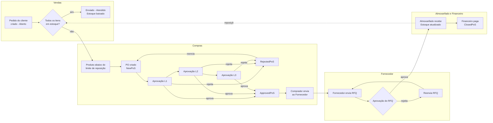

# NorthWind PLUS

🌐 [English](README.md) · **Português (Brasil)** · [Español](Leame%28es-ES%29.md)

**Uma aplicação de linha de negócio (Line-of-Business) completa, rodando nativamente sobre um Labeled Property Graph — portada para Neo4j, Memgraph, FalkorDB, Quine e Ultipa, com um agente de IA que roda ao lado dela no Relate by Neo4j.**

O NorthWind PLUS reconstrói o clássico banco de dados Northwind como uma aplicação *Graph-Native* e o estende para um ciclo de negócio completo de 360 graus: pedidos de clientes, detecção de estoque baixo, pedidos de compra com três níveis de aprovação, RFQs de fornecedores, recebimento no almoxarifado, fechamento financeiro e atendimento de pedidos — tudo expresso em Cypher (ou, no Ultipa, em ISO GQL), dentro do grafo.

É a prova de conceito por trás do artigo **[A Labeled Property Graph (LPG) Masterpiece](https://marcospinedo.substack.com/p/a-labeled-property-graph-lpg-masterpiece)** (em inglês) e faz parte da [Nova Abordagem](../Leiame%28pt-BR%29.md), mais ampla, de construir aplicações de negócio *ao redor* do grafo, em vez de colocar grafos ao redor das aplicações.

O teste definitivo: seis processos de negócio independentes, iniciados como processos separados do sistema operacional, martelando o mesmo grafo vivo ao mesmo tempo — e o modelo aguentando.

---

## Conteúdo

- [Por que isto existe](#por-que-isto-existe)
- [O ciclo de negócio](#o-ciclo-de-negócio)
- [Suporte por mecanismo, em resumo](#suporte-por-mecanismo-em-resumo)
- [Estrutura do repositório](#estrutura-do-repositório)
- [Primeiros passos — Neo4j](#primeiros-passos--neo4j)
- [Primeiros passos — Memgraph](#primeiros-passos--memgraph)
- [Primeiros passos — FalkorDB](#primeiros-passos--falkordb)
- [Primeiros passos — Quine](#primeiros-passos--quine)
- [Primeiros passos — Ultipa](#primeiros-passos--ultipa)
- [Os loops de simulação](#os-loops-de-simulação)
- [Esquema e ontologia](#esquema-e-ontologia)
- [Diferenças entre os mecanismos que vale conhecer](#diferenças-entre-os-mecanismos-que-vale-conhecer)
- [O agente de IA — Relate by Neo4j](#o-agente-de-ia--relate-by-neo4j)
- [Agentes de IA — para reflexão](#agentes-de-ia--para-reflexão)
- [Leituras complementares](#leituras-complementares)

---

## Por que isto existe

A maioria das tentativas de rodar aplicações de negócio sobre um grafo carrega uma mentalidade de tabela: *um registro = um nó*, com o estado guardado em propriedades. O NorthWind PLUS segue o caminho oposto e obedece a um pequeno conjunto de regras:

| Princípio | Na prática |
|---|---|
| **Nós como Substantivos Próprios** (Proper Noun Nodes) | Os nós guardam apenas o que define a identidade daquilo que representam. Estado, categoria e contexto *nunca* são propriedades. |
| **Os relacionamentos movem o sistema** | Um evento de negócio é uma mudança nos relacionamentos — um nó passa de uma *Collection* para outra (por exemplo, `NewPoS` → `ApprovedPoS`). Estado = posição. |
| **Nós Enxutos / Collections** | Nós hub funcionam como conjuntos explícitos (Superconjunto, Subconjunto, Elemento de) que representam estados e contextos do domínio. |
| **Nós somente leitura, "isótopos" para as exceções** | As propriedades não mudam depois da criação. Os poucos valores realmente mutáveis (contagens de estoque, limites) ficam isolados em seus próprios nós pequenos, como o `InventoryLevel`. |
| **Nunca excluir nós** | Nada é excluído, apenas religado e registrado com data e hora, então todo o histórico continua rastreável. |

Uma consequência aparece no harness de simulação: não há limites de aprovação, definições de máquina de estados nem regras de validação no código Python. Todo limite (por exemplo, quem pode aprovar qual valor) fica nos nós de papel, no grafo, e é lido no momento da consulta. O código da aplicação se reduz a orquestração — escolher uma taxa, executar uma instrução Cypher, tentar de novo quando há disputa, registrar o resultado.

O raciocínio completo está no cabeçalho de cada script de importação e no [artigo](https://marcospinedo.substack.com/p/a-labeled-property-graph-lpg-masterpiece).

---

## O ciclo de negócio



O roteamento da aprovação depende do valor do PO e dos valores `ApprovalBase` / `ApprovalLimit` guardados nos nós de papel. Itens rejeitados estão sempre aptos a ser reenviados, então nada fica preso para sempre.

---

## Suporte por mecanismo, em resumo

| | Neo4j | Memgraph | FalkorDB | Quine | Ultipa |
|---|---|---|---|---|---|
| Versão do modelo | v2.3.1 (v2.3.3 para o agente de IA) | versão da v2.3.1 | versão da v2.3.1 | v2.4 (sem propriedades nas arestas) | versão da v2.3.1 (ISO GQL) |
| Importação | `.cypher` no Query console | `.cypher` no Query console | `.sh` via `redis-cli` | `.sh` via API REST do Quine | `.gql` via `run_gql_script.py` (ou Ultipa Manager) |
| Harness de simulação | `NorthwindPlus_Stress_Test.py` | `NorthwindPlus_Stress_Test_MemGraph.py` | `NorthwindPlus_Stress_Test_FalkorDB.py` | `NorthwindPlus_Stress_Test_Quine.py`, **ou** a recipe `northwind-plus-simulation.yaml` (sem Python) | `NorthwindPlus_Stress_Test_Ultipa.py` |
| Dependência Python | driver `neo4j` | driver `neo4j` (Bolt) | `falkordb` | nenhuma (biblioteca padrão) | `ultipa` (importado como `gqldb`) |
| Esquema GRAPH TYPE | ✅ | — | — | — | — |
| Lógica de negócio no grafo | Cypher | Cypher | Cypher | Cypher + **Standing Queries** (+ fluxos de ingestão na recipe) | GQL |
| Iniciador para Windows | `PySetup.bat` | `MPySetup.bat` | — | — | `PySetup_Ultipa.bat` |
| Agente de IA | ✅ [Relate by Neo4j](Neo4jRelate/Leiame%28pt-BR%29.md) | — | — | — | — |

---

## Estrutura do repositório

```
NorthWindPLUS/
├── Import/                                               Cleaned Northwind CSV files (see note below)
├── NorthWind_PLUS_Graph_Data_Model_Import_v2.3.1.cypher   Neo4j import + full 360° initialization + query examples
├── NorthWind_PLUS_Graph_Data_Model_Import_v2.31 (MemGraph).cypher   Memgraph port
├── NorthWind_PLUS_FalkorDB_Import_v2.3.1.sh               FalkorDB port (import | recommend | report | checks | all)
├── NorthwindPlusGraphType_v1.cypher                       Neo4j GRAPH TYPE schema enforcement
├── NorthwindPlusGraph_RDF-turtle_v1.ttl                   RDF/OWL equivalent of the schema
├── NorthwindPlus_Stress_Test.py                           Concurrency harness — Neo4j
├── NorthwindPlus_Stress_Test_MemGraph.py                  Concurrency harness — Memgraph
├── NorthwindPlus_Stress_Test_FalkorDB.py                  Concurrency harness — FalkorDB
├── PySetup.bat                                            Windows: opens 8 loop windows against Neo4j
├── MPySetup.bat                                           Windows: opens 8 loop windows against Memgraph
├── AI_Agents_Food_For_Thought.md                          Ideas for an agentic layer (the first agents are built: see Neo4jRelate/)
├── Neo4jRelate/                                          AI agent on Relate by Neo4j, with model v2.3.3 — see its README
│   ├── README.md
│   ├── NorthWind_PLUS_Agent_Colab.ipynb                 Google Colab front end (knowledge store kept on Google Drive)
│   ├── NorthWind_PLUS_Agent.ipynb                       Local Jupyter front end
│   ├── run_loops_full.bat                               Windows: full mode, all six loops (credentials read from .env)
│   ├── run_loops_agents.bat                             Windows: agents mode, five loops; PO creation and resubmission by the agent
│   ├── run_ui.bat                                       Windows: the Procurement web UI at http://localhost:8000
│   ├── api/                                             The web UI's API (FastAPI), over the same Python and governed Cypher as the agent
│   ├── ui/                                              The web UI: Vite + React + TypeScript
│   ├── model/                                           v2.3.3: import script, GRAPH TYPE, RDF ontology, upgrades from v2.3.1 and v2.3.2, harness
│   ├── kb/                                              The agent's knowledge graph in Relate: build, hybrid search, learning loop, embeddings
│   ├── agent/                                           The agent (Claude + tools, offered by role) and its read-only / governed access to Neo4j
│   ├── sandbox/                                         What-if rehearsals on a subgraph copied from Aura with relate pull
│   └── tests/                                           Offline tests (no API key, no Aura needed)
├── Ultipa/                                                ISO GQL port for Ultipa GQLDB — see its README
│   ├── README.md
│   ├── NorthWind_PLUS_Graph_Data_Model_Import_v2.3.1_Ultipa_GQL.gql   The full model in GQL (sectioned: setup | live_views | recommendation | examples)
│   ├── run_gql_script.py                                 Runs a section of the .gql file, statement by statement
│   ├── NorthwindPlus_Stress_Test_Ultipa.py               Concurrency harness — Ultipa
│   └── PySetup_Ultipa.bat                                Windows: opens 8 loop windows against Ultipa
└── Quine/
    ├── README.md                     Streaming "business day" demo — full walkthrough
    ├── northwind-plus-streaming.yaml Quine recipe: seed + business streams + standing queries
    ├── run-demo-docker.sh            Launcher (Docker, Windows + WSL)
    ├── run-demo.sh                   Launcher (local Quine jar)
    ├── feeds.json                    Graph feeds for the Exploration UI
    ├── DEMO_PLAN.md                  Design decisions and verification runs
    ├── tap-queries-api (3).md        Reference for Quine's tap-query API
    └── Full_NorthWindPLUS/
        ├── Readme.md
        ├── NorthWind_PLUS_Graph_Data_Model_Import_v2.4 (Quine).cypher   The edge-property-free v2.4 model
        ├── northwind-plus-quine-batch.sh                               Builds the full graph through the REST API
        ├── register-standing-queries.sh                                Moves the company's own rules into Standing Queries
        ├── northwind-plus-quine-recommendations.sh                     Optional recommendation layer
        ├── NorthwindPlus_Stress_Test_Quine.py                          Simulation loops (sq | loops | auto modes)
        └── Recipe_Version/
            ├── Readme.md                       The simulation as a recipe — full walkthrough
            ├── northwind-plus-simulation.yaml  Quine recipe: 7 ingest streams, 11 standing queries, 47 sample + 26 quick queries
            ├── northwind-plus-quine-batch.sh   Batch loader with --import-only (load, then switch the simulation on)
            └── Recipe Analyzer Outcome/        thatDot Recipe Analyzer review of the recipe, plus the schema it extracted (Mermaid, GraphML, JSON-LD, Turtle, SHACL…)
```

> **Sobre os arquivos CSV.** Os CSVs originais do Northwind publicados em [neo4j-graph-examples/northwind](https://github.com/neo4j-graph-examples/northwind) contêm vírgulas sem escape em alguns campos (principalmente endereços do Brasil, da França e da Bélgica, e algumas observações), o que desloca as colunas durante a importação. Os arquivos em `Import/` estão corrigidos. Os scripts de importação os carregam diretamente das URLs raw do GitHub deste repositório, então você não precisa baixá-los para o Neo4j, o FalkorDB ou o Ultipa.

---

## Primeiros passos — Neo4j

Testado pelo autor no **Neo4j Aura**. O harness usa `apoc.lock.nodes`, então o APOC precisa estar disponível no banco de dados de destino.

**1. Construa o grafo**

Abra `NorthWind_PLUS_Graph_Data_Model_Import_v2.3.1.cypher`, leia o bloco **Quick Run Instructions** perto do início e execute a seção de importação/inicialização no Query console do Neo4j. Ela:

- limpa o banco de dados (`MATCH (n) DETACH DELETE n` — **use um banco de dados vazio ou descartável**)
- carrega os CSVs e constrói cada Collection, papel e funcionário
- executa uma passada de cada etapa do fluxo de trabalho, para que o grafo comece em um estado realista

O script também contém uma camada opcional de **Motor de Recomendação** (avaliações de clientes + similaridade de cosseno) e um conjunto de **consultas de exemplo e verificações de qualidade de dados** para executar enquanto os loops estão rodando.

**2. (Opcional) Aplique o esquema GRAPH TYPE**

Execute `NorthwindPlusGraphType_v1.cypher` para impor a estrutura do modelo no nível do banco de dados. Isso usa a sintaxe mais recente `ALTER CURRENT GRAPH TYPE` do Neo4j — verifique se a sua versão/edição do Neo4j a suporta.

**3. Rode os loops**

```bash
pip install neo4j

export NEO4J_URI="neo4j+s://<your-instance>.databases.neo4j.io"
export NEO4J_USER="neo4j"
export NEO4J_PASSWORD="<password>"
export NEO4J_DATABASE="neo4j"

# one terminal per loop
python NorthwindPlus_Stress_Test.py --loop customer-order    --rate 6
python NorthwindPlus_Stress_Test.py --loop po-creation       --rate 2
python NorthwindPlus_Stress_Test.py --loop po-vetting        --rate 4
python NorthwindPlus_Stress_Test.py --loop rfq-vetting       --rate 4
python NorthwindPlus_Stress_Test.py --loop warehouse-finance --rate 4
python NorthwindPlus_Stress_Test.py --loop order-fulfillment --rate 4
```

**No Windows:** preencha as quatro linhas `SET NEO4J_...` no início de `PySetup.bat` e execute-o. Ele abre oito janelas de console (duas delas duplicam loops para gerar mais disputa), cada uma esperando você apertar Enter.

Depois volte ao Query console e veja o grafo mudar em tempo real.

**4. (Opcional) Acrescente o agente de IA**

A pasta [`Neo4jRelate/`](Neo4jRelate/Leiame%28pt-BR%29.md) acrescenta o modelo **v2.3.3** e um agente de IA que responde a perguntas sobre o negócio em funcionamento, ensaia e altera os limites de aprovação sob governança, aprende novas consultas e, no modo *agents*, assume dos loops a criação e o reenvio de POs com um Assistente de Compras (Procurement Assistant). Construa o grafo com o script de importação v2.3.3 dela (ou atualize no local um banco v2.3.2 com `NorthWind_PLUS_v2.3.3_Upgrade_from_v2.3.2.cypher`), inicie os loops com `run_loops_full.bat` ou `run_loops_agents.bat` e abra o notebook do Colab ou do Jupyter. O Leiame dela tem os detalhes.

---

## Primeiros passos — Memgraph

1. Execute `NorthWind_PLUS_Graph_Data_Model_Import_v2.31 (MemGraph).cypher` no console de consultas do Memgraph (veja o bloco Quick Run Instructions).
2. Rode os loops com `NorthwindPlus_Stress_Test_MemGraph.py`. Ele se conecta por Bolt usando as mesmas variáveis de ambiente `NEO4J_*` do harness do Neo4j:

```bash
pip install neo4j
export NEO4J_URI="bolt://127.0.0.1:7687"
export NEO4J_USER="<user>"
export NEO4J_PASSWORD="<password>"
export NEO4J_DATABASE="memgraph"

python NorthwindPlus_Stress_Test_MemGraph.py --loop customer-order --rate 6
# ...same six loops as above
```

**No Windows:** edite e execute `MPySetup.bat`, que abre as mesmas oito janelas contra o Memgraph.

---

## Primeiros passos — FalkorDB

Requer o `redis-cli` no seu path e uma instância do FalkorDB rodando. O script de importação e o harness em Python leem as mesmas variáveis de ambiente, então você só precisa defini-las uma vez:

```bash
export FALKORDB_HOST=localhost
export FALKORDB_PORT=6379
export FALKORDB_GRAPH=northwind
# optional: FALKORDB_USERNAME, FALKORDB_PASSWORD, FALKORDB_SSL=1
```

**1. Construa o grafo**

```bash
./NorthWind_PLUS_FalkorDB_Import_v2.3.1.sh            # import (default)
./NorthWind_PLUS_FalkorDB_Import_v2.3.1.sh all        # import + recommend + report + checks
```

Subcomandos: `import`, `recommend`, `report` (Relatório de Nível de Estoque), `checks` (verificações de qualidade de dados), `all`. Por padrão, os CSVs são lidos do GitHub; para arquivos locais, coloque-os na pasta de importação do FalkorDB e defina `CSV_BASE=file:/`. O script de importação também aceita `QUERY_TIMEOUT_MS` e `REDIS_CLI`, e ainda entende os nomes antigos `FALKOR_*` / `GRAPH`.

**2. Rode os loops**

```bash
pip install falkordb
python NorthwindPlus_Stress_Test_FalkorDB.py --loop customer-order --rate 6
# ...same six loops as above
```

---

## Primeiros passos — Quine

O Quine é um grafo de streaming e não suporta propriedades em relacionamentos. Por isso, a versão para o Quine usa o **modelo v2.4**, no qual cada aresta que carregava dados se torna um nó intermediário — itens de linha (`OrderItem`, `POItem`, `RFQItem`), rastros de decisão (`VettingDecision`, `WarehouseDelivery`, `FinancePayment`) e assim por diante. O princípio "estado = posição" não muda.

Há três formas de executá-lo.

| | Opção | Quem conduz o negócio |
|---|---|---|
| **A** | [O modelo completo como recipe](#a-o-modelo-completo-como-recipe-quinefull_northwindplusrecipe_version) | Somente o Quine: fluxos de ingestão + standing queries, sem Python |
| **B** | [O modelo completo com o harness em Python](#b-o-modelo-completo-com-o-harness-em-python-quinefull_northwindplus) | Loops em Python, com ou sem Standing Queries |
| **C** | [A demonstração em streaming do "dia de negócios"](#c-a-demonstração-em-streaming-do-dia-de-negócios-quine) | Somente o Quine, um dia autocontido de cinco minutos |

### A. O modelo completo como recipe (`Quine/Full_NorthWindPLUS/Recipe_Version/`)

Toda a simulação roda a partir de uma única recipe do Quine, `northwind-plus-simulation.yaml`:

- **Fluxos de ingestão** fazem o papel do mundo externo: um representante de vendas registrando pedidos de clientes, o almoxarifado enviando-os, o Assistente de Compras emitindo POs, fornecedores enviando e reenviando RFQs, mercadorias chegando à doca e uma recalibração lenta dos limites.
- **Standing queries** aplicam as regras da empresa no momento em que um padrão aparece: aprovação de POs em L1/L2/L3, envio pelo comprador, aprovação de RFQs, controle do que está em pedido, reavaliação de estoque baixo (LowStock) e fechamento financeiro.

Inicie o Quine **primeiro com a recipe** e depois carregue os dados:

```bash
cd Quine/Full_NorthWindPLUS/Recipe_Version

# window 1 -- Quine with the recipe (the streams wait until the data is in)
docker run --rm --name northwind-quine -p 8080:8080 -v "$PWD":/demo thatdot/quine -r /demo/northwind-plus-simulation.yaml

# window 2 -- load the graph; its last step switches the simulation on
bash ./northwind-plus-quine-batch.sh --import-only

# window 3 -- watch the company act
docker logs -f northwind-quine 2>&1 | grep --line-buffered -o '"alert":"[^"]*"'
```

Depois explore em http://localhost:8080, usando as 47 consultas de exemplo (painéis ao vivo, lucro bruto, os relatórios de vendas do Northwind, verificações de qualidade de dados) e as consultas rápidas pelo botão direito. A recipe roda sobre um armazenamento descartável, então cada execução começa vazia. Veja o [README da Recipe_Version](Quine/Full_NorthWindPLUS/Recipe_Version/Readme.md) (em inglês) para os fluxos, as standing queries, como mudar o ritmo e a solução de problemas no Windows.

### B. O modelo completo com o harness em Python (`Quine/Full_NorthWindPLUS/`)

```bash
# Quine running WITHOUT a recipe (from WSL on Windows, or any Linux/macOS shell)
docker run -d --name quine -p 8080:8080 thatdot/quine

cd Quine/Full_NorthWindPLUS
./northwind-plus-quine-batch.sh --reset          # builds the whole graph via the REST API
./register-standing-queries.sh                   # optional: let the graph run the company's own rules
./northwind-plus-quine-recommendations.sh        # optional: recommendation layer

python3 NorthwindPlus_Stress_Test_Quine.py --check
```

O harness tem três modos:

| Modo | O que roda em Python | O que roda dentro do Quine |
|---|---|---|
| `--mode sq` | Apenas o *mundo externo*: pedidos de clientes, atendimento de pedidos, envio de RFQs pelos fornecedores, chegada de mercadorias, uma tarefa lenta de recalibração de limites | Reposição por estoque baixo, aprovação em L1/L2/L3, envio pelo comprador, aprovação de RFQs, fechamento financeiro — como **Standing Queries** |
| `--mode loops` | Os seis loops originais | Nada além disso |
| `--mode auto` (padrão) | `sq` se as standing queries estiverem registradas; caso contrário, `loops` | |

Sem `--loop`, todos os loops do modo escolhido rodam em um único processo, com um log combinado. `--check` executa as invariantes de qualidade de dados quando você o interrompe; `--check-only` executa apenas essas verificações. Veja `Full_NorthWindPLUS/Readme.md` (em inglês) para todas as opções.

### C. A demonstração em streaming do "dia de negócios" (`Quine/`)

Uma recipe autocontida em que o negócio roda como um fluxo ao vivo — um tique por segundo, 300 tiques por dia de negócios — e standing queries reagem no momento em que um padrão aparece, inclusive gravando no grafo a próxima etapa do negócio.

```bash
cd Quine
./run-demo-docker.sh            # one ~5-minute business day, then the graph stays up to explore
./run-demo-docker.sh --loop     # a fresh day every ~5½ minutes until Ctrl-C
```

Depois abra http://localhost:8080. O `Quine/README.md` (em inglês) explica o que observar em cada momento do dia, as consultas de exemplo, os feeds de grafo e as quatro automações.

---

## Primeiros passos — Ultipa

A pasta [`Ultipa/`](Ultipa/README.md) porta o modelo e os seis loops para o **Ultipa GQLDB** em ISO GQL. Você precisa de uma instância do Ultipa GQLDB e do Python 3.

```bash
cd Ultipa
pip install --upgrade ultipa

export ULTIPA_HOSTS="<host>:<port>"
export ULTIPA_USER="root"
export ULTIPA_PASSWORD="<password>"
export ULTIPA_GRAPH="NorthWindPLUS"

# 1. create the graph and build it (import + one pass of every workflow)
python run_gql_script.py NorthWind_PLUS_Graph_Data_Model_Import_v2.3.1_Ultipa_GQL.gql --section setup

# 2. one terminal per loop -- same six loops as above
python NorthwindPlus_Stress_Test_Ultipa.py --loop customer-order --rate 6
```

**No Windows:** preencha as configurações de conexão no início de `Ultipa/PySetup_Ultipa.bat` e execute-o a partir dessa pasta.

Veja o [README do Ultipa](Ultipa/README.md) (em inglês) para todas as opções, as configurações de TLS e de tempo limite e como a versão lida com a concorrência sem APOC.

---

## Os loops de simulação

Cada loop é uma etapa do fluxo de trabalho rodando como um processo independente, com taxa limitada, simulando um ator do mundo real (Vendas, Compras, Fornecedor, Almoxarifado, Financeiro) trabalhando no mesmo grafo ao mesmo tempo.

| Loop | Ator | O que uma execução faz |
|---|---|---|
| `customer-order` | Vendas | Cria um pedido de cliente aberto (Open), aleatório, com 1 a 11 itens |
| `po-creation` | Compras | Cria um PO por fornecedor com produtos abaixo do seu limite de reposição |
| `po-vetting` | Aprovadores | Escolhe uma etapa elegível: aprovar, rejeitar ou repassar em L1/L2/L3, ou reenviar um PO rejeitado |
| `rfq-vetting` | Comprador ↔ Fornecedor | O comprador envia um PO, o fornecedor envia um RFQ, o comprador o aprova/rejeita/reenvia |
| `warehouse-finance` | Almoxarifado, Financeiro | Recebe um PO entregue (atualiza o estoque); depois o Financeiro paga e o fecha |
| `order-fulfillment` | Almoxarifado | Envia o pedido aberto mais antigo cujos itens estejam todos em estoque, baixando o estoque |

**Opções comuns**

| Opção | Significado |
|---|---|
| `--loop NAME` | Qual loop executar (obrigatório nos harnesses do Neo4j, do Memgraph e do FalkorDB) |
| `--rate N` | Execuções por minuto (padrão 6) |
| `--duration S` | Para depois de S segundos (padrão: roda até Ctrl+C) |

O Ctrl+C interrompe um loop de forma limpa e mostra um resumo: execuções, novas tentativas, erros e taxa alcançada.

Os loops de aprovação escolhem uma ação elegível por execução, com pesos que fazem aprovações e reenvios predominarem sobre rejeições. Quando dois processos disputam o mesmo item, o perdedor verifica de novo se o item ainda é elegível, descobre que ele já foi tratado e registra um "lost the race" inofensivo, sem efeito, em vez de corromper os dados. No Neo4j isso é feito travando o nó escolhido com `apoc.lock.nodes` e verificando de novo a condição de guarda sob a trava; as docstrings do harness explicam os bugs que isso evita (estoque negativo, resultados de aprovação contraditórios, entregas duplicadas).

**Corrigido: pedidos de compra com quantidade zero (harness do Neo4j).** O `po_resubmit` podia criar uma linha de PO com **0 unidades** quando o estoque efetivo de um produto ficava exatamente no limite de elegibilidade (`StockThreshold / 2` é divisão inteira). Um PO de custo 0 não corresponde a nenhuma ação de aprovação, nem mesmo de rejeição, então ficaria esperando em `NewPoS` para sempre. O agente de IA percebeu isso na sua primeira execução ao vivo, quando relatou um PO de valor 0,00 e o apontou como estranho. O `po_resubmit` e o `po_creation` agora ignoram linhas não positivas e POs vazios. A mesma fórmula de quantidade é usada nos harnesses e scripts de importação dos outros mecanismos, que ainda não foram corrigidos.

Brinque com as taxas para simular cargas diferentes — por exemplo, os iniciadores para Windows rodam pedidos de clientes a 60/min contra dois loops de atendimento e dois de aprovação.

---

## Esquema e ontologia

- **`Neo4jRelate/model/NorthwindPlusGraphType_v2.3.3.cypher`** e **`NorthwindPlusGraph_RDF-turtle_v2.3.3.ttl`** — as versões do agente. A v2.3.2 acrescentou o nó `PolicyChange` e seus relacionamentos `REQUESTED_BY` / `CHANGED_ROLE`; a v2.3.3 acrescenta uma trilha de auditoria para agentes e pessoas que atuam ao lado dos loops (`Source`, `Justification` e `RecommendedQt`), o estado `CancelledPoS` e faixas de aprovação contíguas. O agente de IA constrói seu grafo de conhecimento a partir desses dois arquivos.
- **`NorthwindPlusGraphType_v1.cypher`** — um `GRAPH TYPE` do Neo4j que declara cada rótulo de nó, tipo de relacionamento, chave e propriedade obrigatória do modelo, para que o próprio banco de dados rejeite gravações estruturalmente inválidas.
- **`NorthwindPlusGraph_RDF-turtle_v1.ttl`** — o mesmo esquema expresso em RDF/OWL. Duas classes de nível superior, `:Entity` e `:Collection`, tornam explícito o princípio *Nós como Substantivos Próprios vs. Collections*, e `owl:hasKey` faz o papel de `REQUIRE … IS KEY`.

Os dois arquivos começam com um cabeçalho de "known issues" que documenta decisões de modelagem, como Collections por fornecedor que não são singletons e a data sentinela usada para pedidos não enviados.

**Convenção de nomes:** os rótulos dos nós Collection (hub) são PascalCase com a última letra maiúscula — `ApprovedPoS`, `OrderStatusOpeN`, `RoleS` —, para que possam ser distinguidos de nós de entidade como `PurchaseOrder` ou `Product`.

---

## Diferenças entre os mecanismos que vale conhecer

O modelo é o mesmo em todos (a v2.4 no Quine apenas remove as propriedades das arestas). O que muda é como cada mecanismo lida com as consultas e com a concorrência:

- **Neo4j** — transações com várias instruções e `ZONED DATETIME` em todo lugar; a concorrência é protegida com `apoc.lock.nodes` mais uma nova verificação sob a trava; deadlocks são repetidos automaticamente como `TransientError`.
- **FalkorDB** — as consultas de escrita em um grafo são executadas uma por vez e cada consulta é atômica, então as travas do APOC foram removidas (as novas verificações ficam como rede de segurança). Não há transações com várias instruções, então as verificações de elegibilidade rodam como consultas somente leitura em paralelo e a ação como uma única escrita. As datas usam `localdatetime()` (sem datas com fuso horário). O cabeçalho do script de importação lista cada adaptação do Cypher, incluindo uma solução de contorno para um bug de `OPTIONAL MATCH` reproduzido no FalkorDB 4.22.1.
- **Quine** — sem propriedades nas arestas (daí a v2.4), identidade por `idFrom()`, contadores mutáveis atualizados com somas atômicas e parte da lógica de negócio levada para Standing Queries. Na versão em recipe, até a simulação roda dentro do Quine: o mundo externo chega como fluxos de ingestão, e nenhum Python é envolvido.
- **Ultipa GQLDB** — o modelo inteiro foi reescrito em ISO GQL (`INSERT`, `RETURN … NEXT`, `LET`, `FILTER`, `FOR`). Não há APOC nem trava explícita: o GQLDB detecta conflitos de escrita no commit (erro 3011), então o harness executa cada ação em uma transação e a repete sobre um snapshot novo, onde sua guarda a transforma em uma operação sem efeito. Para garantir que mudanças apenas em arestas também gerem conflito, as ações com guarda incrementam um contador `OCCVersion` no nó que antes travavam (isso pode ser desligado com `OCC_TOUCH`). As datas usam `local_datetime()`. O README do Ultipa lista os comportamentos do GQLDB encontrados durante a versão, como elementos anônimos de `INSERT` que guardam null.

---

## O agente de IA — Relate by Neo4j

[`Neo4jRelate/`](Neo4jRelate/Leiame%28pt-BR%29.md) é o primeiro agente construído sobre o NorthWind PLUS. Ele roda contra o mesmo banco de dados Neo4j Aura ao vivo que os loops, em um de dois modos: *full* (ao lado dos seis loops) ou *agents* (no qual assume parte do trabalho da simulação):

- **Responde a perguntas de negócio em linguagem natural** ("Which suppliers get their quotes rejected most often?", "How many POs are waiting for approval?") encontrando um modelo de consulta Cypher já comprovado, adaptando um ou escrevendo um Cypher novo a partir da ontologia, sempre em transações somente leitura.
- **Altera uma regra de negócio sob governança.** Os limites de aprovação L1/L2/L3 ficam nos nós de papel e toda consulta de aprovação os lê no momento da execução, então alterá-los muda a forma como o próximo PO é aprovado, sem mudar código e sem reiniciar nada. O agente só pode alterá-los para alguém que tenha o novo papel `ProcurementPolicyAdmin`, depois de uma prévia e de uma confirmação explícita, e cada alteração é registrada como um nó `PolicyChange`.
- **Ensaia antes de alterar.** Um what-if copia os POs que aguardam aprovação para um armazenamento Relate de rascunho com `relate pull` e repete o próprio Cypher de aprovação da simulação com os limites atuais e os propostos.
- **Assume um processo de negócio (modo agents).** Um Assistente de Compras pergunta o que precisa de reposição; o agente recomenda POs com a própria regra do loop; a pessoa aceita, altera quantidades e justifica cada PO; um Cypher governado os grava. POs rejeitados são reenviados ou cancelados da mesma forma. Cada PO registra quem, quando, por quê, `Source: "agent"` e a quantidade recomendada ao lado da pedida.
- **Tem uma interface web gêmea.** Os mesmos trabalhos de PO podem ser feitos em uma pequena interface web em React + TypeScript, sobre o mesmo Python e o mesmo Cypher governado. Ela mostra sugestões a partir da demanda recente, pode pedir ao Claude um rascunho de justificativa, e todo PO que grava registra `Source: "ui"`.
- **Aprende.** Cada pergunta é guardada como uma `Interaction`; consultas novas que funcionaram se tornam modelos depois que uma pessoa as aprova, e perguntas posteriores as encontram.

Seu conhecimento (a ontologia construída a partir do GRAPH TYPE e do arquivo RDF, a biblioteca de consultas do script de importação, o histórico de perguntas) fica no **[Relate by Neo4j](https://relatedb.ai/)**, um banco de dados de grafos embarcado que roda dentro do processo do agente. Os dados do negócio nunca saem do Aura. Isso combina com os princípios do modelo: a semântica de que uma IA precisa já está no grafo, então o agente a lê diretamente, em vez de depender de um pipeline de ETL.

## Agentes de IA — para reflexão

[`AI_Agents_Food_For_Thought.md`](AI_Agents_Food_For_Thought.md) (em inglês) explora o que muda quando um agente de IA se torna mais um ator que lê o contexto do grafo e grava decisões de volta — ajudando na aprovação de POs dentro das faixas de aprovação existentes, aprendendo com o `Comment` já registrado em cada aprovação/rejeição e ajustando os níveis de aprovação. Ele também inclui um exemplo que acabou *não* precisando de IA (justiça no atendimento de pedidos). O [agente no Relate](Neo4jRelate/Leiame%28pt-BR%29.md) agora cobre a parte de responder a perguntas, o ajuste governado dos níveis de aprovação e a criação e o reenvio de POs com uma pessoa no comando; ajudar na aprovação de POs e aprender com os `Comment`s continuam sendo ideias (a v2.3.3 já registra `Source` em cada decisão de aprovação, pronta para um agente de aprovação).

---

## Leituras complementares

Os artigos estão em inglês.

- [A Labeled Property Graph (LPG) Masterpiece](https://marcospinedo.substack.com/p/a-labeled-property-graph-lpg-masterpiece) — o artigo que esta POC acompanha
- [A new approach to application development using Cypher/GQL (Graphs)](https://medium.com/@marcospinedo/a-new-approach-to-application-development-using-cypher-gql-graphs-7d191e0c55d3) — o conceito original
- [How Graphs simplify Business Processes and Workflows](https://medium.com/@marcospinedo/how-graphs-simplify-business-processes-and-workflows-like-moving-balls-between-baskets-c9606c9e973f)
- [Rethinking Line of Business Applications](https://medium.com/@marcospinedo/rethinking-line-of-business-applications-graphs-cypher-as-an-alternative-to-rdbms-sql-fd1d204f99b7) e a [apresentação em vídeo](https://youtu.be/ExupBmmH1Rs)
- [Tender Workflow](../TenderWorkflow) — uma POC irmã com suporte a vários fornecedores

Perguntas e discussões são bem-vindas: [LinkedIn](https://www.linkedin.com/in/marcospinedo/).
