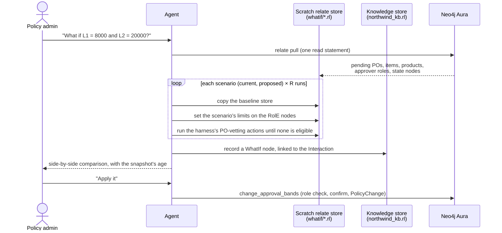

# Design: a what-if sandbox with `relate pull`

**Status:** built and tested offline (Stage 5 of the NorthWind PLUS × Relate POC): 22 checks, plus 3 more for the
real `relate pull` against `relate serve --http` standing in for Aura. Not yet run against Aura.

**Idea credit:** a Neo4j staff engineer (Tomas Riha), commenting on the LinkedIn post: *"pull a subgraph from the AuraDB system of
record into the agent's context. That allows the agent to mutate and experiment on the subgraph in isolation."*

## Goal

Today, `preview_approval_bands` only sorts the POs waiting for approval into cost bands under the proposed limits.
That's arithmetic, not a rehearsal. The sandbox answers the question a policy admin actually has:

> *"If I raise L1 to 8,000 and L2 to 20,000, what happens to the queue that's waiting right now?"*

It does this by **running the simulation's own vetting Cypher** against a private copy of the relevant part of Aura,
once with today's limits and once with the proposed ones, and comparing the results. Aura isn't touched until the
user confirms the change through the governed action that already exists.

The pattern, in one line: **pull to experiment, governed Cypher to commit.**

## What `relate pull` does (verified)

Read from the relate repository's CLI spec and skill references (`docs/api/cli/spec.md`,
`surfaces/relate-cli/src/skill/bundle/references/pull.md`, docs as of relate 1.0.2, released 2026-11-14):

```
relate pull [--from FILE] --query Q [--param N=V] --database PATH
```

- Talks to Neo4j over the **HTTP Query API v2**, not Bolt. An Aura `neo4j+s://<id>.databases.neo4j.io` URI is mapped
  to `https://<id>.databases.neo4j.io` automatically.
- Credentials come from `--from` (an env file in Aura's own credentials format) or from the process environment:
  `NEO4J_URI`, `NEO4J_USERNAME` (`NEO4J_USER` is accepted as an alias), `NEO4J_PASSWORD`, optional `NEO4J_DATABASE`.
  Our `.env` and Colab Secrets already use those names.
- `--query` must `RETURN` nodes, relationships or paths, not scalars. It can be a `;`-separated list of statements; a
  later statement's relationships can attach to nodes an earlier one created.
- **It refuses a non-empty destination.** A re-pull is never a merge, so every experiment starts from a fresh store.
- Values keep their Cypher types (DATETIME stays DATETIME). Constraints and RANGE/TEXT indexes are replayed into the
  local store; full-text and vector indexes are skipped with a note.
- It is a **CLI command only**. `pip install relate-db` doesn't install it, and the Python API has no `pull`. The CLI
  installs with `curl -sSfL https://relatedb.ai/install.sh | bash` (Linux, macOS, Colab) or the PowerShell
  `install.ps1` (Windows).

And the reason not to use `push` for the result: **`relate push` never deletes on the remote** (the relate docs say
deletion sync is a later design). In NorthWind PLUS, a state change *deletes* the old state relationship. Pushing a
vetted copy would leave a PO both in `NewPoS` and in `ApprovedPoS`.

## Flow



## 1. Pull: what goes into the scratch store

One statement, so Aura serves it from **one transaction**: the six loops keep writing while we read, and separate
statements could see the queue at different moments. *To verify on the first run:* that the Query API runs a single
`UNION ALL` statement as one transaction (that's how Neo4j treats a single statement, but I haven't tested it through
`relate pull`).

```cypher
// The POs waiting for approval, their lines and products
MATCH p = (:NewPoS)-[:IS_NEW_PO_STATE]->(:PurchaseOrder)-[:HAS_PO_ITEM]->(:Product)
RETURN p
UNION ALL
// Vetting already done on those POs (an L1 passthrough leaves the PO in NewPoS with an L1 approval)
MATCH p = (:NewPoS)-[:IS_NEW_PO_STATE]->(:PurchaseOrder)
          -[:HAS_L1_PO_APPROVAL|HAS_L2_PO_APPROVAL|HAS_L1_PO_REJECTION|HAS_L2_PO_REJECTION|HAS_L3_PO_REJECTION]->(:Employee)
RETURN p
UNION ALL
// The approver roles, with their limits, and who holds them
MATCH p = (r:RolE)-[:IS_ACTIVE_ROLE]->(:Employee)
WHERE r.Title IN ["Level1Approver", "Level2Approver", "Level3Approver"]
RETURN p
UNION ALL
// The state nodes the vetting actions move POs into
MATCH p = (c) WHERE c:NewPoS OR c:ApprovedPoS OR c:RejectedPoS
RETURN p
```

Roughly a few hundred nodes at the queue sizes we've seen, so the pull should take seconds. The exact relationship
type names above come from the harness and the GRAPH TYPE, and get checked against the store's ontology before use.

The pull goes to `whatif/baseline-<timestamp>.rl`, deleted before each new pull. `*.rl` is already gitignored, but the
folder holds business data, so it's cleared at the end of the session too.

## 2. Rehearse: run the simulation's own logic

- **Same Cypher as the live loops.** The runner imports `PO_VETTING_ACTIONS` from
  `model/NorthwindPlus_Stress_Test.py`, so there's one source of truth. The `CALL apoc.lock.nodes(...)` lines are
  dropped (relate has no APOC; the offline tests already do this), and nothing else changes.
- **Two scenarios:** *current* (limits as pulled) and *proposed* (the limits set on the copy's `RolE` nodes with the
  same `SET` the governed change uses, minus the audit node). The proposed limits go through the same contiguity
  check as the governed change (`0 < L1 < L2 < L3`), so the sandbox refuses what Aura would refuse.
- **One cycle = one PO-vetting loop execution:** check which actions are eligible, pick one by the harness's weights,
  run it. Repeat until nothing is eligible or a cap is hit (say 5 × the queue size).
- **Several runs:** the harness picks actions and POs at random (`ORDER BY rand()` plus the weights), so one run is one
  sample. Each run starts from a file copy of the baseline store, which is cheap. The default is 5 runs per scenario,
  reported as a median and a range.
- **v1 leaves out `po_resubmit`.** Resubmitting needs stock levels, every active PO and every open customer order to
  size the new PO, which multiplies the pull. In v1 a rejection ends the PO's path, and the report says how many
  rejected POs would come back as resubmissions later.

## 3. Report

Per scenario, median (and range) across runs:

| Measure | From |
|---|---|
| POs approved at L1 / L2 / L3, count and value | approval relationships created in the copy |
| POs rejected (would be resubmitted later) | rejection relationships created |
| POs still stuck when nothing is eligible | `NewPoS` members left at the end |
| Vetting cycles to clear the queue, and the minutes that means at the loop's rate | cycle count ÷ `--rate` (12 per minute in `run_loops_full.bat`) |
| Workload per approver role | actions per `RolE` |

Plus the snapshot's age ("pulled 3 minutes ago; the live queue has moved since") and whether the data came from
`relate pull` or the fallback copier (below).

The **stuck** measure matters. With the harness's conditions, a PO whose cost equals the L1 or L2 limit exactly
matches no approval action (`< ApprovalLimit` for a final approval, `> ApprovalLimit` to pass through), so only a
rejection fits it. Worse, the governed change sets `L2.ApprovalBase = L1 + 0.01`: a cost inside that one-cent gap is
passed on by L1, and then nothing at L2 matches it, not even a rejection (rejections also require
`> ApprovalBase`). It's stuck. The same goes for a cost at or above the L3 limit. Unlikely with real prices, but this is
exactly what a rehearsal should catch: the report lists such POs as `boundary_pos` for both scenarios. Whether any
live PO sits on a boundary hasn't been checked yet.

## 4. The agent and governance

- **New tool `what_if_approval_bands(l1, l2, l3, runs=5)`.** It writes only to scratch stores, never to Aura. Its
  cypher is fixed code, not model-written, like the other governed tools.
- **Who can run it:** anyone signed in (see decisions below). Applying the change still requires
  `ProcurementPolicyAdmin`, checked inside the Aura transaction as today.
- **Prompt rule:** before `change_approval_bands`, offer a what-if if none was run for these limits in this session.
  It's an offer, not a block: the existing preview stays as the quick path.
- **Provenance in the knowledge store:** a `(:WhatIf {id, limitsBefore, limitsAfter, pulledAt, runs, summary, source})`
  node, linked `(:Interaction)-[:RAN]->(:WhatIf)`. When the change is applied, the `PolicyChange` justification cites
  the what-if ID, so the audit trail on Aura points at the evidence. (A proper `WhatIfID` property on `PolicyChange`
  would be a model change, v2.3.3; that's a parking-lot decision, not part of this stage.)

## 5. Without the CLI: a fallback copier

The CLI may not be installed everywhere (your Windows machine, for example). The fallback runs the same shape
statement through the Neo4j Python driver in one read transaction and writes the nodes and relationships into the
scratch store through the relate Python API. It produces the same store shape, and the report labels which path was
used. `relate pull` remains the default whenever the `relate` binary is found (`PATH`, or `RELATE_BIN`).

The fallback also makes offline tests possible without network access. If the CLI can be installed in the test
environment, `relate serve --http` on a toy store can stand in for Aura, which tests the real `pull` path end to end.

## 6. Files (as built)

| File | Change |
|---|---|
| `sandbox/pull.py` | new: find the CLI, run `relate pull` with a timeout, parse its summary line; fallback copier |
| `sandbox/whatif.py` | new: scenarios, runs, the vetting loop on the copy, the report |
| `agent/agent.py` | new tool and prompt rule; `WhatIf` provenance |
| `kb/kb_query.py` | `record_whatif()`, `mark_whatif_applied()` |
| `kb/build_kb.py` | keeps `WhatIf` nodes and their `RAN` links on rebuild |
| `tools/make_notebooks.py` | Colab: install the CLI; a "What-if" section in both notebooks |
| `tests/test_whatif_offline.py`, `tests/toy_vetting.py` | new: toy queue, both scenarios, boundary cases, fallback copier, the agent end to end, and `relate pull` when a CLI is available |
| `README.md` | Relate capability table gets `relate pull`; quick start gets the CLI install |

## 7. Caveats

- **A snapshot of a moving business.** The comparison is about the queue at pull time. New POs keep arriving on Aura.
- **Random weights aren't people.** The harness's approve-versus-reject weights stand in for human approvers, so the
  numbers show how the *simulation* would respond, not how a real procurement team would.
- **Aura's Query API must be reachable** from where the agent runs. To confirm on the first live run.
- **Relate 1.0.2** came out on 2026-11-14 (CLI); PyPI still has `relate-db` 1.0.1, which the POC pins.

## Decisions (2026-11-15)

1. **Resubmissions:** left out of v1; rejections are reported.
2. **Who may run a what-if:** anyone signed in. Applying a change still needs `ProcurementPolicyAdmin`.
3. **Where `relate pull` runs:** Colab installs the CLI. Locally the fallback copier is used until the CLI is installed
   (planned, for Jupyter testing); the code picks `relate pull` automatically once `relate` is on `PATH`.
4. **Runs per scenario:** 5.

## What the offline tests showed

- The harness's PO-vetting Cypher runs unchanged in relate once the APOC lock lines are dropped.
- `relate pull` (CLI 1.0.2, built from source) and the fallback copier produce the same store: same labels, types and
  counts. A store written by the 1.0.2 CLI opens in the 1.0.1 Python library.
- One test check first compared cycle counts between scenarios and failed now and then: random early rejections can
  shorten today's scenario to the same length. Single runs are samples, which is why the report gives medians and
  ranges, and why medians of separate measures needn't add up to the queue size.

## Still to verify on Aura

- That Aura's Query API is reachable from Colab with the same credentials.
- That `relate pull` sends the `UNION ALL` statement as one request, served from one transaction.
- How long the pull and the 10 replays take on the live queue.

## Later

The same sandbox can rehearse other changes before they reach Aura: the stuck-PO cleanup from the parking lot,
reorder-threshold changes, or any new write query the agent proposes, rehearsed on a copy before a person approves it.
