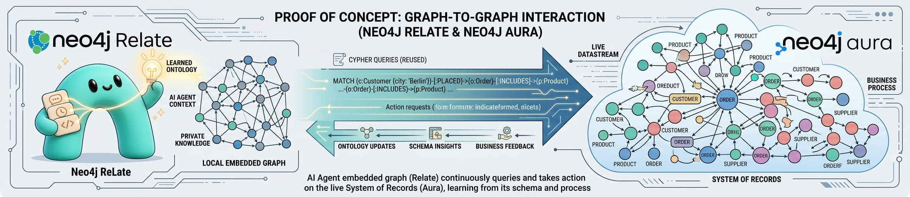
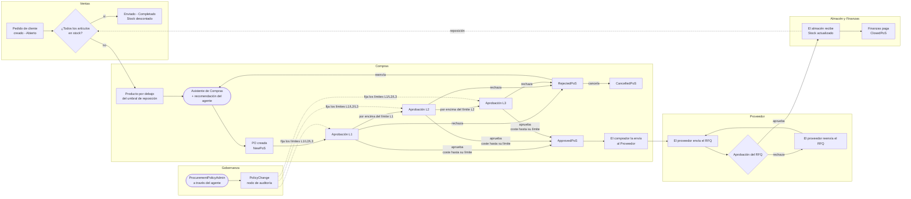
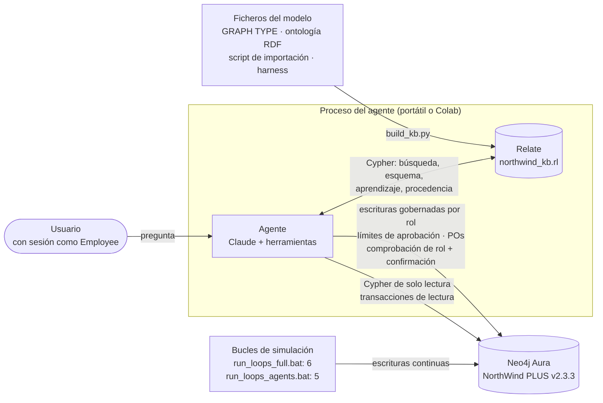

# NorthWind PLUS × Relate by Neo4j



🌐 [English](README.md) · [Português (Brasil)](Leiame%28pt-BR%29.md) · **Español**

**Un agente de IA que aprende a orientarse en una base de datos de grafos en vivo.**

[](https://colab.research.google.com/github/Flyer-Boy/NewApproach/blob/main/NorthWindPLUS/Neo4jRelate/NorthWind_PLUS_Agent_Colab.ipynb)

Parte de [Un Nuevo Enfoque para el Desarrollo de Aplicaciones con Grafos](../../Leame%28es-ES%29.md) · construido sobre la prueba de concepto [NorthWind PLUS](../Leame%28es-ES%29.md).

Un agente de negocio responde a preguntas sobre una simulación *en vivo* de NorthWind PLUS que se ejecuta en Neo4j Aura, realiza las acciones gobernadas que permiten los roles de la persona que ha iniciado sesión y **aprende**: recuerda cada pregunta, y las nuevas consultas que una persona aprueba se convierten en conocimiento reutilizable que encuentran las preguntas posteriores.

Sus acciones hasta ahora: un administrador de políticas puede ensayar y cambiar los límites de aprobación L1/L2/L3 de las órdenes de compra, y un **Asistente de Compras (Procurement Assistant) hace ahora lo que antes hacía uno de los bucles de la simulación**: el agente recomienda qué POs crear o reenviar, y la persona las acepta, las cambia o las cancela, con una justificación en cada una. Es el primer paso para pasar los trabajos de la simulación de bucles en Python a personas que trabajan con agentes, con un rastro de auditoría completo. Los mismos trabajos de PO también se pueden hacer en una **pequeña interfaz web** (React + TypeScript), que ejecuta el mismo Cypher gobernado, con ayuda del grafo y de Claude entre bastidores (ver *Interfaz web*).

Neo4j Aura sigue siendo el sistema de registro. El conocimiento del agente (la ontología, una biblioteca de Cypher probado, el historial de preguntas, todo lo que ha aprendido) reside en **[Relate by Neo4j](https://relatedb.ai/)**, una base de datos de grafos embebida que se ejecuta dentro del propio proceso Python del agente.

> Prueba de concepto. Relate 1.0.1 · Neo4j Aura con GRAPH TYPE (Cypher 25) · Claude mediante el Anthropic SDK ·
> Modelo NorthWind PLUS v2.3.3

---

## Por qué Relate

Los grafos de producción y los agentes necesitan cosas distintas. Aura guarda el negocio: los bucles de la simulación escriben en él, sin parar, pedidos, órdenes de compra, presupuestos, entregas y pagos. Un agente necesita un lugar propio para *pensar*: qué significa el modelo, qué consultas funcionan, qué se preguntó antes y qué lo respondió. Eso no debería ensuciar el sistema de registro ni quedarse esperando por él.

Relate encaja bien en ese papel:

- **Embebida, sin servidor.** `pip install relate-db` y después `relate.connect("kb/northwind_kb.rl")`: un fichero, dentro del proceso. El mismo notebook funciona en un portátil con Windows y en Google Colab.
- **El mismo Cypher en ambos lados.** El agente escribe Cypher 25 contra relate para buscar en su conocimiento, y Cypher contra Aura para responder preguntas, con un solo lenguaje y un solo modelo mental.
- **Un grafo, no un almacén vectorial.** Las plantillas están enlazadas a los conceptos de la ontología que tocan, a las etapas del flujo de trabajo a las que pertenecen y a las preguntas que respondieron. La búsqueda puede *recorrer* el grafo, no solo comparar texto.
- **Búsqueda integrada.** Índices full-text (`SEARCH ... FULLTEXT INDEX ... SCORE AS`) y vectoriales, combinados en una sola sentencia Cypher y actualizados en cuanto el agente escribe. Una plantilla guardada hace un momento ya se puede encontrar.
- **Barata de reconstruir, segura de conservar.** El almacén de conocimiento se genera a partir de los ficheros del modelo en segundos, y lo que el agente ha aprendido se conserva en cada reconstrucción.

## Por qué funciona: un sistema de registro graph-native

Relate le da al agente un lugar para pensar, pero lo que hace funcionar esta prueba de concepto es cómo está modelado el sistema de registro en Aura. NorthWind PLUS es **graph-native**: cada estado y cada elemento de contexto de negocio es una relación explícita, no una propiedad ni una columna de estado. El grafo no solo guarda los datos; es una **máquina de estados y de contexto** que un agente puede leer directamente.

- **El estado es una relación con un nodo Collection.** Una PO pendiente de aprobación está enlazada a `NewPoS`; la aprobación mueve ese enlace a `ApprovedPoS`. "¿Qué está pendiente?" es una coincidencia de patrón, no un filtro sobre un campo de estado cuyos valores solo conoce la aplicación.
- **El contexto vive en las aristas.** Quién aprobó o rechazó una PO, cuándo, por qué y si la decisión la tomó un bucle o una persona con el agente son propiedades de la relación que registra la decisión (`HAS_L1_PO_REJECTION
  {Date, Comment, Source}`, `PO_CREATED_BY {Date, Justification, Source}`). No se sobrescribe nada.
- **Las reglas son datos.** Los límites de aprobación están en los nodos `RolE` y se leen en el momento en que se evalúa cada PO, así que un cambio gobernado tiene efecto inmediato y queda registrado a su vez como un `PolicyChange`.
- **Los nodos nunca se borran.** El historial permanece en el grafo, así que el rastro detrás de cualquier decisión está a un recorrido de distancia.

Por eso cada pieza del agente puede seguir siendo sencilla. Su ontología sale directamente de los ficheros GRAPH TYPE y RDF; sus preguntas son coincidencias de patrón sobre el estado en vivo; sus escrituras son Cypher fijo que mueve una relación y registra el porqué; un what-if copia un subgrafo que lleva sus propios estados y reglas; y el rastro de auditoría existe porque el modelo registra las decisiones como aristas, no porque el agente añada logs. Con los mismos datos en tablas y columnas de estado, el agente tendría que reconstruir primero ese significado a partir del código de la aplicación. Aquí lee el significado en el grafo, **en vivo**, mientras el negocio funciona.

```cypher
// Everything an agent needs to explain one PO's history: its states, decisions, who, when and why
MATCH (po:PurchaseOrder {PONumber: $po})
OPTIONAL MATCH (state)-[s]->(po) WHERE state:NewPoS OR state:ApprovedPoS OR state:RejectedPoS OR state:CancelledPoS
OPTIONAL MATCH (po)-[d]->(e:Employee)-[:HAS_PERSON]->(p:Person)
RETURN labels(state)[0] AS CurrentState,
       collect({decision: type(d), by: p.FirstName + " " + p.LastName, date: toString(d.Date),
                why: coalesce(d.Comment, d.Justification), source: d.Source}) AS Decisions
```

## El ciclo de negocio de NorthWind PLUS (ejecutándose en Aura)

Cinco bucles de simulación y un Asistente de Compras (con el agente) mueven este ciclo de forma continua. Cada caja es un estado que el grafo registra como una relación con un nodo Collection (`NewPoS`, `ApprovedPoS`, etc.), así que hacer avanzar una PO significa mover una relación.



Los pedidos de clientes abiertos cuentan contra el stock disponible, así que un producto puede caer por debajo de su umbral de reposición antes de que un pedido no se pueda enviar. Los límites L1/L2/L3 se leen de los nodos `RolE` cada vez que se evalúa una PO, y por eso un `PolicyChange` gobernado tiene efecto en el siguiente ciclo de aprobación, sin tocar los bucles. Desde la v2.3.3 las franjas son contiguas: cada nivel aprueba base < coste ≤ límite y el nivel siguiente empieza en ese límite, así que todo coste hasta el límite L3 tiene un camino.

## Arquitectura



1. **Construir:** `kb/build_kb.py` convierte los ficheros del modelo en un grafo de conocimiento en relate. Lee el GRAPH TYPE (nombres y tipos exactos), la ontología RDF/Turtle (Entity frente a Collection), significados de negocio seleccionados, 64 consultas del script de importación y 19 acciones del harness de simulación.
2. **Preguntar:** el agente reescribe la pregunta en el vocabulario del modelo, busca en relate y después ejecuta una plantilla que encaje, adapta una o escribe Cypher nuevo a partir de la ontología. Ejecuta la consulta en Aura y responde.
3. **Aprender:** cada pregunta se guarda en relate con las plantillas que usó. Una consulta nueva que funcionó puede guardarse como plantilla cuando el usuario la aprueba.

## Qué hace Relate en este proyecto

| Capacidad de Relate | Cómo la usa el proyecto | Dónde |
|---|---|---|
| Almacén embebido, un único fichero `.rl` | El grafo de conocimiento del agente vive junto al código; en Colab se guarda en Google Drive entre sesiones | `kb/build_kb.py`, notebooks |
| API de Python (`relate.connect`, `execute`, parámetros, `autocommit=False`, `commit`) | Toda la construcción se ejecuta como una sola transacción; cada consulta está parametrizada | `kb/` |
| Cypher 25 (`MERGE`, `UNWIND`, subconsultas `COUNT {}`, `CALL () { ... UNION ALL ... }`) | Ontología, plantillas, enlaces y puntuación son Cypher sencillo | `kb/kb_query.py` |
| Restricciones de unicidad | Los nombres de plantillas, de tipos de nodo y de tipos de relación son claves | `build_kb.py` |
| Índices full-text + `SEARCH ... SCORE AS` | Búsqueda BM25 sobre las plantillas, la ontología y las preguntas anteriores | `kb_query.search_templates` |
| Índices vectoriales (`vector(...)`, coseno) | Búsqueda semántica opcional sobre los embeddings de las plantillas (voyage-4-nano) | `kb/embeddings.py` |
| Índices actualizados al escribir | Una plantilla guardada en mitad de la conversación aparece ya en la búsqueda siguiente | ciclo de aprendizaje |
| Conexiones `read_only=True` | Las herramientas que solo buscan abren el almacén en modo de solo lectura | `KnowledgeBase(read_only=True)` |
| Bloqueo de escritor único | Impide que dos procesos escriban en el almacén a la vez (ver *Lo que nos enseñaron las ejecuciones en vivo*) | los notebooks cierran primero la sesión anterior |
| Recorrido del grafo en la búsqueda | Pregunta → conceptos que coinciden → plantillas que los `USE`/`TRAVERSE`, puntuadas por especificidad | `kb_query.search_templates` |
| Procedencia como grafo | `(:Interaction)-[:USED\|CREATED]->(:QueryTemplate)`: qué pregunta usó o creó qué consulta | ciclo de aprendizaje |
| `relate pull` (CLI, mediante la HTTP Query API de Aura) | Copia las POs pendientes de aprobación a un almacén de borrador, donde se ensaya un cambio de límites propuesto con el propio Cypher de la simulación | `sandbox/` |
| Copias baratas del fichero de un almacén | Cada ejecución del ensayo parte de una copia del almacén copiado | `sandbox/whatif.py` |
| Un almacén de borrador en el que se puede escribir | Hace avanzar el negocio en el tiempo (envía pedidos, descuenta stock, añade pedidos nuevos y entregas) para averiguar qué liberaría los pedidos de clientes atascados; Aura nunca se toca | `sandbox/unblock.py` |

## Sandbox what-if: copiar para experimentar, Cypher gobernado para confirmar

Lo sugirió un ingeniero de la plantilla de Neo4j tras la primera publicación: *copiar un subgrafo de Aura al contexto del agente, para que pueda modificarlo y experimentar con él de forma aislada.* Ante la pregunta *"what would happen if we raised L1 to 8000 and L2 to 20000?"*, el agente:

1. **copia** las POs pendientes de aprobación, sus líneas y productos, los roles de aprobadores y los nodos de estado a un almacén relate de borrador, en una sola sentencia, para que Aura sirva una instantánea coherente mientras los bucles siguen escribiendo;
2. **repite** el propio Cypher de aprobación de POs de la simulación (importado del harness, sin las líneas de bloqueo de APOC) sobre copias de ese almacén, con los límites actuales y con los propuestos, 5 ejecuciones de cada;
3. **compara** las aprobaciones por nivel, los rechazos, las POs que se quedan atascadas y los ciclos necesarios para vaciar la cola, y señala las POs que ninguna regla de aprobación puede tratar (desde las franjas contiguas de la v2.3.3, solo un coste de 0 o por encima del límite L3);
4. registra un nodo `(:WhatIf)` en relate junto a la pregunta. Si después se aplica el cambio, la justificación del `PolicyChange` en Aura cita el what-if, y el `WhatIf` registra qué `PolicyChange` lo aplicó.

Nada vuelve con `relate push`: push nunca borra en el remoto, y en este modelo un cambio de estado borra la relación del estado anterior. Los cambios siguen pasando por la acción gobernada.

La copia viene de `relate pull` cuando la CLI `relate` está instalada (`RELATE_BIN`, o en el `PATH`; el notebook de Colab la instala); si no, viene de un copiador alternativo que usa el driver de Neo4j.

**Dale una cola con la que trabajar.** Con los ritmos de los ficheros `run_loops_*.bat`, PO Vetting (12 por minuto) aprueba las POs nuevas casi tan rápido como PO Creation (1 por minuto) las crea, así que un what-if puede mostrar poca diferencia entre los escenarios. Pausa el bucle de PO Vetting durante 10-15 minutos (o baja su `--rate` a 2 o 3) para acumular una cola; subir el ritmo de Customer Order también hace que las POs sean más grandes, empujando más de ellas a las franjas L2 y L3. La simulación da la misma velocidad a todos los niveles de aprobación, así que unos límites más altos se notan como menos traspasos y menos ciclos para vaciar la cola, no como un nivel que retiene a los demás.

Detalles y puntos abiertos:
[DESIGN_what_if_sandbox.md](DESIGN_what_if_sandbox.md) (en inglés).

## Asistente de Compras: el primer bucle que pasa a una persona y un agente

En modo `agents` (ver *Dos formas de ejecutarlo*), el bucle `po-creation` no se arranca, y el bucle `po-vetting` deja de reenviar las POs rechazadas (`--no-resubmit`). Con sesión iniciada como Asistente de Compras (`--as-employee 16 --mode agents`, o `sign_in("16")` en un notebook con `SIMULATION_MODE = "agents"`):

1. *"What needs restocking?"* El agente ejecuta la propia regla del bucle (stock efectivo = en stock + en POs activas − comprometido con pedidos de clientes abiertos, cerca del umbral de reposición) y lista una PO por proveedor: productos, cantidades recomendadas, coste estimado y **el nivel de aprobación que va a necesitar**.
2. La persona responde con sus propias palabras (*"create 1 as recommended, and 2 with 20 fewer units; justification: …"*). El agente muestra la lista final y pide confirmación; no se escribe nada antes.
3. Una plantilla Cypher gobernada escribe cada PO en una transacción. Vuelve a comprobar el rol, bloquea los productos y **recalcula lo que todavía hace falta**, así que una línea que ya se ha cubierto desde la recomendación (por otro asistente, por ejemplo) se deja fuera y se informa de ello, en lugar de pedirla dos veces.
4. *"Which rejected POs should I resubmit or cancel?"* Cada una viene con quién la rechazó, en qué nivel y por qué, y lo que todavía hace falta ahora. La persona la reenvía (una PO nueva que apunta hacia atrás con `HAS_PREVIOUS_PO`) o la cancela (pasa al nuevo estado `CancelledPoS`).

Cada PO registra quién la creó, cuándo, por qué y `Source: "agent"`, con la cantidad recomendada junto a la pedida. Así, una sola consulta muestra dónde las personas cambiaron la recomendación del agente, y por qué:

```cypher
MATCH (po:PurchaseOrder)-[c:PO_CREATED_BY {Source:"agent"}]->(:Employee)-[:HAS_PERSON]->(p:Person),
      (po)-[it:HAS_PO_ITEM]->(pr:Product)
WHERE it.RecommendedQt IS NULL OR it.POqt <> it.RecommendedQt
RETURN po.PONumber, p.FirstName + " " + p.LastName AS By, pr.ProductName, it.RecommendedQt, it.POqt, c.Justification
```

Salvaguardas, en el código y en el Cypher: el rol se comprueba de nuevo en la base de datos; una justificación por PO; una PO por proveedor y lote, y **el agente nunca sugiere dividir ni recortar una PO para que quede por debajo de un límite de aprobación menor** (un fallo clásico de control en compras); las cantidades muy alejadas de la recomendación (más de 3× o menos de un tercio) se destacan en la confirmación.

El cambio de modelo se diseñó pensando en los agentes de aprobación que vendrán después: cada relación de decisión (aprobaciones, rechazos, decisiones del comprador, entregas, pagos) puede llevar `Source: "simulation"`, `"agent"` o `"ui"` junto a los ya existentes `Date` y `Comment`, para que bucles y agentes puedan trabajar codo con codo y aun así distinguirse. Consulta [DESIGN_procurement_agent.md](DESIGN_procurement_agent.md) (en inglés).

## Interfaz web: el tercer front end

Los mismos trabajos de PO, de una tercera forma: una pequeña aplicación React + TypeScript sobre una API en Python (`api/main.py`) que llama a `agent/procurement.py`, el mismo código que usa el agente. Así, el script (los bucles), el agente y la interfaz llegan al grafo por el mismo Cypher gobernado. Solo cambia la interfaz, y el rastro de auditoría los distingue: cada PO escrita desde la interfaz registra `Source: "ui"`.

- **Reposición (Restock):** una tarjeta por proveedor con la recomendación del grafo, cantidades editables, el coste estimado y el nivel de aprobación que va a necesitar la PO (recalculado por la API mientras escribes), y una justificación obligatoria. Las tarjetas empiezan fuera del lote: usa *Include* en las POs que quieras crear ahora; el botón *Review* queda fijo en la parte inferior de la ventana.
- **POs rechazadas:** quién creó cada una, quién la rechazó, en qué nivel y por qué, y lo que todavía hace falta ahora; reenviar o cancelar. Es la cola compartida del equipo de compras: cualquier Asistente de Compras puede reenviar o cancelar una PO rechazada, incluso una creada por otra persona, y el rastro de auditoría registra quién la creó y quién decidió.
- **Auditoría:** POs creadas, reenviadas y canceladas por la simulación, el agente y la interfaz, con la justificación de cada persona y los cambios respecto a la recomendación.
- **Revisar y después confirmar:** cada escritura son dos llamadas: *prepare* (las comprobaciones del agente y una vista previa; no se escribe nada) y *commit*. El commit comprueba que la revisión es la que se mostró, que tiene menos de 15 minutos y que el bucle de PO Creation sigue apagado. Después de cada escritura, todas las pantallas se recargan desde el grafo.

No hay chat. Dos tipos de ayuda trabajan entre bastidores, ambos solo como sugerencia:

- **Sugerencias de demanda (Cypher, sin IA).** Una nueva plantilla de lectura, *Recent demand for products*, mide lo que los clientes pidieron en los últimos 7 días y cuántos días cubre una cantidad prevista. Cuando eso queda por debajo de 7, la interfaz sugiere la cantidad que los cubriría, y el nivel de aprobación que entonces necesitaría la PO (`DEMAND_WINDOW_DAYS` y `DEMAND_COVER_DAYS` en `.env`). El agente puede usar la misma plantilla.
- **Borradores de justificación (Claude).** Un botón *Suggest* pide a Claude un borrador hecho solo con hechos que el servidor obtiene del grafo (stock, pedidos abiertos, demanda, el comentario de quien rechazó). La persona lo edita, y **solo se registra el texto enviado**. Los borradores usan el modelo del agente (`DRAFT_MODEL` en `.env` para cambiarlo); sin `ANTHROPIC_API_KEY`, el botón no aparece.

El navegador nunca ve las credenciales de Aura ni elige su propia identidad: la API guarda ambas. El inicio de sesión es una lista de Asistentes de Compras que hace las veces de un inicio de sesión, como `--as-employee`. La API no abre el almacén de conocimiento (relate no permite ninguna otra conexión mientras el agente lo tiene abierto), así que lee sus plantillas directamente del script de importación, con el mismo analizador que usa `build_kb.py`. Detalles: [DESIGN_procurement_ui.md](DESIGN_procurement_ui.md) (en inglés).

## Pedidos de clientes atascados: Relate hace avanzar el negocio en el tiempo

El bucle del almacén envía el pedido más antiguo cuyas líneas estén todas en stock. Un pedido grande necesita todos sus productos en stock a la vez, así que cada entrega que cubriría parte de él la consumen antes pedidos más pequeños que están completos: los pedidos grandes pueden esperar indefinidamente (inanición, o *starvation*), y a menudo son los clientes más valiosos. La regla de reposición no lo resuelve, porque mira totales.

La pestaña **Stuck orders** de la interfaz web lista los pedidos abiertos que esperan más de 3× el tiempo habitual de envío (medido en los últimos 3 días), señala los que ya han pasado su fecha requerida y tiene un botón: *Find what would free them*. Solo cuentan los pedidos de la propia simulación (IDs que empiezan por `CO-`, definido por `ORDER_ID_PREFIX`): tras una carga nueva, el bucle también envía los pedidos históricos importados, hechos hace décadas, lo que llevaría la mediana del tiempo de envío a décadas.

La respuesta obvia, "pedir lo que falta hoy", es errónea: los pedidos que van delante en la cola y los nuevos que siguen llegando consumen el stock antes de que llegue una entrega extra. Encontrar la cantidad real exige repetir la preparación de pedidos hacia delante en el tiempo, lo que escribe sin parar (envía pedidos, descuenta stock, añade llegadas y entregas). Por eso, la API copia la parte relevante del grafo (pedidos abiertos, stock, POs en camino, proveedores) a un **almacén Relate de borrador** y lo hace avanzar:

- el **propio Cypher de preparación de pedidos de la simulación** se ejecuta sobre la copia, sin más cambios que quitar los bloqueos de APOC;
- los pedidos nuevos llegan al ritmo medido, con la forma de los pedidos recientes; las POs llegan tras el plazo de entrega medido;
- un pedido atascado es más antiguo que los pedidos pequeños que siguen adelantándolo, así que se envía antes que ellos en cuanto todas sus líneas están en stock. Solo los pedidos más antiguos pueden adelantarse: pedidos históricos importados aún abiertos, que se envían primero si la entrega los completa y se llevan su parte. El extra es lo que lleva el stock que queda en el momento de la entrega por encima de las cantidades de los pedidos atascados, más lo que se llevan esos pedidos más antiguos. Una repetición encuentra el stock y la cola en ese momento y una segunda confirma que los pedidos se envían (en al menos 4 de 5 ejecuciones);
- la misma repetición prueba la cantidad ingenua y, como alternativa, una regla que reserva stock para los pedidos atascados;
- la proyección se basa en el pasado reciente, así que, en una base de datos nueva (poco historial, ninguna PO entregada todavía), la pantalla lo avisa y las cantidades probablemente salen bajas; `UNBLOCK_SAFETY_PERCENT` añade un margen opcional encima.

El resultado es una PO prioritaria por proveedor, con la evidencia en pantalla: en stock ahora, esperado cuando llegue la PO, lo que falta hoy frente a lo simulado, y lo que pidieron los clientes en los últimos 3 días (más que eso se marca como exceso de stock deliberado). La justificación empieza con una línea `PRIORITY:` que nombra los pedidos, para que los aprobadores la vean, y una nueva plantilla gobernada escribe la PO: en lugar de la regla de reposición, comprueba que cada producto está en un pedido atascado que sigue abierto y sigue atascado.

Aura sigue siendo el sistema de registro; Relate es donde el negocio avanza en el tiempo. No se escribe nada en Aura hasta que una persona lo confirma. En el grafo de prueba, donde un pedido importado aún abierto necesita 35 Chai, la simulación pide 61 Chai extra donde "lo que falta hoy" dice 11; la cantidad simulada libera el pedido atascado en 4 de 5 ejecuciones, la ingenua en 0, y reservar stock no libera nada (no viene nada para uno de sus productos) y además retrasa otros 7 pedidos. Detalles: [DESIGN_stuck_orders.md](DESIGN_stuck_orders.md) (en inglés).

## El grafo de conocimiento

```
(:NodeType {name, category: Entity|Collection, description})-[:HAS_PROPERTY]->(:Property {name, type, notNull, isKey})
(:NodeType)-[:SOURCE_OF]->(:RelType {name, pattern, description})-[:TARGETS]->(:NodeType)
(:WorkflowStep {name, description})-[:INVOLVES]->(:RelType)

(:QueryTemplate {title, description, cypher, params, governance, source, status, useCount, embedding?})
    -[:USES]->(:NodeType)
    -[:TRAVERSES]->(:RelType)
    -[:PART_OF {via: keyword|relationship}]->(:WorkflowStep)

(:Interaction {question, answer, employeeId, model, modelCalls, inputTokens, outputTokens, newQueries})
    -[:USED]->(:QueryTemplate)
    -[:CREATED]->(:QueryTemplate)

(:ModelPrinciple {text})   (:KnowledgeBase {ontologyVersion, embeddingModel, embeddingDims})
```

Inicializado a partir del modelo v2.3.3: **48 tipos de nodo, 89 tipos de relación, 175 propiedades, 13 etapas del flujo de trabajo, 83 plantillas**. Las plantillas son 58 consultas de lectura, 5 acciones gobernadas (el cambio de límites de aprobación; la creación, el reenvío y la cancelación de POs; y POs prioritarias para pedidos de clientes atascados), 1 escritura solo para administradores y 19 acciones de la simulación.

| Gobernanza de la plantilla | Significado |
|---|---|
| `read` | El agente puede ejecutarla, siempre en una transacción de lectura |
| `governed` | El cambio de límites de aprobación y los comandos de PO: rol comprobado en la base de datos, el usuario confirma, se escribe el rastro de auditoría |
| `admin` | Escrituras de mantenimiento (por ejemplo, el "atajo" de reposición); nunca se ofrecen al agente |
| `simulation` | Las propias acciones de los bucles; solo conocimiento de contexto |

Los significados de negocio están en `kb/semantics.json`, redactados a partir de los comentarios del script de importación (por ejemplo, *"SupplierNewPoS answers the Supplier's question 'Do I have any new POs?'"*). Editar ese fichero es la forma de enseñar al agente más cosas sobre el negocio.

## Cómo responde el agente

```
question
  └─ rewrite into the model's vocabulary ("quotes rejected" -> "Supplier RFQ rejection rate")
      └─ search_templates (required before any query)
          ├─ a template fits      -> run it (or adapt it) on Aura
          └─ nothing fits         -> get_schema -> write new Cypher -> run it on Aura
                                      └─ worked and reusable? -> save_template (user approves)
  └─ answer in business language, say it's a live snapshot, name the template or "new query"
```

En resumen: la pregunta se reescribe en el vocabulario del modelo; una búsqueda de plantillas es obligatoria antes de cualquier consulta; si una plantilla encaja, se ejecuta (o se adapta) en Aura; si no encaja ninguna, el agente consulta el esquema, escribe Cypher nuevo y lo ejecuta, y ofrece guardarlo si funcionó y es reutilizable (el usuario lo aprueba); la respuesta llega en lenguaje de negocio, avisa de que es una instantánea en vivo y nombra la plantilla usada o "new query".

| Herramienta | Qué hace | Salvaguardas |
|---|---|---|
| `search_templates` | Búsqueda híbrida en relate | — |
| `get_schema` | Propiedades exactas y patrones de relación para los tipos de nodo indicados | — |
| `run_read_query` | Ejecuta Cypher en Aura; devuelve las filas y los avisos de Neo4j que haya | se rechaza hasta que se haya hecho una búsqueda para la pregunta · palabras clave de escritura rechazadas · transacción de lectura · tiempo de espera de 20 s · máximo de 500 filas (50 para el modelo) |
| `save_template` | Guarda una consulta nueva como plantilla | solo consultas de lectura · tiene que haberse ejecutado con éxito en esta pregunta · aprobación del usuario · una por pregunta |
| `preview_approval_bands` | Cómo encaminarían los límites propuestos las POs pendientes de aprobación | plantilla de solo lectura |
| `what_if_approval_bands` | Ensaya los límites propuestos sobre una copia de la cola (ver *Sandbox what-if*) | nunca escribe en Aura · los almacenes de borrador se borran después · se registra como un nodo `WhatIf` |
| `change_approval_bands` | Cambia los límites L1/L2/L3 a la vez, sin huecos | solo ProcurementPolicyAdmin · confirmación del usuario · el Cypher vuelve a comprobar el rol y los límites · nodo de auditoría `PolicyChange` |
| `recommend_restock`, `recommend_resubmissions` | Qué necesita una PO nueva y qué hacer con las POs rechazadas (ver *Asistente de Compras*) | solo Procurement Assistant · plantillas de solo lectura |
| `create_purchase_orders`, `resubmit_purchase_orders`, `cancel_rejected_purchase_orders` | Escriben las POs que la persona aceptó | solo Procurement Assistant · primero una recomendación · una justificación por PO · una PO por proveedor y lote · confirmación del usuario · el Cypher vuelve a comprobar el rol y la necesidad · se registran `Source`, `Justification`, `RecommendedQt` |

La ontología completa (~17.000 caracteres) va en el prompt de sistema con prompt caching, así que se paga una vez por sesión. Los avisos de Neo4j (por ejemplo, *"property `Date` does not exist"*) vuelven al modelo para que corrija su propio Cypher, y los recuentos y totales tienen que salir del Cypher, no de la aritmética del modelo.

### Gobernanza: quién decide qué

- **La identidad viene de la sesión, nunca del modelo.** `--as-employee 25` (o `EMPLOYEE_ID` en los notebooks) hace las veces de un inicio de sesión. El agente comprueba los roles de esa persona en Aura.
- **Las herramientas se ofrecen por rol.** Un Asistente de Compras recibe las herramientas de PO; solo un ProcurementPolicyAdmin recibe el cambio de límites de aprobación; todos pueden hacer preguntas y ejecutar what-ifs. Una herramienta que no se ha ofrecido se rechaza aunque se llame, y cada plantilla gobernada vuelve a comprobar el rol dentro de la transacción de la base de datos.
- **Las escrituras son plantillas fijas, no Cypher escrito por el modelo de IA.** El cambio de límites de aprobación es una sentencia Cypher probada que comprueba el rol `ProcurementPolicyAdmin` *dentro de la transacción de la base de datos*, rechaza límites que dejarían un hueco entre niveles (un hueco deja POs atascadas para siempre) y registra un nodo `PolicyChange` con los valores de antes/después y la justificación.
- **Una persona confirma cada escritura**: cambios de límites de aprobación, POs y plantillas guardadas por igual.

## El ciclo de aprendizaje

1. Cada pregunta se convierte en una `Interaction` en relate, enlazada a las plantillas que `USED`, y el `useCount` de cada plantilla aumenta.
2. Cuando no encaja ninguna plantilla, el agente escribe Cypher a partir de la ontología. Si la consulta funcionó y es probable que otras personas pregunten lo mismo, el agente se ofrece a guardarla, generalizada con `$parameters`. **El usuario la aprueba o la rechaza.**
3. Una plantilla guardada se enlaza a los conceptos de la ontología y a las etapas del flujo de trabajo que toca, recibe su embedding (si los embeddings están activados) y se vincula a la `Interaction` que la `CREATED`.
4. Las preguntas posteriores la encuentran **de dos formas**: a través de la propia plantilla y a través de la pregunta anterior que respondió (*"preguntas como esta se respondieron con…"*).
5. **Las reconstrucciones la conservan.** `build_kb.py` exporta las plantillas aprendidas y el historial, reconstruye a partir de los ficheros del modelo y vuelve a enlazarlo todo con la ontología actual. Una plantilla aprendida que nombra algo que el modelo ya no declara se conserva, se marca como `needs-review` y se oculta de la búsqueda.

Para verlo, usa la sección *What the agent learned* del notebook, ejecuta `python kb/kb_query.py learned` o consulta relate directamente:

```cypher
MATCH (i:Interaction)-[:CREATED]->(q:QueryTemplate {source:'agent'})
RETURN q.title, q.createdBy, i.question, q.useCount ORDER BY q.useCount DESC
```

## Búsqueda

Cuatro listas ordenadas, combinadas con puntuaciones normalizadas, todas calculadas en relate:

| Camino | Cómo | Peso |
|---|---|---|
| Texto de la plantilla | Full-text (BM25) sobre título, descripción y nombre | 1.0 |
| Significado | Búsqueda vectorial sobre los embeddings de las plantillas (solo si se construyó con embeddings) | 0.8 |
| Preguntas anteriores | Full-text sobre `Interaction.question` → las plantillas que esas preguntas usaron o crearon | 0.6 |
| Conceptos | Full-text sobre la ontología, y después recorrido hasta las plantillas que usan esos conceptos, puntuadas por especificidad | 0.35 |

**Referencia medida, sin embeddings:** la plantilla esperada está entre las 3 primeras en **9 de 12** preguntas de negocio de prueba (`kb/eval_search.py`). Los tres fallos son huecos de vocabulario: "quotes" frente a "RFQ", "negative" frente a "below zero", "approve" frente a "approval". Reescritas en los términos del modelo, las mismas preguntas aciertan en el 1.er puesto, y por eso el agente reescribe antes de buscar.

**Embeddings (opcional).** `voyage-4-nano` es el modelo de pesos abiertos de Voyage AI (Apache-2.0, ~346M parámetros), que se ejecuta en local con sentence-transformers. No necesita clave de API, pero la primera ejecución descarga ~700 MB. `voyage-api` usa en su lugar la API alojada. Anthropic no ofrece un modelo de embeddings. Todavía no se ha medido el efecto sobre las 12 preguntas. Para medirlo, ejecuta `python kb/eval_search.py --compare voyage-4-nano`, que tarda varios minutos en una CPU y es mucho más rápido en una GPU.

## Lo que nos enseñaron las ejecuciones en vivo

Una prueba de concepto vale lo que valen sus sorpresas. Estas salieron de las ejecuciones contra la simulación en vivo:

- **El agente encontró un fallo real en la simulación.** Al preguntarle cuántas POs esperaban aprobación, informó de una PO de importe 0,00 y la señaló como extraña. La causa era la acción `po_resubmit`. Cuando el stock efectivo quedaba justo en su límite de elegibilidad, la fórmula de cantidad (con división entera en `StockThreshold / 2`) producía una línea de **0 unidades**. Una PO de coste 0 no coincide con ninguna acción de aprobación, ni siquiera de rechazo, así que se habría quedado en la cola para siempre. Las dos acciones que crean POs omiten ahora las líneas no positivas. Los bucles llevaban mucho tiempo funcionando sin sacar esto a la luz.
- **Una regla en el prompt no es una garantía.** Una vez, el modelo se saltó la búsqueda de plantillas y afirmó que "no encajaba ninguna plantilla". Buscar primero se impone ahora en el código: `run_read_query` se niega hasta que se haya hecho una búsqueda.
- **Los recuentos pertenecen a la base de datos.** Una vez, el modelo resumió 28 filas como 29 al sumar los grupos por su cuenta. Ahora los totales tienen que salir del Cypher.
- **Relate permite una conexión de escritura por almacén, incluso dentro de un mismo proceso.** Volver a ejecutar la celda de inicio de sesión de un notebook daba `storage locked`, hasta que la celda aprendió a cerrar primero la sesión anterior. No ejecutes el agente de terminal y un notebook sobre el mismo almacén a la vez.
- **Los detalles del entorno importan.** El driver de Python de Neo4j rechaza objetos `Query(..., timeout=...)` dentro de transacciones gestionadas, así que los tiempos de espera pasan por `@unit_of_work`. La versión antigua de `brotli` de Anaconda rompía el cliente HTTP del Anthropic SDK, así que `brotli>=1.2.0` está fijado. Las instancias más nuevas de Aura pueden usar el ID de la instancia como usuario y como nombre de la base de datos.
- **Leer las propias escrituras.** Después de crear una PO o reenviar una PO rechazada, la interfaz web a veces seguía mostrándola como pendiente durante un rato. La lectura siguiente iba a un miembro de la base de datos que aún no había aplicado la escritura. Ahora todas las sesiones de Aura comparten un mismo gestor de bookmarks, así que una lectura espera a las escrituras hechas antes que ella; y las pantallas se reinician en cada recarga, aunque los datos vuelvan iguales. Y, tras una escritura, las pantallas ocultan al instante lo que se acaba de enviar y muestran "Reloading from the graph…" (la demanda de todas las tarjetas llega ahora en una sola consulta, no una por tarjeta).
- **Aura puede quedarse brevemente sin servidor para lecturas.** En la primera ejecución en vivo de la interfaz web, la API y cuatro de los bucles no lograron conectarse (`ReadServiceUnavailable`), mientras un bucle ya conectado seguía funcionando; un reinicio limpio lo resolvió. El agente y la API ahora reintentan la conexión varias veces, en la base de datos indicada en `.env`, antes de rendirse con un mensaje que dice qué comprobar.

## Dos formas de ejecutarlo

El mismo modelo (v2.3.3), el mismo agente, el mismo notebook. Elige cuánto del negocio ejecuta la simulación:

| | **Simulación completa** | **Agentes** |
|---|---|---|
| Bucles | los seis: `run_loops_full.bat` | cinco: `run_loops_agents.bat` (sin PO Creation; PO Vetting con `--no-resubmit`) |
| `SIMULATION_MODE` | `full` (por defecto) | `agents` |
| Quién crea y reenvía las POs | los bucles | un Asistente de Compras con el agente, con una justificación en cada una |
| Qué hace el agente | responde preguntas, ejecuta what-ifs, cambia los límites de aprobación (administrador de políticas) | todo eso, y además recomienda, crea, reenvía y cancela POs (Asistente de Compras) |
| Útil para | ver a un agente trabajando junto a un negocio con mucha actividad y totalmente simulado | el comienzo del traspaso de los trabajos de la simulación a personas que trabajan con agentes |
| Interfaz web (`run_ui.bat`) | inicia sesión y explica por qué no puede escribir | los mismos trabajos de PO que el agente, con formularios |

Fija el modo en `.env` (`SIMULATION_MODE=full` o `agents`), con `--mode` en el agente de terminal, o en la celda de inicio de sesión del notebook. El modo tiene que coincidir con los bucles que has arrancado. En modo `full`, un Asistente de Compras no recibe herramientas de PO, así que el agente nunca compite con los bucles. En modo `agents`, si el bucle de PO Creation sigue escribiendo (una PO simulada en los últimos 3 minutos), el agente muestra las recomendaciones, pero se niega a crear POs hasta que se detenga. Cambiar de modo no requiere cambiar el modelo, solo otro fichero `.bat` y otro ajuste.

El código tal como lo describió el primer artículo (modelo v2.3.2, antes del modo agents) se conserva como la etiqueta git `v2.3.2-agent`, como referencia. Para tener esa experiencia hoy, usa el modo `full`: es el mismo agente sobre el modelo más reciente.

## Primeros pasos

### 0. Carga el modelo en Neo4j Aura (Aura Query console)

1. `model/NorthWind_PLUS_Graph_Data_Model_Import_v2.3.3.cypher`, **líneas 109–1186**. Esto vacía la base de datos y construye NorthWind PLUS v2.3.3. Opcional: el Motor de Recomendación, líneas 1286–1349. Para conservar una base de datos v2.3.2 existente, detén los bucles y ejecuta `model/NorthWind_PLUS_v2.3.3_Upgrade_from_v2.3.2.cypher`, que enumera sus pasos (desde la v2.3.1, ejecuta antes la actualización a la v2.3.2).
   La importación reconstruye la clásica base de datos Northwind como una aplicación graph-native y la amplía a un ciclo de negocio completo de 360 grados: pedidos de clientes, detección de stock bajo, órdenes de compra con tres niveles de aprobación, RFQs de proveedores, recepción en almacén, cierre financiero y preparación de pedidos. A partir de ahí, todo funciona de forma nativa en el grafo: sin ingesta de datos, sin ETL ni pipelines de datos.
2. `model/NorthwindPlusGraphType_v2.3.3.cypher` (el esquema GRAPH TYPE). Añade una capa de gobernanza al modelo: la propia base de datos impone la ontología.
3. Arranca los bucles en uno de los dos modos (ver *Dos formas de ejecutarlo* más arriba) y fija `SIMULATION_MODE` en `.env` en consonancia. En Windows, `run_loops_full.bat` abre los seis bucles y `run_loops_agents.bat`, cinco; ambos leen las credenciales de `.env` y usan ritmos que permiten que la aprobación y la preparación de pedidos sigan el paso de los pedidos nuevos. Ejecútalo desde esta carpeta, con el `.env` rellenado. En otros sistemas, ejecuta `python model/NorthwindPlus_Stress_Test.py --loop <name> --rate <per minute>`, una vez por bucle.

### 1a. Google Colab

Haz clic en **Open in Colab** más arriba, o abre tú mismo `NorthWind_PLUS_Agent_Colab.ipynb` en Colab. Añade los Colab Secrets que enumera (barra lateral 🔑, con *Notebook access* activado): `ANTHROPIC_API_KEY`, `NEO4J_URI`, `NEO4J_PASSWORD`, más `NEO4J_USER` o `NEO4J_USERNAME`, y `NEO4J_DATABASE`. Después elige *Run all*. El notebook clona este repositorio (unos 14 MB) y usa esta carpeta; para ejecutar tu propia copia, fija `REPO_URL` a tu fork, o a `""` para subir un zip en su lugar. El almacén de conocimiento se guarda en Google Drive entre sesiones.

### 1b. En local (terminal o Jupyter)

```
cp .env.example .env                      # fill in ANTHROPIC_API_KEY and the NEO4J_* values
pip install -r requirements.txt           # + requirements-embeddings.txt for voyage-4-nano
python kb/build_kb.py                     # add --embeddings voyage-4-nano for semantic search
python agent/agent.py --as-employee 25    # Olivia Bennett, ProcurementPolicyAdmin: can change the limits
python agent/agent.py --as-employee 12    # Gloria Gaynor, Level1Approver: can ask, can't change them
python agent/agent.py --as-employee 16 --mode agents   # Albert Camus, Procurement Assistant: creates, resubmits and cancels POs
```

Los tres agentes de arriba son: 25, Olivia Bennett, ProcurementPolicyAdmin, que puede cambiar los límites; 12, Gloria Gaynor, Level1Approver, que puede preguntar pero no cambiarlos; y 16, Albert Camus, Procurement Assistant, que crea, reenvía y cancela POs.

O abre `NorthWind_PLUS_Agent.ipynb` desde la carpeta del proyecto (Jupyter, por ejemplo desde Anaconda). Comparte las celdas de preguntas, gobernanza y aprendizaje con el notebook de Colab (ambos los genera `tools/make_notebooks.py`) y se ha ejecutado de principio a fin offline, pero **todavía no contra una base de datos en vivo; Colab es el camino probado.** Si falla, comprueba primero que el kernel del notebook es el entorno de Python en el que ejecutaste `pip install -r requirements.txt`.

La API de Anthropic se factura a través de una cuenta de Claude Console; no está incluida en una suscripción de Claude Pro.

### 1c. Interfaz web (Windows: `run_ui.bat`)

Solo en modo agents (`SIMULATION_MODE=agents`, bucles arrancados con `run_loops_agents.bat`). Construir la interfaz requiere Node.js 20.19+ o 22.12+, una sola vez:

```
pip install -r requirements.txt -r requirements-ui.txt
cd ui && npm install && npm run build && cd ..
uvicorn api.main:app --port 8000          # or run_ui.bat on Windows; then open http://localhost:8000
```

Para probarla sin Aura ni una clave de API, `python tests/serve_toy_ui.py` ejecuta la API sobre un pequeño grafo de prueba, con borradores predefinidos. Ejecutada en vivo contra Aura en Chrome y Edge.

Si no arranca, estos fueron los problemas de la primera ejecución en vivo:

- **`pip` no se reconoce:** ejecuta pip con el Python que usa `run_ui.bat`: `"%PYTHON%" -m pip install ...` (la ruta de `PYTHON` en `.env`), o usa un Anaconda Prompt.
- **`.env not found`:** git ignora `.env`, así que cada clon necesita su propia copia. Si el Explorador lo muestra pero `dir /a .env*` no, renómbralo o cópialo desde la línea de comandos (OneDrive puede ocultarlo).
- **La compilación falla con `styleText` o `EBADENGINE`:** Node.js es anterior a la 20.19. Instala la versión LTS actual, abre una ventana nueva, borra `ui\node_modules` y vuelve a ejecutar `npm install` y `npm run build`.
- **La página parece una versión antigua:** vuelve a compilar, reinicia `run_ui.bat` y pulsa Ctrl+F5.
- **Evita las carpetas de OneDrive** para este proyecto: OneDrive sincronizando `ui\node_modules` y el almacén de relate bloquea ficheros.

### Qué preguntar

Las preguntas están en inglés, tal como se probaron. El agente reescribe cada pregunta en el vocabulario del modelo antes de buscar, así que las preguntas en español deberían funcionar, pero todavía no se ha probado.

- *Which suppliers get their quotes rejected most often?* Prueba el paso de reescritura y la reutilización de plantillas.
- *How many POs are waiting for approval?* No existe plantilla para ella, así que el agente escribe Cypher nuevo y se ofrece a guardarlo.
- *What is the number and value of purchase orders still waiting to be vetted?* Debería encontrar la plantilla que acabas de guardar.
- *What would happen to the approval queue if we raised L1 to 8000 and L2 to 20000?* Un what-if sobre una copia.
- *Raise L1 to 8000 and L2 to 20000 to speed up vetting.* Vista previa, confirmación, auditoría en `PolicyChange`.
- *Who changed the approval limits, when and why?* Vuelve a leer el rastro de auditoría.
- *What were total revenue and gross profit in the last hour?* O en los últimos 15 minutos: estás consultando un grafo en vivo, no uno estático.
- *Which available products urgently need restocking to fulfill customer orders?*
- *Who are our top 10 customers by revenue, and by product quantity?*
- *Who does the most PO vetting?*
- *Where is the PO vetting friction concentrated?*
- *Which supplier has the most rejected RFQs?* Parecida a la primera pregunta con otras palabras, una buena prueba de reutilización de plantillas.
- *Which available products are ordered least?*
- *Who is our best salesperson?*
- *Which is our best sales region?*
- *Which employee gives our customers the biggest discounts?*
- *Which fulfillment clerk received the most supplier deliveries (POs)?* También puedes preguntar por los pedidos de clientes.

Como Asistente de Compras (EmployeeID 16, 17 o 18), en modo `agents`:

- *What needs restocking?* Después acepta algunas, cambia una cantidad y da una justificación por PO.
- *Which rejected POs should I resubmit or cancel?*
- *Show the POs created, resubmitted or cancelled through the agent, and where the recommendation was changed.*
- *Split the Exotic Liquids PO in two so each half goes to L1.* El agente debería negarse.

## Estructura del proyecto

```
model/                       NorthWind PLUS v2.3.3
  NorthWind_PLUS_Graph_Data_Model_Import_v2.3.3.cypher   import script + query examples + governed commands
  NorthwindPlusGraphType_v2.3.3.cypher                   GRAPH TYPE schema
  NorthwindPlusGraph_RDF-turtle_v2.3.3.ttl               RDF/OWL ontology
  NorthWind_PLUS_v2.3.3_Upgrade_from_v2.3.2.cypher       in-place upgrade from v2.3.2
  NorthWind_PLUS_v2.3.2_Upgrade_from_v2.3.1.cypher       in-place upgrade from v2.3.1
  NorthwindPlus_Stress_Test.py                           the simulation loops (po-creation kept, not started)
kb/                          the knowledge store (Relate)
  semantics.json             curated business meanings -- edit to teach the agent
  build_kb.py                builds northwind_kb.rl; keeps learned knowledge on rebuild
  kb_query.py                hybrid search, schema context, learning-loop writes
  kb_write.py                shared template writing (seed and learned templates get the same shape)
  model_templates.py         the templates read straight from the model files (for the web UI's API)
  embeddings.py              none | voyage-4-nano (local) | voyage-api | hash (tests)
  eval_search.py             retrieval check; --compare <provider> for with/without embeddings
sandbox/                     what-if rehearsals on a pulled copy
  pull.py                    relate pull (CLI), or the fallback copier through the Neo4j driver
  whatif.py                  replays the harness's PO-vetting Cypher with current vs proposed limits
  unblock.py                 plays fulfillment forward to find what would free stuck customer orders
agent/
  agent.py                   the agent (Anthropic SDK tool use)
  aura.py                    Neo4j side: read transactions with warnings, identity, governed write
  procurement.py             Procurement Assistant tools: recommendations, create / resubmit / cancel POs (prepare/commit)
api/
  main.py                    the web UI's API (FastAPI): sessions, prepare/commit, demand, AI drafts; serves ui/dist
ui/                          the web UI: Vite + React + TypeScript + Chakra UI (npm run build -> ui/dist)
tests/                       offline tests (no API, no Aura); serve_toy_ui.py runs the web UI on a toy graph
NorthWind_PLUS_Agent.ipynb         local Jupyter front end
NorthWind_PLUS_Agent_Colab.ipynb   Google Colab front end
run_loops_full.bat                 Windows: full mode, all six simulation loops (credentials read from .env)
run_loops_agents.bat               Windows: agents mode, five loops; PO creation and resubmission by the agent
run_ui.bat                         Windows: the web UI at http://localhost:8000 (credentials read from .env)
DESIGN_what_if_sandbox.md          the what-if sandbox (relate pull)
DESIGN_procurement_agent.md        the Procurement Assistant agent and model v2.3.3
DESIGN_procurement_ui.md           the web UI, its API and the help behind the scenes
DESIGN_stuck_orders.md             unblocking stuck customer orders: the play-forward simulation in Relate
tools/make_notebooks.py            generates both notebooks
```

## Pruebas

```
python tests/test_agent_offline.py     # 27 checks
python tests/test_aura_driver_path.py  # 8 checks
python tests/test_whatif_offline.py    # 22 checks; 25 with RELATE_BIN set to a relate CLI
python tests/test_procurement_offline.py  # 61 checks
python tests/test_procurement_api.py   # 52 checks: the web UI's API
python tests/test_unblock_offline.py   # 34 checks: stuck customer orders
python kb/eval_search.py               # retrieval: 9/12 without embeddings
```

Las pruebas offline usan relate dos veces: como almacén de conocimiento del agente y como sustituto de Aura con un pequeño grafo de NorthWind PLUS, lo que funciona porque ambos hablan Cypher. Un cliente con guion hace el papel de Claude, emitiendo llamadas reales a herramientas y leyendo resultados reales. Las pruebas cubren la imposición de buscar primero, el rechazo de escrituras, las comprobaciones de rol, las confirmaciones, el cambio de límites de aprobación y su nodo de auditoría, guardar y volver a encontrar una plantilla aprendida, el aprendizaje que sobrevive a una reconstrucción, el marcado `needs-review`, la búsqueda vectorial y el Asistente de Compras: herramientas por rol, las recomendaciones frente a las fórmulas del bucle, cada salvaguarda, las propiedades de auditoría, una PO concurrente que cubre una línea, el reenvío y la cancelación, y el `--no-resubmit`, las franjas contiguas y el `Source` del harness. La prueba del driver ejecuta el `aura.py` real contra un sustituto que impone las reglas de transacción del driver de Neo4j. Las pruebas de la interfaz web cubren prepare/commit y `Source: "ui"`, la plantilla de demanda y sus sugerencias, la reconstrucción cuando cambian los ficheros del modelo y la propia API: inicio de sesión, comprobaciones de rol y de modo, revisiones caducadas o reutilizadas, el control del bucle en el commit y borradores hechos solo con los hechos del grafo.

## Notas y límites de Relate con los que nos encontramos

- Un proceso de escritura por almacén, y una conexión de escritura por proceso, como descubrimos. Mientras un proceso tiene un almacén abierto para escritura, ningún otro proceso puede abrirlo, ni siquiera en modo de solo lectura (`storage locked`). Por eso, la API de la interfaz web lee sus plantillas de los ficheros del modelo.
- Sin APOC, así que las llamadas `apoc.lock.nodes` de la simulación solo se ejecutan en Aura; las plantillas se guardan en relate, pero solo se ejecutan en Aura.
- La búsqueda full-text solo encontraba palabras completas ("rejected" no encontraba "Rejection"). No encontramos un analizador con stemming, así que los embeddings o la reescritura de la pregunta cubren ese hueco.
- `pip install relate-db` instala la biblioteca de Python; la herramienta de línea de comandos `relate` (`pull`, `push`, `serve`) se instala aparte (`install.sh` / `install.ps1` desde relatedb.ai). La API de Python no tiene `pull`.
- El instalador de relate descarga la CLI más reciente (hoy la 1.0.2), mientras que PyPI tiene `relate-db` 1.0.1: en nuestras pruebas, un almacén escrito por la CLI 1.0.2 se abrió sin problemas con la biblioteca 1.0.1.
- `relate pull` habla con Aura mediante la HTTP Query API, rechaza un destino que no esté vacío (volver a copiar nunca es una fusión) y `relate push` nunca borra en el remoto. Por eso, un almacén de borrador nuevo para cada experimento, y Cypher gobernado, no `push`, para los cambios que mueven relaciones de estado.
- `datetime()` vuelve como un objeto `Temporal` de relate en Python.

## Estado y pendientes

| Etapa | Qué | Estado |
|---|---|---|
| 1 | Modelo v2.3.2: rol ProcurementPolicyAdmin, nodo de auditoría PolicyChange, cambio gobernado de límites de aprobación, correcciones de consultas | Aplicado en Aura |
| 2 | Almacén de conocimiento + búsqueda de plantillas | Ejecutado en vivo |
| 3 | Agente con consultas de lectura y el cambio gobernado | Ejecutado en vivo (terminal y Colab) |
| 4 | Ciclo de aprendizaje, procedencia, avisos al modelo, imposición de buscar primero, embeddings | Probado offline; en pruebas en vivo |
| 5 | Sandbox what-if con `relate pull` (sugerido por un ingeniero de la plantilla de Neo4j) | Ejecutado en vivo (Colab) |
| 6 | Modelo v2.3.3 + agente Asistente de Compras: creación y reenvío de POs traspasados de los bucles a una persona con el agente; dos modos de ejecución (full, agents) | Ejecutado en vivo (Colab, modo agents): 27 POs creadas con cambios, aprobadas por el bucle; 16 POs rechazadas reenviadas o canceladas |
| 7 | Interfaz web: los mismos trabajos de PO con formularios, sugerencias de demanda y borradores de justificación con IA; `Source: "ui"` | Ejecutada en vivo contra Aura (Chrome y Edge): POs creadas con justificaciones redactadas por IA, POs rechazadas revisadas |
| 8 | Pedidos de clientes atascados: simulación que avanza en el tiempo en un almacén Relate de borrador, POs prioritarias, la comparación con la reserva de stock | Probado offline y sobre un grafo de prueba; todavía no ejecutado contra Aura |

**Pendientes**
- Copiar las plantillas guardadas (y quizá el historial de preguntas) al grafo de Aura, para poder consultarlas junto a los datos de negocio: escritura al aprobar desde el agente, o `relate push`. Decisiones abiertas: versión del modelo y alcance.
- Una acción gobernada para rechazar las POs atascadas con cantidad cero (roles por decidir).
- Medir voyage-4-nano frente a la referencia de 9/12.

## Historial de cambios

- **Etapa 8 / pedidos de clientes atascados:** plantillas de lectura *Stuck customer orders* y *Fulfillment pace*; la gobernada *Create a Purchase Order for stuck customer orders* (justificación con `PRIORITY:`, cada producto en un pedido atascado); `sandbox/unblock.py` (copiar, avanzar en el tiempo con el Cypher de preparación de pedidos del harness, encontrar y verificar el extra, probar la cantidad ingenua y la reserva de stock); `sandbox/pull.py` acepta cualquier consulta de copia; `stuck_orders`, `recommend_unblock`, `prepare_unblock` y `commit_unblock` en `agent/procurement.py`; endpoints de la API y la pestaña *Stuck orders*; `tests/toy_stuck.py` y `tests/test_unblock_offline.py`. Tras la primera ejecución en vivo: solo los pedidos `CO-` cuentan como atascados y para la mediana del tiempo de envío (`ORDER_ID_PREFIX`), y la búsqueda tiene en cuenta lo que se llevan primero los pedidos más antiguos.

- **Etapa 7 / interfaz web:** `agent/procurement.py` dividido en prepare/commit, con la comprobación de rol y de modo en cada punto de entrada; `$source` en los comandos gobernados de PO (`"agent"` o `"ui"`; cualquier otro valor no escribe nada); nuevas plantillas de lectura *Recent demand for products* y *PO activity by front end*; el almacén de conocimiento registra un hash de los ficheros del modelo y se reconstruye cuando cambian, sin cambiar la versión del modelo; `kb/model_templates.py`; la capa FastAPI (`api/`), la aplicación React (`ui/`), `run_ui.bat` y `tests/serve_toy_ui.py`. Tras la primera ejecución en vivo: quién creó cada PO rechazada (`RaisedBy` en la recomendación de reenvío, así que el agente también lo ve) y una nota sobre la cola compartida; las tarjetas empiezan fuera del lote, con el botón Review fijo abajo; todas las pantallas se recargan tras una escritura; los errores del borrador con IA se muestran en pantalla, borradores con el modelo del agente; la página nunca se sirve desde una caché antigua; la conexión con Aura se reintenta; el logotipo de Northwind.

- **Etapa 6 / modelo v2.3.3:** agente Asistente de Compras (`agent/procurement.py`): recomendaciones de reposición y de reenvío, comandos gobernados de crear / reenviar / cancelar, herramientas ofrecidas por rol. Modelo: `Date`, `Justification`, `Source` en `PO_CREATED_BY`; `RecommendedQt` en `HAS_PO_ITEM`; `Date`, `Source` en `HAS_PREVIOUS_PO`; `Source` en cada relación de decisión; nuevo estado `CancelledPoS` y `PO_CANCELLED_BY`; franjas de aprobación contiguas. Harness: `Source:"simulation"`, franjas contiguas, `--no-resubmit`. Dos formas de ejecutarlo: `run_loops_full.bat` (seis bucles, `SIMULATION_MODE=full`, por defecto) o `run_loops_agents.bat` (cinco bucles, `SIMULATION_MODE=agents`); en modo agents, las herramientas de PO se niegan a escribir mientras el bucle de PO Creation siga activo. Notebooks: una sección de Compras, `sign_in()` y una reconstrucción cuando cambia la versión del modelo.

- **Etapa 5:** sandbox what-if (`sandbox/`): `relate pull` o un copiador alternativo, repetición del Cypher de aprobación de POs del harness con los límites actuales frente a los propuestos (5 ejecuciones de cada, sin repetir los reenvíos), comprobación de POs en los límites de las franjas, herramienta `what_if_approval_bands`, procedencia `(:Interaction)-[:RAN]->(:WhatIf)` conservada en las reconstrucciones, justificación del `PolicyChange` que cita el what-if. Colab instala la CLI de relate; ambos notebooks reciben una sección What-if.

- **Etapa 4:** ciclo de aprendizaje (`save_template` con aprobación, procedencia en `Interaction`, `useCount`, aprendizaje que sobrevive a las reconstrucciones, marcado `needs-review`); preguntas anteriores como camino de búsqueda; embeddings opcionales con índice vectorial; avisos de Neo4j devueltos al modelo; buscar primero impuesto en el código; recuentos desde Cypher; etiquetas de flujo de trabajo a partir de palabras clave *y* de relaciones; los notebooks cierran la sesión anterior antes de iniciar sesión; Colab guarda el almacén en Drive; `run_loops.bat`.
- **Corrección del harness:** `po_resubmit` y `po_creation` omiten las líneas de PO de 0 unidades o menos, y las POs vacías; la elegibilidad de `po_resubmit` aplica la misma regla. Lo encontró el agente en su primera ejecución en vivo.
- **Agente:** tiempo de espera de las consultas mediante `@unit_of_work`; los errores de inicio de sesión se notifican en lugar de ocultarse; uso de tokens sumado en todas las llamadas al modelo.
- **requirements.txt:** `brotli>=1.2.0`.
- **Modelo v2.3.2:** rol `ProcurementPolicyAdmin` y empleado 25; nodo `PolicyChange` con `REQUESTED_BY` y `CHANGED_ROLE`; cambio gobernado de límites de aprobación con consultas de vista previa y de historial; correcciones en la consulta de beneficio de la "última 1 hora" y en la de "pedidos abiertos que se pueden preparar"; comprobación de contigüidad de las franjas de aprobación.

## Enlaces

- Relate by Neo4j: [relatedb.ai](https://relatedb.ai/) · [github.com/relatedb/relate](https://github.com/relatedb/relate)
- Anuncio (en inglés): [Meet Relate by Neo4j: An Embedded Database for AI Agents](https://neo4j.com/blog/news/meet-relate-by-neo4j-an-embedded-database-for-ai-agents/)
- Embeddings de pesos abiertos de Voyage AI: [voyageai/voyage-4-nano](https://huggingface.co/voyageai/voyage-4-nano)
