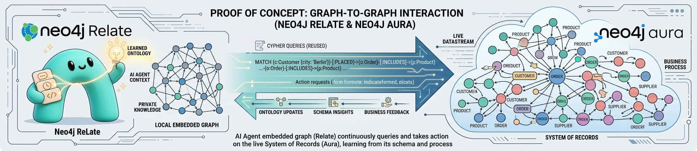
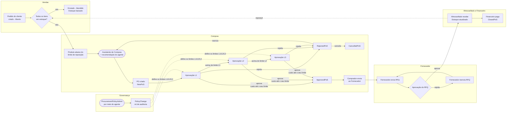
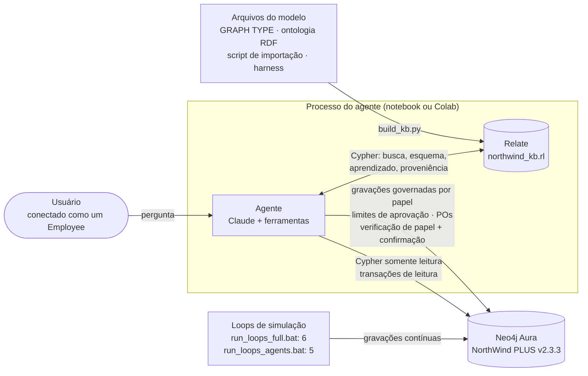

# NorthWind PLUS × Relate by Neo4j



🌐 [English](README.md) · **Português (Brasil)** · [Español](Leame%28es-ES%29.md)

**Um agente de IA que aprende a se orientar em um banco de dados de grafos ao vivo.**

[](https://colab.research.google.com/github/Flyer-Boy/NewApproach/blob/main/NorthWindPLUS/Neo4jRelate/NorthWind_PLUS_Agent_Colab.ipynb)

Parte de [Uma Nova Abordagem para o Desenvolvimento de Aplicações com Grafos](../../Leiame%28pt-BR%29.md) · construído sobre a prova de conceito [NorthWind PLUS](../Leiame%28pt-BR%29.md).

Um agente de negócios responde a perguntas sobre uma simulação *ao vivo* do NorthWind PLUS rodando no Neo4j Aura, executa as ações governadas que os papéis da pessoa conectada permitem e **aprende**: toda pergunta é lembrada, e as novas consultas que uma pessoa aprova se tornam conhecimento reutilizável que perguntas posteriores encontram.

Suas ações até agora: um administrador de políticas pode ensaiar e alterar os limites de aprovação L1/L2/L3 dos pedidos de compra, e um **Assistente de Compras (Procurement Assistant) agora faz o que um dos loops da simulação fazia**: o agente recomenda quais POs criar ou reenviar, e a pessoa os aceita, altera ou cancela, com uma justificativa em cada um. É o primeiro passo para passar os trabalhos da simulação de loops em Python para pessoas trabalhando com agentes, com uma trilha de auditoria completa. Os mesmos trabalhos de PO também podem ser feitos em uma **pequena interface web** (React + TypeScript), que executa o mesmo Cypher governado, com ajuda do grafo e do Claude nos bastidores (veja *Interface web*).

O Neo4j Aura continua sendo o sistema de registro. O conhecimento do agente (a ontologia, uma biblioteca de Cypher comprovado, o histórico de perguntas, tudo o que ele aprendeu) fica no **[Relate by Neo4j](https://relatedb.ai/)**, um banco de dados de grafos embarcado que roda dentro do próprio processo Python do agente.

> Prova de conceito. Relate 1.0.1 · Neo4j Aura com GRAPH TYPE (Cypher 25) · Claude pelo Anthropic SDK ·
> Modelo NorthWind PLUS v2.3.3

---

## Por que o Relate

Grafos de produção e agentes precisam de coisas diferentes. O Aura guarda o negócio: os loops da simulação gravam nele, sem parar, pedidos, pedidos de compra, cotações, entregas e pagamentos. Um agente precisa de um lugar próprio para *pensar*: o que o modelo significa, quais consultas funcionam, o que já foi perguntado e o que respondeu. Isso não deveria poluir o sistema de registro nem ficar esperando por ele.

O Relate cumpre bem esse papel:

- **Embarcado, sem servidor.** `pip install relate-db` e depois `relate.connect("kb/northwind_kb.rl")`: um arquivo, dentro do processo. O mesmo notebook roda em um notebook Windows e no Google Colab.
- **O mesmo Cypher dos dois lados.** O agente escreve Cypher 25 no relate para buscar no seu conhecimento, e Cypher no Aura para responder às perguntas, com uma linguagem e um modelo mental só.
- **Um grafo, não um banco vetorial.** Os modelos de consulta estão ligados aos conceitos da ontologia que tocam, às etapas do fluxo de trabalho a que pertencem e às perguntas que responderam. A busca pode *percorrer* o grafo, não só comparar texto.
- **Busca embutida.** Índices full-text (`SEARCH ... FULLTEXT INDEX ... SCORE AS`) e vetoriais, combinados em uma única instrução Cypher e atualizados assim que o agente grava. Um modelo salvo há um instante já pode ser encontrado.
- **Barato de reconstruir, seguro de manter.** O armazenamento de conhecimento é gerado a partir dos arquivos do modelo em segundos, e o que o agente aprendeu é preservado em cada reconstrução.

## Por que funciona: um sistema de registro graph-native

O Relate dá ao agente um lugar para pensar, mas o que faz esta prova de conceito funcionar é a forma como o sistema de registro no Aura foi modelado. O NorthWind PLUS é **graph-native**: todo estado e todo elemento de contexto de negócio é um relacionamento explícito, não uma propriedade nem uma coluna de status. O grafo não apenas guarda os dados; ele é uma **máquina de estados e de contexto** que um agente consegue ler diretamente.

- **O estado é um relacionamento com um nó Collection.** Um PO aguardando aprovação está ligado a `NewPoS`; a aprovação move essa ligação para `ApprovedPoS`. "O que está aguardando?" é uma correspondência de padrão, não um filtro sobre um campo de status cujos valores só a aplicação conhece.
- **O contexto fica nas arestas.** Quem aprovou ou rejeitou um PO, quando, por quê e se a decisão foi tomada por um loop ou por uma pessoa com o agente são propriedades do relacionamento que registra a decisão (`HAS_L1_PO_REJECTION
  {Date, Comment, Source}`, `PO_CREATED_BY {Date, Justification, Source}`). Nada é sobrescrito.
- **Regras são dados.** Os limites de aprovação ficam nos nós `RolE` e são lidos no momento em que cada PO é avaliado, então uma alteração governada tem efeito imediato e é ela própria registrada como um `PolicyChange`.
- **Nós nunca são excluídos.** O histórico permanece no grafo, então o rastro por trás de qualquer decisão está a uma travessia de distância.

É por isso que cada parte do agente pode continuar simples. Sua ontologia vem diretamente dos arquivos GRAPH TYPE e RDF; suas perguntas são correspondências de padrão sobre o estado ao vivo; suas gravações são Cypher fixo que move um relacionamento e registra o porquê; um what-if copia um subgrafo que carrega seus próprios estados e regras; e a trilha de auditoria existe porque o modelo registra decisões como arestas, não porque o agente acrescenta logs. Com os mesmos dados em tabelas e colunas de status, o agente primeiro teria de reconstruir esse significado a partir do código da aplicação. Aqui ele lê o significado no grafo, **ao vivo**, enquanto o negócio funciona.

```cypher
// Everything an agent needs to explain one PO's history: its states, decisions, who, when and why
MATCH (po:PurchaseOrder {PONumber: $po})
OPTIONAL MATCH (state)-[s]->(po) WHERE state:NewPoS OR state:ApprovedPoS OR state:RejectedPoS OR state:CancelledPoS
OPTIONAL MATCH (po)-[d]->(e:Employee)-[:HAS_PERSON]->(p:Person)
RETURN labels(state)[0] AS CurrentState,
       collect({decision: type(d), by: p.FirstName + " " + p.LastName, date: toString(d.Date),
                why: coalesce(d.Comment, d.Justification), source: d.Source}) AS Decisions
```

## O ciclo de negócio do NorthWind PLUS (rodando no Aura)

Cinco loops de simulação e um Assistente de Compras (com o agente) movem este ciclo continuamente. Cada caixa é um estado que o grafo registra como um relacionamento com um nó Collection (`NewPoS`, `ApprovedPoS` e assim por diante), então fazer um PO avançar significa mover um relacionamento.



Pedidos de clientes em aberto contam contra o estoque disponível, então um produto pode cair abaixo do seu limite de reposição antes que um pedido deixe de ser enviado. Os limites L1/L2/L3 são lidos dos nós `RolE` toda vez que um PO é avaliado, e é por isso que um `PolicyChange` governado tem efeito já no próximo ciclo de aprovação, sem mexer nos loops. Desde a v2.3.3 as faixas são contíguas: cada nível aprova base < custo ≤ limite e o nível seguinte começa nesse limite, então todo custo até o limite L3 tem um caminho.

## Arquitetura



1. **Construir:** `kb/build_kb.py` transforma os arquivos do modelo em um grafo de conhecimento no relate. Ele lê o GRAPH TYPE (nomes e tipos exatos), a ontologia RDF/Turtle (Entity vs. Collection), significados de negócio selecionados, 61 consultas do script de importação e 19 ações do harness de simulação.
2. **Perguntar:** o agente reescreve a pergunta no vocabulário do modelo, busca no relate e então executa um modelo de consulta correspondente, adapta um ou escreve um Cypher novo a partir da ontologia. Ele executa a consulta no Aura e responde.
3. **Aprender:** toda pergunta é guardada no relate com os modelos que usou. Uma consulta nova que funcionou pode ser salva como modelo depois que o usuário aprová-la.

## O que o Relate faz neste projeto

| Recurso do Relate | Como o projeto o usa | Onde |
|---|---|---|
| Armazenamento embarcado, um único arquivo `.rl` | O grafo de conhecimento do agente fica ao lado do código; no Colab ele é guardado no Google Drive entre sessões | `kb/build_kb.py`, notebooks |
| API Python (`relate.connect`, `execute`, parâmetros, `autocommit=False`, `commit`) | A construção inteira roda como uma única transação; toda consulta é parametrizada | `kb/` |
| Cypher 25 (`MERGE`, `UNWIND`, subconsultas `COUNT {}`, `CALL () { ... UNION ALL ... }`) | Ontologia, modelos, ligações e pontuação são Cypher simples | `kb/kb_query.py` |
| Restrições de unicidade | Os nomes de modelos, de tipos de nó e de tipos de relacionamento são chaves | `build_kb.py` |
| Índices full-text + `SEARCH ... SCORE AS` | Busca BM25 sobre modelos, a ontologia e perguntas anteriores | `kb_query.search_templates` |
| Índices vetoriais (`vector(...)`, cosseno) | Busca semântica opcional sobre os embeddings dos modelos (voyage-4-nano) | `kb/embeddings.py` |
| Índices atualizados na gravação | Um modelo salvo no meio da conversa é encontrado já na busca seguinte | ciclo de aprendizado |
| Conexões `read_only=True` | Ferramentas que só buscam abrem o armazenamento em modo somente leitura | `KnowledgeBase(read_only=True)` |
| Trava de escritor único | Impede que dois processos gravem no armazenamento ao mesmo tempo (veja *O que as execuções ao vivo nos ensinaram*) | os notebooks fecham a sessão anterior primeiro |
| Travessia do grafo na busca | Pergunta → conceitos correspondentes → modelos que os `USE`/`TRAVERSE`, pontuados por especificidade | `kb_query.search_templates` |
| Proveniência como grafo | `(:Interaction)-[:USED\|CREATED]->(:QueryTemplate)`: qual pergunta usou ou criou qual consulta | ciclo de aprendizado |
| `relate pull` (CLI, pela HTTP Query API do Aura) | Copia os POs aguardando aprovação para um armazenamento de rascunho, onde uma proposta de alteração de limites é ensaiada com o próprio Cypher da simulação | `sandbox/` |
| Cópias baratas do arquivo de um armazenamento | Cada execução do ensaio começa a partir de uma cópia do armazenamento copiado | `sandbox/whatif.py` |

## Sandbox what-if: copiar para experimentar, Cypher governado para efetivar

Sugerido por um engenheiro da equipe da Neo4j depois da primeira publicação: *copiar um subgrafo do Aura para o contexto do agente, para que ele possa modificá-lo e experimentar de forma isolada.* Diante da pergunta *"what would happen if we raised L1 to 8000 and L2 to 20000?"*, o agente:

1. **copia** os POs aguardando aprovação, seus itens e produtos, os papéis de aprovadores e os nós de estado para um armazenamento relate de rascunho, em uma única instrução, para que o Aura sirva um snapshot consistente enquanto os loops continuam gravando;
2. **repete** o próprio Cypher de aprovação de POs da simulação (importado do harness, sem as linhas de trava do APOC) em cópias desse armazenamento, com os limites atuais e com os propostos, 5 execuções de cada;
3. **compara** aprovações por nível, rejeições, POs que ficam presos e os ciclos necessários para esvaziar a fila, e aponta POs que nenhuma regra de aprovação consegue tratar (desde as faixas contíguas da v2.3.3, apenas um custo 0 ou acima do limite L3);
4. registra um nó `(:WhatIf)` no relate ao lado da pergunta. Se a alteração for aplicada depois, a justificativa do `PolicyChange` no Aura cita o what-if, e o `WhatIf` registra qual `PolicyChange` o aplicou.

Nada volta com `relate push`: o push nunca exclui nada no remoto, e neste modelo uma mudança de estado exclui o relacionamento do estado anterior. As alterações continuam passando pela ação governada.

A cópia vem do `relate pull` quando a CLI `relate` está instalada (`RELATE_BIN`, ou no `PATH`; o notebook do Colab a instala); caso contrário, vem de um copiador alternativo que usa o driver do Neo4j.

**Dê a ele uma fila para trabalhar.** Com as taxas dos arquivos `run_loops_*.bat`, o PO Vetting (12 por minuto) aprova os novos POs quase tão rápido quanto o PO Creation (1 por minuto) os cria, então um what-if pode mostrar pouca diferença entre os cenários. Pause o loop de PO Vetting por 10 a 15 minutos (ou baixe o `--rate` dele para 2 ou 3) para acumular uma fila; aumentar a taxa de Customer Order também deixa os POs maiores, empurrando mais deles para as faixas L2 e L3. A simulação dá a mesma velocidade a todos os níveis de aprovação, então limites mais altos aparecem como menos repasses e menos ciclos para esvaziar a fila, não como um nível segurando os outros.

Detalhes e pontos em aberto:
[DESIGN_what_if_sandbox.md](DESIGN_what_if_sandbox.md) (em inglês).

## Assistente de Compras: o primeiro loop passado a uma pessoa e a um agente

No modo `agents` (veja *Duas formas de executar*), o loop `po-creation` não é iniciado, e o loop `po-vetting` deixa de reenviar POs rejeitados (`--no-resubmit`). Conectado como Assistente de Compras (`--as-employee 16 --mode agents`, ou `sign_in("16")` em um notebook com `SIMULATION_MODE = "agents"`):

1. *"What needs restocking?"* O agente executa a própria regra do loop (estoque efetivo = em estoque + em POs ativos − prometido a pedidos de clientes em aberto, perto do limite de reposição) e lista um PO por fornecedor: produtos, quantidades recomendadas, custo estimado e **o nível de aprovação de que ele vai precisar**.
2. A pessoa responde com as próprias palavras (*"create 1 as recommended, and 2 with 20 fewer units; justification: …"*). O agente mostra a lista final e pede confirmação; nada é gravado antes disso.
3. Um modelo Cypher governado grava cada PO em uma transação. Ele verifica o papel de novo, trava os produtos e **recalcula o que ainda é necessário**, então um item que foi coberto depois da recomendação (por outro assistente, por exemplo) fica de fora e é informado, em vez de ser pedido duas vezes.
4. *"Which rejected POs should I resubmit or cancel?"* Cada um vem com quem o rejeitou, em qual nível e por quê, e o que ainda é necessário agora. A pessoa o reenvia (um novo PO que aponta de volta com `HAS_PREVIOUS_PO`) ou o cancela (ele passa para o novo estado `CancelledPoS`).

Cada PO registra quem o criou, quando, por quê e `Source: "agent"`, com a quantidade recomendada ao lado da pedida. Assim, uma única consulta mostra onde as pessoas mudaram a recomendação do agente, e por quê:

```cypher
MATCH (po:PurchaseOrder)-[c:PO_CREATED_BY {Source:"agent"}]->(:Employee)-[:HAS_PERSON]->(p:Person),
      (po)-[it:HAS_PO_ITEM]->(pr:Product)
WHERE it.RecommendedQt IS NULL OR it.POqt <> it.RecommendedQt
RETURN po.PONumber, p.FirstName + " " + p.LastName AS By, pr.ProductName, it.RecommendedQt, it.POqt, c.Justification
```

Salvaguardas, no código e no Cypher: o papel é verificado de novo no banco de dados; uma justificativa por PO; um PO por fornecedor por lote, e **o agente nunca sugere dividir ou reduzir um PO para que caiba abaixo de um limite de aprovação menor** (uma falha clássica de controle em compras); quantidades muito distantes da recomendação (mais de 3× ou menos de um terço) são destacadas na confirmação.

A mudança no modelo foi pensada para os agentes de aprovação que virão em seguida: todo relacionamento de decisão (aprovações, rejeições, decisões do comprador, entregas, pagamentos) pode carregar `Source: "simulation"`, `"agent"` ou `"ui"` ao lado dos já existentes `Date` e `Comment`, para que loops e agentes possam trabalhar lado a lado e ainda assim ser diferenciados. Veja [DESIGN_procurement_agent.md](DESIGN_procurement_agent.md) (em inglês).

## Interface web: o terceiro front end

Os mesmos trabalhos de PO, de uma terceira forma: uma pequena aplicação React + TypeScript sobre uma API em Python (`api/main.py`) que chama o `agent/procurement.py`, o mesmo código que o agente usa. Assim, o script (os loops), o agente e a interface chegam ao grafo pelo mesmo Cypher governado. Só a interface muda, e a trilha de auditoria os diferencia: todo PO gravado pela interface registra `Source: "ui"`.

- **Reposição (Restock):** um cartão por fornecedor com a recomendação do grafo, quantidades editáveis, o custo estimado e o nível de aprovação de que o PO vai precisar (recalculado pela API enquanto você digita), e uma justificativa obrigatória.
- **POs rejeitados:** quem rejeitou cada um, em qual nível e por quê, e o que ainda é necessário agora; reenviar ou cancelar.
- **Auditoria:** POs criados, reenviados e cancelados pela simulação, pelo agente e pela interface, com a justificativa de cada pessoa e as alterações em relação à recomendação.
- **Revisar e depois confirmar:** cada gravação são duas chamadas: *prepare* (as verificações do agente e uma prévia; nada é gravado) e *commit*. O commit verifica se a revisão é a que foi mostrada, se tem menos de 15 minutos e se o loop de PO Creation continua desligado.

Não há chat. Dois tipos de ajuda trabalham nos bastidores, ambos apenas como sugestão:

- **Sugestões de demanda (Cypher, sem IA).** Um novo modelo de leitura, *Recent demand for products*, mede o que os clientes pediram nos últimos 7 dias e quantos dias uma quantidade planejada cobre. Quando isso fica abaixo de 7, a interface sugere a quantidade que os cobriria, e o nível de aprovação de que o PO passaria a precisar (`DEMAND_WINDOW_DAYS` e `DEMAND_COVER_DAYS` no `.env`). O agente pode usar o mesmo modelo.
- **Rascunhos de justificativa (Claude).** Um botão *Suggest* pede ao Claude um rascunho feito apenas com fatos que o servidor obtém do grafo (estoque, pedidos em aberto, demanda, o comentário de quem rejeitou). A pessoa o edita, e **só o texto enviado é registrado**. Sem `ANTHROPIC_API_KEY`, o botão não aparece.

O navegador nunca vê as credenciais do Aura nem escolhe a própria identidade: a API guarda as duas. O login é uma lista de Assistentes de Compras que faz as vezes de um login, como o `--as-employee`. A API não abre o armazenamento de conhecimento (o relate não permite nenhuma outra conexão enquanto o agente o mantém aberto), então lê seus modelos diretamente do script de importação, com o mesmo analisador que o `build_kb.py` usa. Detalhes: [DESIGN_procurement_ui.md](DESIGN_procurement_ui.md) (em inglês).

## O grafo de conhecimento

```
(:NodeType {name, category: Entity|Collection, description})-[:HAS_PROPERTY]->(:Property {name, type, notNull, isKey})
(:NodeType)-[:SOURCE_OF]->(:RelType {name, pattern, description})-[:TARGETS]->(:NodeType)
(:WorkflowStep {name, description})-[:INVOLVES]->(:RelType)

(:QueryTemplate {title, description, cypher, params, governance, source, status, useCount, embedding?})
    -[:USES]->(:NodeType)
    -[:TRAVERSES]->(:RelType)
    -[:PART_OF {via: keyword|relationship}]->(:WorkflowStep)

(:Interaction {question, answer, employeeId, model, modelCalls, inputTokens, outputTokens, newQueries})
    -[:USED]->(:QueryTemplate)
    -[:CREATED]->(:QueryTemplate)

(:ModelPrinciple {text})   (:KnowledgeBase {ontologyVersion, embeddingModel, embeddingDims})
```

Inicializado a partir do modelo v2.3.3: **48 tipos de nó, 89 tipos de relacionamento, 175 propriedades, 13 etapas de fluxo de trabalho, 80 modelos de consulta**. Os modelos são 56 consultas de leitura, 4 ações governadas (a alteração dos limites de aprovação e a criação, o reenvio e o cancelamento de POs), 1 gravação só para administradores e 19 ações da simulação.

| Governança do modelo | Significado |
|---|---|
| `read` | O agente pode executá-lo, sempre em uma transação de leitura |
| `governed` | A alteração dos limites de aprovação e os comandos de PO: papel verificado no banco de dados, usuário confirma, trilha de auditoria gravada |
| `admin` | Gravações de manutenção (por exemplo, o "atalho" de reposição); nunca oferecidas ao agente |
| `simulation` | As próprias ações dos loops; apenas conhecimento de contexto |

Os significados de negócio ficam em `kb/semantics.json`, escritos a partir dos comentários do script de importação (por exemplo, *"SupplierNewPoS answers the Supplier's question 'Do I have any new POs?'"*). Editar esse arquivo é a forma de ensinar ao agente mais sobre o negócio.

## Como o agente responde

```
question
  └─ rewrite into the model's vocabulary ("quotes rejected" -> "Supplier RFQ rejection rate")
      └─ search_templates (required before any query)
          ├─ a template fits      -> run it (or adapt it) on Aura
          └─ nothing fits         -> get_schema -> write new Cypher -> run it on Aura
                                      └─ worked and reusable? -> save_template (user approves)
  └─ answer in business language, say it's a live snapshot, name the template or "new query"
```

Em resumo: a pergunta é reescrita no vocabulário do modelo; uma busca de modelos é obrigatória antes de qualquer consulta; se um modelo serve, ele é executado (ou adaptado) no Aura; se nada serve, o agente consulta o esquema, escreve um Cypher novo e o executa, oferecendo salvá-lo se funcionou e for reutilizável (o usuário aprova); a resposta vem em linguagem de negócio, avisa que é um snapshot ao vivo e cita o modelo usado ou "new query".

| Ferramenta | O que faz | Salvaguardas |
|---|---|---|
| `search_templates` | Busca híbrida no relate | — |
| `get_schema` | Propriedades exatas e padrões de relacionamento para os tipos de nó informados | — |
| `run_read_query` | Executa Cypher no Aura; devolve as linhas e eventuais avisos do Neo4j | recusada até que uma busca tenha rodado para a pergunta · palavras-chave de escrita rejeitadas · transação de leitura · tempo limite de 20 s · limite de 500 linhas (50 para o modelo) |
| `save_template` | Salva uma consulta nova como modelo | apenas consultas de leitura · precisa ter rodado com sucesso nesta pergunta · aprovação do usuário · uma por pergunta |
| `preview_approval_bands` | Como os limites propostos encaminhariam os POs aguardando aprovação | modelo somente leitura |
| `what_if_approval_bands` | Ensaia os limites propostos em uma cópia da fila (veja *Sandbox what-if*) | nunca grava no Aura · armazenamentos de rascunho excluídos depois · registrado como um nó `WhatIf` |
| `change_approval_bands` | Altera os limites L1/L2/L3 juntos, sem lacunas | somente ProcurementPolicyAdmin · confirmação do usuário · o Cypher verifica de novo papel e limites · nó de auditoria `PolicyChange` |
| `recommend_restock`, `recommend_resubmissions` | O que precisa de um novo PO e o que fazer com os POs rejeitados (veja *Assistente de Compras*) | somente Procurement Assistant · modelos somente leitura |
| `create_purchase_orders`, `resubmit_purchase_orders`, `cancel_rejected_purchase_orders` | Gravam os POs que a pessoa aceitou | somente Procurement Assistant · primeiro uma recomendação · uma justificativa por PO · um PO por fornecedor por lote · confirmação do usuário · o Cypher verifica de novo papel e necessidade · `Source`, `Justification`, `RecommendedQt` registrados |

A ontologia completa (~17.000 caracteres) fica no prompt de sistema com prompt caching, então é paga uma vez por sessão. Os avisos do Neo4j (por exemplo, *"property `Date` does not exist"*) voltam para o modelo para que ele corrija o próprio Cypher, e contagens e totais precisam vir do Cypher, não da aritmética do modelo.

### Governança: quem decide o quê

- **A identidade vem da sessão, nunca do modelo.** `--as-employee 25` (ou `EMPLOYEE_ID` nos notebooks) faz as vezes de um login. O agente verifica os papéis dessa pessoa no Aura.
- **As ferramentas são oferecidas por papel.** Um Assistente de Compras recebe as ferramentas de PO; só um ProcurementPolicyAdmin recebe a alteração dos limites de aprovação; todos podem fazer perguntas e rodar what-ifs. Uma ferramenta que não foi oferecida é recusada mesmo se chamada, e todo modelo governado verifica o papel de novo dentro da transação do banco de dados.
- **As gravações são modelos fixos, não Cypher escrito pelo modelo de IA.** A alteração dos limites de aprovação é uma instrução Cypher testada que verifica o papel `ProcurementPolicyAdmin` *dentro da transação do banco de dados*, rejeita limites que deixariam uma lacuna entre os níveis (uma lacuna deixa POs presos para sempre) e registra um nó `PolicyChange` com os valores antes/depois e a justificativa.
- **Uma pessoa confirma toda gravação**: alterações de limites de aprovação, POs e modelos salvos.

## O ciclo de aprendizado

1. Toda pergunta se torna uma `Interaction` no relate, ligada aos modelos que `USED`, e o `useCount` de cada modelo aumenta.
2. Quando nenhum modelo serve, o agente escreve Cypher a partir da ontologia. Se a consulta funcionou e é provável que outras pessoas perguntem a mesma coisa, o agente se oferece para salvá-la, generalizada com `$parameters`. **O usuário aprova ou recusa.**
3. Um modelo salvo é ligado aos conceitos da ontologia e às etapas do fluxo de trabalho que toca, recebe embedding (se os embeddings estiverem ligados) e é associado à `Interaction` que o `CREATED`.
4. Perguntas posteriores o encontram **de duas formas**: pelo próprio modelo e pela pergunta anterior que ele respondeu (*"perguntas como esta foram respondidas por…"*).
5. **As reconstruções o preservam.** O `build_kb.py` exporta os modelos aprendidos e o histórico, reconstrói a partir dos arquivos do modelo e liga tudo de novo à ontologia atual. Um modelo aprendido que cita algo que o modelo não declara mais é mantido, marcado como `needs-review` e escondido da busca.

Para ver o que foi aprendido, use a seção *What the agent learned* do notebook, execute `python kb/kb_query.py learned` ou consulte o relate diretamente:

```cypher
MATCH (i:Interaction)-[:CREATED]->(q:QueryTemplate {source:'agent'})
RETURN q.title, q.createdBy, i.question, q.useCount ORDER BY q.useCount DESC
```

## Busca

Quatro listas ordenadas, combinadas por pontuações normalizadas, todas calculadas no relate:

| Caminho | Como | Peso |
|---|---|---|
| Texto do modelo | Full-text (BM25) sobre título, descrição e nome | 1.0 |
| Significado | Busca vetorial sobre os embeddings dos modelos (só se construído com embeddings) | 0.8 |
| Perguntas anteriores | Full-text sobre `Interaction.question` → os modelos que essas perguntas usaram ou criaram | 0.6 |
| Conceitos | Full-text sobre a ontologia, depois travessia até os modelos que usam esses conceitos, pontuados por especificidade | 0.35 |

**Linha de base medida, sem embeddings:** o modelo esperado aparece entre os 3 primeiros em **9 de 12** perguntas de negócio de teste (`kb/eval_search.py`). As três falhas são lacunas de vocabulário: "quotes" vs. "RFQ", "negative" vs. "below zero", "approve" vs. "approval". Reescritas nos termos do modelo, as mesmas perguntas acertam em 1º lugar, e é por isso que o agente reescreve antes de buscar.

**Embeddings (opcional).** O `voyage-4-nano` é o modelo de pesos abertos da Voyage AI (Apache-2.0, ~346M parâmetros), executado localmente com sentence-transformers. Ele não precisa de chave de API, mas a primeira execução baixa ~700 MB. O `voyage-api` usa a API hospedada. A Anthropic não oferece um modelo de embeddings. O efeito nas 12 perguntas ainda não foi medido. Para medi-lo, execute `python kb/eval_search.py --compare voyage-4-nano`, que leva vários minutos em uma CPU e é bem mais rápido em uma GPU.

## O que as execuções ao vivo nos ensinaram

Uma prova de conceito vale pelas suas surpresas. Estas vieram das execuções contra a simulação ao vivo:

- **O agente encontrou um bug real na simulação.** Perguntado sobre quantos POs aguardavam aprovação, ele relatou um PO de valor 0,00 e o apontou como estranho. A causa era a ação `po_resubmit`. Quando o estoque efetivo ficava exatamente no limite de elegibilidade, a fórmula de quantidade (com divisão inteira em `StockThreshold / 2`) gerava um item de **0 unidades**. Um PO de custo 0 não corresponde a nenhuma ação de aprovação, nem mesmo de rejeição, então ficaria na fila para sempre. As duas ações que criam POs agora ignoram itens não positivos. Os loops tinham rodado por muito tempo sem revelar isso.
- **Uma regra no prompt não é uma garantia.** Certa vez, o modelo pulou a busca de modelos e afirmou que "nenhum modelo servia". Buscar primeiro agora é imposto no código: `run_read_query` recusa até que uma busca tenha rodado.
- **Contagens pertencem ao banco de dados.** Certa vez, o modelo resumiu 28 linhas como 29 ao somar os grupos por conta própria. Agora os totais precisam vir do Cypher.
- **O Relate permite uma conexão de escrita por armazenamento, mesmo dentro de um único processo.** Executar de novo a célula de login de um notebook dava `storage locked`, até que a célula passou a fechar a sessão anterior primeiro. Não rode o agente no terminal e um notebook no mesmo armazenamento ao mesmo tempo.
- **Detalhes de ambiente importam.** O driver Python do Neo4j rejeita objetos `Query(..., timeout=...)` dentro de transações gerenciadas, então os tempos limite passam por `@unit_of_work`. A versão antiga do `brotli` no Anaconda quebrava o cliente HTTP do Anthropic SDK, então `brotli>=1.2.0` está fixado. Instâncias mais novas do Aura podem usar o ID da instância como usuário e como nome do banco de dados.

## Duas formas de executar

Mesmo modelo (v2.3.3), mesmo agente, mesmo notebook. Escolha quanto do negócio a simulação executa:

| | **Simulação completa** | **Agentes** |
|---|---|---|
| Loops | os seis: `run_loops_full.bat` | cinco: `run_loops_agents.bat` (sem PO Creation; PO Vetting com `--no-resubmit`) |
| `SIMULATION_MODE` | `full` (o padrão) | `agents` |
| Quem cria e reenvia POs | os loops | um Assistente de Compras com o agente, com uma justificativa em cada um |
| O que o agente faz | responde a perguntas, roda what-ifs, altera os limites de aprovação (administrador de políticas) | tudo isso, além de recomendar, criar, reenviar e cancelar POs (Assistente de Compras) |
| Bom para | ver um agente trabalhando ao lado de um negócio movimentado e totalmente simulado | o início da passagem dos trabalhos da simulação para pessoas trabalhando com agentes |
| Interface web (`run_ui.bat`) | faz login e explica por que não pode gravar | os mesmos trabalhos de PO do agente, com formulários |

Defina o modo no `.env` (`SIMULATION_MODE=full` ou `agents`), com `--mode` no agente de terminal, ou na célula de login do notebook. O modo precisa corresponder aos loops que você iniciou. No modo `full`, um Assistente de Compras não recebe as ferramentas de PO, então o agente nunca concorre com os loops. No modo `agents`, se o loop de PO Creation ainda estiver gravando (um PO simulado nos últimos 3 minutos), o agente mostra as recomendações, mas se recusa a criar POs até que ele pare. Trocar de modo não exige mudar o modelo, apenas usar outro arquivo `.bat` e outra configuração.

O código como o primeiro artigo o descreveu (modelo v2.3.2, antes do modo agents) está guardado na tag git `v2.3.2-agent`, para referência. Para ter essa experiência hoje, use o modo `full`: é o mesmo agente sobre o modelo mais novo.

## Primeiros passos

### 0. Carregue o modelo no Neo4j Aura (Aura Query console)

1. `model/NorthWind_PLUS_Graph_Data_Model_Import_v2.3.3.cypher`, **linhas 109–1186**. Isso apaga o banco de dados e constrói o NorthWind PLUS v2.3.3. Opcional: o Motor de Recomendação, linhas 1286–1349. Para manter um banco de dados v2.3.2 existente, pare os loops e execute `model/NorthWind_PLUS_v2.3.3_Upgrade_from_v2.3.2.cypher`, que lista seus passos (a partir da v2.3.1, execute primeiro a atualização para a v2.3.2).
   A importação reconstrói o clássico banco de dados Northwind como uma aplicação graph-native e o estende para um ciclo de negócio completo de 360 graus: pedidos de clientes, detecção de estoque baixo, pedidos de compra com três níveis de aprovação, RFQs de fornecedores, recebimento no almoxarifado, fechamento financeiro e atendimento de pedidos. Daí em diante, tudo roda nativamente no grafo: sem ingestão de dados, sem ETL nem pipelines de dados.
2. `model/NorthwindPlusGraphType_v2.3.3.cypher` (o esquema GRAPH TYPE). Isso acrescenta uma camada de governança ao modelo: o próprio banco de dados impõe a ontologia.
3. Inicie os loops em um dos dois modos (veja *Duas formas de executar* acima) e defina `SIMULATION_MODE` no `.env` de acordo. No Windows, `run_loops_full.bat` abre os seis loops e `run_loops_agents.bat`, cinco; os dois leem as credenciais do `.env` e usam taxas que permitem à aprovação e ao atendimento acompanhar os novos pedidos. Execute-o a partir desta pasta, com o `.env` preenchido. Em outros sistemas, execute `python model/NorthwindPlus_Stress_Test.py --loop <name> --rate <per minute>`, uma vez por loop.

### 1a. Google Colab

Clique em **Open in Colab** acima, ou abra você mesmo o `NorthWind_PLUS_Agent_Colab.ipynb` no Colab. Adicione os Colab Secrets que ele lista (barra lateral 🔑, com *Notebook access* ligado): `ANTHROPIC_API_KEY`, `NEO4J_URI`, `NEO4J_PASSWORD`, mais `NEO4J_USER` ou `NEO4J_USERNAME`, e `NEO4J_DATABASE`. Depois escolha *Run all*. O notebook clona este repositório (cerca de 14 MB) e usa esta pasta; para rodar a sua própria cópia, defina `REPO_URL` como o seu fork, ou como `""` para enviar um zip. O armazenamento de conhecimento é guardado no Google Drive entre sessões.

### 1b. Local (terminal ou Jupyter)

```
cp .env.example .env                      # fill in ANTHROPIC_API_KEY and the NEO4J_* values
pip install -r requirements.txt           # + requirements-embeddings.txt for voyage-4-nano
python kb/build_kb.py                     # add --embeddings voyage-4-nano for semantic search
python agent/agent.py --as-employee 25    # Olivia Bennett, ProcurementPolicyAdmin: can change the limits
python agent/agent.py --as-employee 12    # Gloria Gaynor, Level1Approver: can ask, can't change them
python agent/agent.py --as-employee 16 --mode agents   # Albert Camus, Procurement Assistant: creates, resubmits and cancels POs
```

Os três agentes acima são: 25, Olivia Bennett, ProcurementPolicyAdmin, que pode alterar os limites; 12, Gloria Gaynor, Level1Approver, que pode perguntar, mas não alterá-los; e 16, Albert Camus, Procurement Assistant, que cria, reenvia e cancela POs.

Ou abra o `NorthWind_PLUS_Agent.ipynb` a partir da pasta do projeto (Jupyter, por exemplo pelo Anaconda). Ele compartilha as células de perguntas, governança e aprendizado com o notebook do Colab (os dois são gerados por `tools/make_notebooks.py`) e foi executado do início ao fim offline, mas **ainda não contra um banco de dados ao vivo; o Colab é o caminho testado.** Se ele falhar, verifique primeiro se o kernel do notebook é o ambiente Python em que você executou `pip install -r requirements.txt`.

A API da Anthropic é cobrada por uma conta do Claude Console; ela não está incluída em uma assinatura do Claude Pro.

### 1c. Interface web (Windows: `run_ui.bat`)

Somente no modo agents (`SIMULATION_MODE=agents`, loops iniciados com `run_loops_agents.bat`). Construir a interface exige o Node.js 20.19+ ou 22.12+, uma única vez:

```
pip install -r requirements.txt -r requirements-ui.txt
cd ui && npm install && npm run build && cd ..
uvicorn api.main:app --port 8000          # or run_ui.bat on Windows; then open http://localhost:8000
```

Para experimentar sem o Aura nem uma chave de API, `python tests/serve_toy_ui.py` roda a API sobre um pequeno grafo de teste, com rascunhos prontos. **Ela ainda não foi executada contra um banco de dados Aura ao vivo**; os testes offline e uma navegação completa sobre o grafo de teste passam.

### O que perguntar

As perguntas estão em inglês, como foram testadas. O agente reescreve cada pergunta no vocabulário do modelo antes de buscar, então perguntas em português devem funcionar, mas isso ainda não foi testado.

- *Which suppliers get their quotes rejected most often?* Testa a etapa de reescrita e a reutilização de modelos.
- *How many POs are waiting for approval?* Não existe modelo para ela, então o agente escreve um Cypher novo e se oferece para salvá-lo.
- *What is the number and value of purchase orders still waiting to be vetted?* Deve encontrar o modelo que você acabou de salvar.
- *What would happen to the approval queue if we raised L1 to 8000 and L2 to 20000?* Um what-if sobre uma cópia.
- *Raise L1 to 8000 and L2 to 20000 to speed up vetting.* Prévia, confirmação, auditoria em `PolicyChange`.
- *Who changed the approval limits, when and why?* Lê a trilha de auditoria de volta.
- *What were total revenue and gross profit in the last hour?* Ou nos últimos 15 minutos: você está consultando um grafo ao vivo, não um estático.
- *Which available products urgently need restocking to fulfill customer orders?*
- *Who are our top 10 customers by revenue, and by product quantity?*
- *Who does the most PO vetting?*
- *Where is the PO vetting friction concentrated?*
- *Which supplier has the most rejected RFQs?* Próxima da primeira pergunta com outras palavras, um bom teste de reutilização de modelos.
- *Which available products are ordered least?*
- *Who is our best salesperson?*
- *Which is our best sales region?*
- *Which employee gives our customers the biggest discounts?*
- *Which fulfillment clerk received the most supplier deliveries (POs)?* Você também pode perguntar sobre pedidos de clientes.

Como Assistente de Compras (EmployeeID 16, 17 ou 18), no modo `agents`:

- *What needs restocking?* Depois aceite alguns, altere uma quantidade e dê uma justificativa por PO.
- *Which rejected POs should I resubmit or cancel?*
- *Show the POs created, resubmitted or cancelled through the agent, and where the recommendation was changed.*
- *Split the Exotic Liquids PO in two so each half goes to L1.* O agente deve recusar.

## Estrutura do projeto

```
model/                       NorthWind PLUS v2.3.3
  NorthWind_PLUS_Graph_Data_Model_Import_v2.3.3.cypher   import script + query examples + governed commands
  NorthwindPlusGraphType_v2.3.3.cypher                   GRAPH TYPE schema
  NorthwindPlusGraph_RDF-turtle_v2.3.3.ttl               RDF/OWL ontology
  NorthWind_PLUS_v2.3.3_Upgrade_from_v2.3.2.cypher       in-place upgrade from v2.3.2
  NorthWind_PLUS_v2.3.2_Upgrade_from_v2.3.1.cypher       in-place upgrade from v2.3.1
  NorthwindPlus_Stress_Test.py                           the simulation loops (po-creation kept, not started)
kb/                          the knowledge store (Relate)
  semantics.json             curated business meanings -- edit to teach the agent
  build_kb.py                builds northwind_kb.rl; keeps learned knowledge on rebuild
  kb_query.py                hybrid search, schema context, learning-loop writes
  kb_write.py                shared template writing (seed and learned templates get the same shape)
  model_templates.py         the templates read straight from the model files (for the web UI's API)
  embeddings.py              none | voyage-4-nano (local) | voyage-api | hash (tests)
  eval_search.py             retrieval check; --compare <provider> for with/without embeddings
sandbox/                     what-if rehearsals on a pulled copy
  pull.py                    relate pull (CLI), or the fallback copier through the Neo4j driver
  whatif.py                  replays the harness's PO-vetting Cypher with current vs proposed limits
agent/
  agent.py                   the agent (Anthropic SDK tool use)
  aura.py                    Neo4j side: read transactions with warnings, identity, governed write
  procurement.py             Procurement Assistant tools: recommendations, create / resubmit / cancel POs (prepare/commit)
api/
  main.py                    the web UI's API (FastAPI): sessions, prepare/commit, demand, AI drafts; serves ui/dist
ui/                          the web UI: Vite + React + TypeScript + Chakra UI (npm run build -> ui/dist)
tests/                       offline tests (no API, no Aura); serve_toy_ui.py runs the web UI on a toy graph
NorthWind_PLUS_Agent.ipynb         local Jupyter front end
NorthWind_PLUS_Agent_Colab.ipynb   Google Colab front end
run_loops_full.bat                 Windows: full mode, all six simulation loops (credentials read from .env)
run_loops_agents.bat               Windows: agents mode, five loops; PO creation and resubmission by the agent
run_ui.bat                         Windows: the web UI at http://localhost:8000 (credentials read from .env)
DESIGN_what_if_sandbox.md          the what-if sandbox (relate pull)
DESIGN_procurement_agent.md        the Procurement Assistant agent and model v2.3.3
DESIGN_procurement_ui.md           the web UI, its API and the help behind the scenes
tools/make_notebooks.py            generates both notebooks
```

## Testes

```
python tests/test_agent_offline.py     # 27 checks
python tests/test_aura_driver_path.py  # 8 checks
python tests/test_whatif_offline.py    # 22 checks; 25 with RELATE_BIN set to a relate CLI
python tests/test_procurement_offline.py  # 60 checks
python tests/test_procurement_api.py   # 38 checks: the web UI's API
python kb/eval_search.py               # retrieval: 9/12 without embeddings
```

Os testes offline usam o relate duas vezes: como armazenamento de conhecimento do agente e como substituto do Aura, guardando um pequeno grafo do NorthWind PLUS, o que funciona porque os dois falam Cypher. Um cliente com roteiro faz o papel do Claude, emitindo chamadas reais de ferramentas e lendo resultados reais. Os testes cobrem a imposição da busca primeiro, a rejeição de escritas, as verificações de papel, as confirmações, a alteração dos limites de aprovação e seu nó de auditoria, salvar e reencontrar um modelo aprendido, o aprendizado que sobrevive a uma reconstrução, a marcação `needs-review`, a busca vetorial e o Assistente de Compras: ferramentas por papel, as recomendações contra as fórmulas do loop, cada salvaguarda, as propriedades de auditoria, um PO concorrente cobrindo um item, reenvio e cancelamento, e o `--no-resubmit`, as faixas contíguas e o `Source` do harness. O teste do driver executa o `aura.py` real contra um substituto que impõe as regras de transação do driver do Neo4j. Os testes da interface web cobrem prepare/commit e `Source: "ui"`, o modelo de demanda e suas sugestões, a reconstrução quando os arquivos do modelo mudam e a própria API: login, verificações de papel e de modo, revisões vencidas ou reutilizadas, o controle do loop no commit e rascunhos feitos apenas com os fatos do grafo.

## Notas e limites do Relate que encontramos

- Um processo de escrita por armazenamento, e uma conexão de escrita por processo, como descobrimos. Enquanto um processo mantém um armazenamento aberto para escrita, nenhum outro processo consegue abri-lo, nem mesmo em modo somente leitura (`storage locked`). Por isso, a API da interface web lê seus modelos dos arquivos do modelo.
- Sem APOC, então as chamadas `apoc.lock.nodes` da simulação rodam só no Aura; os modelos ficam guardados no relate, mas são executados só no Aura.
- A busca full-text só encontrava palavras inteiras ("rejected" não encontrava "Rejection"). Não encontramos um analisador com stemming, então os embeddings ou a reescrita da pergunta cobrem isso.
- `pip install relate-db` instala a biblioteca Python; a ferramenta de linha de comando `relate` (`pull`, `push`, `serve`) é uma instalação separada (`install.sh` / `install.ps1` de relatedb.ai). A API Python não tem `pull`.
- O instalador do relate baixa a CLI mais recente (1.0.2 hoje), enquanto o PyPI tem o `relate-db` 1.0.1: nos nossos testes, um armazenamento gravado pela CLI 1.0.2 abriu sem problemas na biblioteca 1.0.1.
- O `relate pull` fala com o Aura pela HTTP Query API, recusa um destino não vazio (copiar de novo nunca é uma mesclagem) e o `relate push` nunca exclui nada no remoto. Por isso, um armazenamento de rascunho novo para cada experimento, e Cypher governado, não `push`, para alterações que movem relacionamentos de estado.
- `datetime()` volta como um objeto `Temporal` do relate em Python.

## Situação e pendências

| Etapa | O quê | Situação |
|---|---|---|
| 1 | Modelo v2.3.2: papel ProcurementPolicyAdmin, nó de auditoria PolicyChange, alteração governada dos limites de aprovação, correções de consultas | Aplicado no Aura |
| 2 | Armazenamento de conhecimento + busca de modelos | Executado ao vivo |
| 3 | Agente com consultas de leitura e a alteração governada | Executado ao vivo (terminal e Colab) |
| 4 | Ciclo de aprendizado, proveniência, avisos para o modelo, imposição da busca primeiro, embeddings | Testado offline; em testes ao vivo |
| 5 | Sandbox what-if com `relate pull` (sugerido por um engenheiro da equipe da Neo4j) | Executado ao vivo (Colab) |
| 6 | Modelo v2.3.3 + agente Assistente de Compras: criação e reenvio de POs passados dos loops para uma pessoa com o agente; dois modos de execução (full, agents) | Executado ao vivo (Colab, modo agents): 27 POs criados com alterações, aprovados pelo loop; 16 POs rejeitados reenviados ou cancelados |
| 7 | Interface web: os mesmos trabalhos de PO com formulários, sugestões de demanda e rascunhos de justificativa por IA; `Source: "ui"` | Testada offline e sobre um grafo de teste; ainda não executada contra o Aura |

**Pendências**
- Copiar os modelos salvos (e talvez o histórico de perguntas) para o grafo no Aura, para que possam ser consultados ao lado dos dados de negócio: gravação na aprovação pelo agente, ou `relate push`. Decisões em aberto: versão do modelo e escopo.
- Uma ação governada para rejeitar POs presos com quantidade zero (papéis a definir).
- Medir o voyage-4-nano contra a linha de base de 9/12.

## Histórico de alterações

- **Etapa 7 / interface web:** `agent/procurement.py` dividido em prepare/commit, com a verificação de papel e de modo em toda entrada; `$source` nos comandos governados de PO (`"agent"` ou `"ui"`; qualquer outro valor não grava nada); novos modelos de leitura *Recent demand for products* e *PO activity by front end*; o armazenamento de conhecimento registra um hash dos arquivos do modelo e é reconstruído quando eles mudam, sem mudar a versão do modelo; `kb/model_templates.py`; a camada FastAPI (`api/`), a aplicação React (`ui/`), `run_ui.bat` e `tests/serve_toy_ui.py`.

- **Etapa 6 / modelo v2.3.3:** agente Assistente de Compras (`agent/procurement.py`): recomendações de reposição e de reenvio, comandos governados de criar / reenviar / cancelar, ferramentas oferecidas por papel. Modelo: `Date`, `Justification`, `Source` em `PO_CREATED_BY`; `RecommendedQt` em `HAS_PO_ITEM`; `Date`, `Source` em `HAS_PREVIOUS_PO`; `Source` em todo relacionamento de decisão; novo estado `CancelledPoS` e `PO_CANCELLED_BY`; faixas de aprovação contíguas. Harness: `Source:"simulation"`, faixas contíguas, `--no-resubmit`. Duas formas de executar: `run_loops_full.bat` (seis loops, `SIMULATION_MODE=full`, o padrão) ou `run_loops_agents.bat` (cinco loops, `SIMULATION_MODE=agents`); no modo agents, as ferramentas de PO se recusam a gravar enquanto o loop de PO Creation estiver ligado. Notebooks: uma seção de Compras, `sign_in()` e uma reconstrução quando a versão do modelo muda.

- **Etapa 5:** sandbox what-if (`sandbox/`): `relate pull` ou um copiador alternativo, repetição do Cypher de aprovação de POs do harness com os limites atuais vs. os propostos (5 execuções de cada, reenvios não repetidos), verificação de POs nos limites das faixas, ferramenta `what_if_approval_bands`, proveniência `(:Interaction)-[:RAN]->(:WhatIf)` preservada nas reconstruções, justificativa do `PolicyChange` que cita o what-if. O Colab instala a CLI do relate; os dois notebooks ganham uma seção What-if.

- **Etapa 4:** ciclo de aprendizado (`save_template` com aprovação, proveniência em `Interaction`, `useCount`, aprendizado que sobrevive às reconstruções, marcação `needs-review`); perguntas anteriores como caminho de busca; embeddings opcionais com índice vetorial; avisos do Neo4j devolvidos ao modelo; busca primeiro imposta no código; contagens vindas do Cypher; etiquetas de fluxo de trabalho a partir de palavras-chave *e* de relacionamentos; os notebooks fecham a sessão anterior antes do login; o Colab guarda o armazenamento no Drive; `run_loops.bat`.
- **Correção no harness:** `po_resubmit` e `po_creation` ignoram itens de PO com 0 unidades ou menos e ignoram POs vazios; a elegibilidade do `po_resubmit` aplica a mesma regra. Encontrado pelo agente na sua primeira execução ao vivo.
- **Agente:** tempo limite das consultas por `@unit_of_work`; erros de login relatados em vez de escondidos; uso de tokens somado em todas as chamadas ao modelo.
- **requirements.txt:** `brotli>=1.2.0`.
- **Modelo v2.3.2:** papel `ProcurementPolicyAdmin` e funcionário 25; nó `PolicyChange` com `REQUESTED_BY` e `CHANGED_ROLE`; alteração governada dos limites de aprovação com consultas de prévia e de histórico; correções na consulta de lucro da "última 1 hora" e na de "pedidos em aberto atendíveis"; verificação de contiguidade das faixas de aprovação.

## Links

- Relate by Neo4j: [relatedb.ai](https://relatedb.ai/) · [github.com/relatedb/relate](https://github.com/relatedb/relate)
- Anúncio (em inglês): [Meet Relate by Neo4j: An Embedded Database for AI Agents](https://neo4j.com/blog/news/meet-relate-by-neo4j-an-embedded-database-for-ai-agents/)
- Embeddings de pesos abertos da Voyage AI: [voyageai/voyage-4-nano](https://huggingface.co/voyageai/voyage-4-nano)
