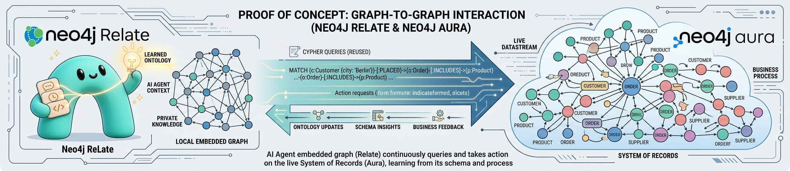
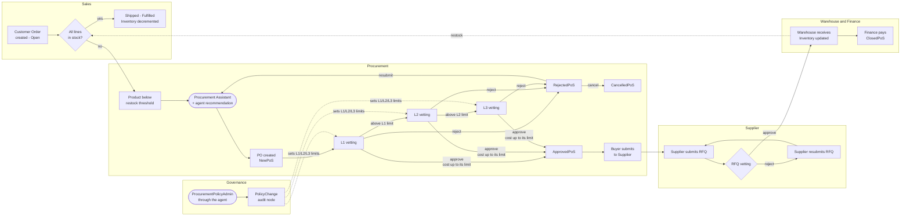
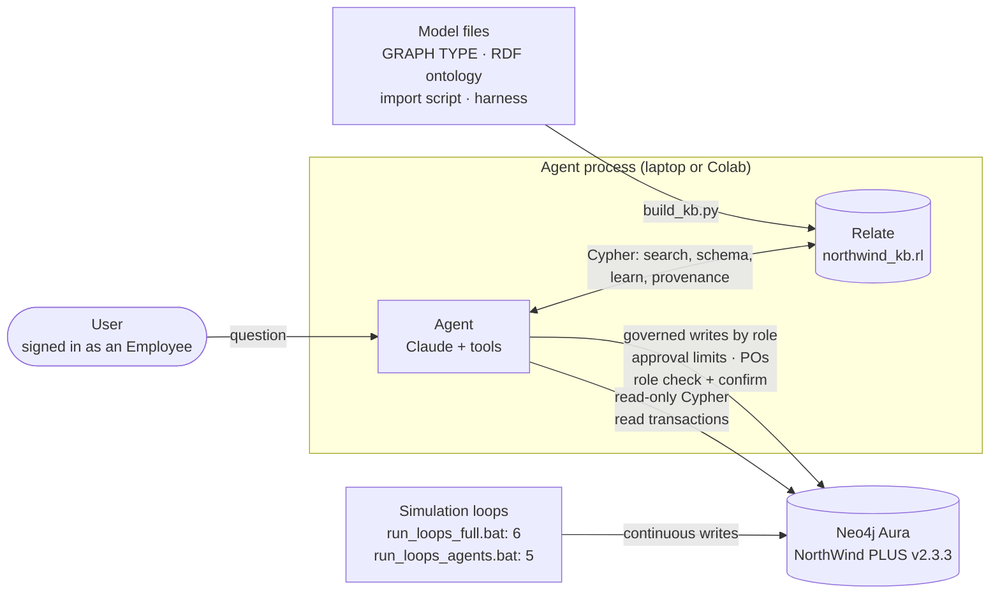

# NorthWind PLUS × Relate by Neo4j



🌐 **English** · [Português (Brasil)](Leiame%28pt-BR%29.md) · [Español](Leame%28es-ES%29.md)

**An AI agent that learns its way around a live graph database.**

[](https://colab.research.google.com/github/Flyer-Boy/NewApproach/blob/main/NorthWindPLUS/Neo4jRelate/NorthWind_PLUS_Agent_Colab.ipynb)

Part of [A New Approach to Application Development using Graphs](../../README.md) · built on the [NorthWind PLUS](../README.md) proof of concept.

A business agent answers questions about a *live* NorthWind PLUS simulation running on Neo4j Aura, takes the governed
actions the signed-in person's roles allow, and **learns**: every question is remembered, and new queries a person
approves become reusable knowledge that later questions find.

Its actions so far: a policy admin can rehearse and change the L1/L2/L3 purchase-order approval limits, and a
**Procurement Assistant now does what one of the simulation loops used to do**: the agent recommends which POs to
create or resubmit, and the person accepts, changes or cancels them, with a justification on each. It's the first step
of handing the simulation's jobs from Python loops to people working with agents, with a full audit trail. The same
PO jobs can also be done in a **small web UI** (React + TypeScript) that runs the same governed Cypher, with help from
the graph and from Claude behind the scenes (see *Web UI*).

Neo4j Aura stays the system of record. The agent's knowledge (the ontology, a library of proven Cypher, the question
history, everything it has learned) lives in **[Relate by Neo4j](https://relatedb.ai/)**, an embedded graph database
that runs inside the agent's own Python process.

> Proof of concept. Relate 1.0.1 · Neo4j Aura with GRAPH TYPE (Cypher 25) · Claude through the Anthropic SDK ·
> NorthWind PLUS model v2.3.3

---

## Why Relate

Production graphs and agents need different things. Aura holds the business: the simulation loops write orders,
purchase orders, quotes, deliveries and payments to it continuously. An agent needs a place of its own to *think*:
what the model means, which queries work, what was asked before and what answered it. It shouldn't clutter the system
of record or wait on it.

Relate fits that role well:

- **Embedded, no server.** `pip install relate-db`, then `relate.connect("kb/northwind_kb.rl")`: one file, in-process.
  The same notebook runs on a Windows laptop and on Google Colab.
- **The same Cypher on both sides.** The agent writes Cypher 25 against relate to search its knowledge, and Cypher
  against Aura to answer questions, in one language and one mental model.
- **A graph, not a vector store.** Templates are linked to the ontology concepts they touch, the workflow steps they
  belong to, and the questions they answered. Retrieval can *traverse*, not only match text.
- **Search built in.** Full-text (`SEARCH ... FULLTEXT INDEX ... SCORE AS`) and vector indexes, combined in a single
  Cypher statement, and updated as soon as the agent writes. A template saved a moment ago is searchable at once.
- **Cheap to rebuild, safe to keep.** The knowledge store is generated from the model files in seconds, and what the
  agent learned is carried over on every rebuild.

## Why it works: a graph-native system of record

Relate gives the agent a place to think, but what makes this proof of concept work is how the system of record on
Aura is modeled. NorthWind PLUS is **graph-native**: every state and every piece of business context is an explicit
relationship, not a property or a status column. The graph doesn't only hold the data; it's a **state and context
machine** that an agent can read directly.

- **State is a relationship to a Collection node.** A PO waiting for approval is linked to `NewPoS`; approval moves
  that link to `ApprovedPoS`. "What's waiting?" is a pattern match, not a filter on a status field whose values only
  the application knows.
- **Context lives on the edges.** Who approved or rejected a PO, when, why, and whether a loop or a person with the
  agent made the decision are properties of the relationship that records the decision (`HAS_L1_PO_REJECTION
  {Date, Comment, Source}`, `PO_CREATED_BY {Date, Justification, Source}`). Nothing is overwritten.
- **Rules are data.** The approval limits sit on the `RolE` nodes and are read at the moment each PO is vetted, so a
  governed change takes effect immediately and is itself recorded as a `PolicyChange`.
- **Nodes are never deleted.** History stays in the graph, so the trail behind any decision is a traversal away.

That's why each piece of the agent can stay simple. Its ontology comes straight from the GRAPH TYPE and RDF files;
its questions are pattern matches on live state; its writes are fixed Cypher that moves a relationship and records
why; a what-if pulls a subgraph that carries its own states and rules; and the audit trail exists because the model
records decisions as edges, not because the agent adds logging. With the same data in tables and status columns,
the agent would first have to rebuild that meaning from application code. Here it reads the meaning from the graph,
**live**, while the business runs.

```cypher
// Everything an agent needs to explain one PO's history: its states, decisions, who, when and why
MATCH (po:PurchaseOrder {PONumber: $po})
OPTIONAL MATCH (state)-[s]->(po) WHERE state:NewPoS OR state:ApprovedPoS OR state:RejectedPoS OR state:CancelledPoS
OPTIONAL MATCH (po)-[d]->(e:Employee)-[:HAS_PERSON]->(p:Person)
RETURN labels(state)[0] AS CurrentState,
       collect({decision: type(d), by: p.FirstName + " " + p.LastName, date: toString(d.Date),
                why: coalesce(d.Comment, d.Justification), source: d.Source}) AS Decisions
```

## The NorthWind PLUS business cycle (running on Aura)

Five simulation loops and a Procurement Assistant (with the agent) drive this cycle continuously. Each box is a state
the graph records as a relationship to a Collection node (`NewPoS`, `ApprovedPoS`, and so on), so moving a PO forward
means moving a relationship.



Open customer orders count against available stock, so a product can fall below its restock threshold before an
order fails to ship. The L1/L2/L3 limits are read from the `RolE` nodes every time a PO is vetted, which is why a
governed `PolicyChange` takes effect on the very next vetting cycle without touching the loops. Since v2.3.3 the bands
are contiguous: each level approves base < cost ≤ limit and the next level starts at that limit, so every cost up to
the L3 limit has a path.

## Architecture



1. **Build:** `kb/build_kb.py` turns the model files into a knowledge graph in relate. It reads the GRAPH TYPE
   (exact names and types), the RDF/Turtle ontology (Entity vs. Collection), curated business meanings, 64 queries
   from the import script and 19 actions from the simulation harness.
2. **Ask:** the agent rewrites the question into the model's vocabulary, searches relate, and then runs a matching
   template, adapts one, or writes new Cypher from the ontology. It runs the query on Aura and answers.
3. **Learn:** every question is stored in relate with the templates it used. A new query that worked can be saved
   as a template once the user approves it.

## What Relate does in this project

| Relate capability | How the project uses it | Where |
|---|---|---|
| Embedded store, single `.rl` file | The agent's knowledge graph lives next to the code; on Colab it's kept on Google Drive between sessions | `kb/build_kb.py`, notebooks |
| Python API (`relate.connect`, `execute`, parameters, `autocommit=False`, `commit`) | The whole build runs as one transaction; every query is parameterized | `kb/` |
| Cypher 25 (`MERGE`, `UNWIND`, `COUNT {}` subqueries, `CALL () { ... UNION ALL ... }`) | Ontology, templates, links and scoring are plain Cypher | `kb/kb_query.py` |
| Uniqueness constraints | Template, node-type and relationship-type names are keys | `build_kb.py` |
| Full-text indexes + `SEARCH ... SCORE AS` | BM25 search over templates, the ontology and past questions | `kb_query.search_templates` |
| Vector indexes (`vector(...)`, cosine) | Optional semantic search over template embeddings (voyage-4-nano) | `kb/embeddings.py` |
| Indexes updated on write | A template saved mid-conversation is found by the very next search | learning loop |
| `read_only=True` connections | Search-only tools open the store read-only | `KnowledgeBase(read_only=True)` |
| Single-writer lock | Stops two processes from writing the store at once (see *Lessons*) | notebooks close the old session first |
| Graph traversal for retrieval | Question → matched concepts → templates that `USE`/`TRAVERSE` them, scored by specificity | `kb_query.search_templates` |
| Provenance as a graph | `(:Interaction)-[:USED\|CREATED]->(:QueryTemplate)`: which question used or created which query | learning loop |
| `relate pull` (CLI, over Aura's HTTP Query API) | Copies the POs waiting for approval into a scratch store, where a proposed limit change is rehearsed with the simulation's own Cypher | `sandbox/` |
| Cheap file copies of a store | Each rehearsal run starts from a copy of the pulled store | `sandbox/whatif.py` |
| A scratch store you can write to | Plays the business forward (ships orders, decrements stock, adds new orders and deliveries) to find what would free stuck customer orders; Aura is never touched | `sandbox/unblock.py` |

## What-if sandbox: pull to experiment, governed Cypher to commit

Suggested by a Neo4j staff engineer after the first post: *pull a subgraph from Aura into the agent's context, so it
can mutate and experiment on it in isolation.* Asked *"what would happen if we raised L1 to 8000 and L2 to 20000?"*,
the agent:

1. **pulls** the POs waiting for approval, their lines and products, the approver roles and the state nodes into a
   scratch relate store, in one statement so Aura serves one consistent snapshot while the loops keep writing;
2. **replays** the simulation's own PO-vetting Cypher (imported from the harness, minus the APOC lock lines) on file
   copies of that store, with today's limits and with the proposed ones, 5 runs each;
3. **compares** approvals per level, rejections, POs left stuck and the cycles needed to clear the queue, and flags
   POs no approval rule can match (since v2.3.3's contiguous bands, only a cost of 0 or above the L3 limit);
4. records a `(:WhatIf)` node in relate next to the question. If the change is then applied, the `PolicyChange`
   justification on Aura cites the what-if, and the `WhatIf` records which `PolicyChange` applied it.

Nothing goes back with `relate push`: push never deletes on the remote, and in this model a state change deletes the
old state relationship. Changes still go through the governed action.

The copy comes from `relate pull` when the `relate` CLI is installed (`RELATE_BIN`, or on `PATH`; the Colab notebook
installs it), otherwise from a fallback copier through the Neo4j driver.

**Give it a queue to work on.** With the rates in the `run_loops_*.bat` files, PO Vetting (12 per minute) clears new POs almost as
fast as PO Creation (1 per minute) makes them, so a what-if may show little difference between the scenarios. Pause the
PO Vetting loop for 10-15 minutes (or lower its `--rate` to 2 or 3) to build a backlog; raising the Customer Order rate
also makes POs bigger, pushing more of them into the L2 and L3 bands. The simulation gives every approval level the same
speed, so higher limits show up as fewer hand-offs and fewer cycles to clear the queue, not as one level holding others up.

Details and open points:
[DESIGN_what_if_sandbox.md](DESIGN_what_if_sandbox.md).

## Procurement Assistant: the first loop handed to a person and an agent

In `agents` mode (see *Two ways to run*), the `po-creation` loop isn't started, and the `po-vetting` loop stops
resubmitting rejected POs (`--no-resubmit`). Signed in as a Procurement Assistant (`--as-employee 16 --mode agents`, or
`sign_in("16")` in a notebook with `SIMULATION_MODE = "agents"`):

1. *"What needs restocking?"* The agent runs the loop's own rule (effective stock = in stock + on active POs −
   promised to open customer orders, near the restock threshold) and lists one PO per Supplier: products, recommended
   quantities, estimated cost and **the approval level it will need**.
2. The person answers in their own words (*"create 1 as recommended, and 2 with 20 fewer units; justification:
   …"*). The agent shows the final list and asks for confirmation; nothing is written before that.
3. A governed Cypher template writes each PO in one transaction. It re-checks the role, locks the products, and
   **recomputes what's still needed**, so a line covered since the recommendation (by another assistant, say) is left
   out and reported rather than ordered twice.
4. *"Which rejected POs should I resubmit or cancel?"* Each one comes with who rejected it, at which level and why,
   and what's still needed now. The person resubmits it (a new PO pointing back with `HAS_PREVIOUS_PO`) or cancels it
   (it moves to the new `CancelledPoS` state).

Every PO records who created it, when, why and `Source: "agent"`, with the recommended quantity next to the one
ordered. So a single query shows where people overrode the agent, and why:

```cypher
MATCH (po:PurchaseOrder)-[c:PO_CREATED_BY {Source:"agent"}]->(:Employee)-[:HAS_PERSON]->(p:Person),
      (po)-[it:HAS_PO_ITEM]->(pr:Product)
WHERE it.RecommendedQt IS NULL OR it.POqt <> it.RecommendedQt
RETURN po.PONumber, p.FirstName + " " + p.LastName AS By, pr.ProductName, it.RecommendedQt, it.POqt, c.Justification
```

Guard rails, in code and in the Cypher: the role is checked again in the database; one justification per PO; one PO
per Supplier per batch, and **the agent never suggests splitting or trimming a PO to fit under a lower approval
limit** (a classic procurement control failure); quantities far from the recommendation (over 3× or under a third)
are flagged in the confirmation.

The model change was designed for the vetting agents that come next: every decision relationship (approvals,
rejections, Buyer decisions, deliveries, payments) can carry `Source: "simulation"`, `"agent"` or `"ui"` next to its existing
`Date` and `Comment`, so loops and agents can work side by side and still be told apart. See
[DESIGN_procurement_agent.md](DESIGN_procurement_agent.md).

## Web UI: the third front end

The same PO jobs, a third way: a small React + TypeScript app over a Python API (`api/main.py`) that calls
`agent/procurement.py`, the code the agent uses. So the script (the loops), the agent and the UI all reach the graph
through the same governed Cypher. Only the interface differs, and the audit trail tells them apart: every PO written in
the UI records `Source: "ui"`.

- **Restock:** one card per Supplier with the graph's recommendation, editable quantities, the estimated cost and the
  approval level the PO will need (recomputed by the API as you type), and a required justification. Cards start left
  out: *Include* the POs to create now, and the *Review* button stays pinned to the bottom of the window.
- **Rejected POs:** who raised each one, who rejected it, at which level and why, and what's still needed now;
  resubmit or cancel. It's the procurement team's shared queue: any Procurement Assistant can resubmit or cancel a
  rejected PO, including one raised by someone else, and the audit trail records who raised it and who decided.
- **Audit:** POs created, resubmitted and cancelled by the simulation, the agent and the UI, with each person's
  justification and changes to the recommendation.
- **Review, then confirm:** each write is two calls: *prepare* (the agent's checks and a preview; nothing is written)
  and *commit*. A commit checks that the review is the one shown, that it's less than 15 minutes old, and that the PO
  Creation loop is still off. After each write, every screen reloads from the graph.

There's no chat. Two kinds of help work behind the scenes, both advisory:

- **Demand suggestions (Cypher, no AI).** A new read template, *Recent demand for products*, measures what customers
  ordered over the last 7 days and how many days a planned quantity covers. When that's under 7, the UI suggests the
  quantity that would cover them, and the approval level the PO would then need (`DEMAND_WINDOW_DAYS` and
  `DEMAND_COVER_DAYS` in `.env`). The agent can use the same template.
- **Justification drafts (Claude).** A *Suggest* button asks Claude for a draft built only from facts the server
  gathers from the graph (stock, open orders, demand, the rejecter's comment). The person edits it, and **only the
  submitted text is recorded**. Drafts use the agent's model (`DRAFT_MODEL` in `.env` to change it); without
  `ANTHROPIC_API_KEY`, the button isn't shown.

The browser never sees the Aura credentials or picks its own identity: the API holds both. Sign-in is a picker of
Procurement Assistants, standing in for a login, like `--as-employee`. The API doesn't open the knowledge store (relate
allows no other connection while the agent has it open), so it reads its templates straight from the import script,
with the same parser `build_kb.py` uses. Details: [DESIGN_procurement_ui.md](DESIGN_procurement_ui.md).

## Stuck customer orders: Relate plays the business forward

The warehouse loop ships the oldest order whose every line is in stock. A large order needs all its products in stock
at the same moment, so each delivery that would cover part of it is used up first by smaller orders that are complete:
large orders can wait indefinitely (starvation), and those are often the most valuable customers. The restock rule
doesn't fix it, because it looks at totals.

The web UI's **Stuck orders** tab lists open orders waiting more than 3× the usual time to ship (measured from the
last 3 days), flags those past their required date, and has a button: *Find what would free them*. Only the
simulation's own orders count (IDs starting with `CO-`, set by `ORDER_ID_PREFIX`): after a fresh load the loop also
ships the imported historical orders, placed decades ago, which would push the median time to ship to decades.

The obvious answer, "order what's missing today", is wrong: the orders ahead in the queue and the new ones still coming
in use up stock before an extra delivery lands. Finding the real quantity means replaying fulfillment forward, which
writes constantly (ships orders, decrements stock, adds arrivals and deliveries). So the API copies the relevant part
of the graph (open orders, stock, incoming POs, suppliers) into a **scratch Relate store** and plays it forward:

- the **simulation's own fulfillment Cypher** runs on the copy, unchanged apart from the APOC locks;
- new orders arrive at the measured pace, shaped like recent orders; POs land after the measured lead time;
- a stuck order is older than the small orders that keep overtaking it, so it ships before them as soon as all its
  lines are in stock. Only older orders can get in first: imported historical orders still open, which ship first if
  the delivery completes them and take their share. The extra is what lifts the stock left at delivery time above the
  stuck orders' quantities plus what those older orders take. One replay finds the stock and the queue at that moment,
  a second confirms the orders ship (in at least 4 of 5 runs);
- the same replay tests the naive quantity and, as an alternative, a rule that reserves stock for the stuck orders;
- the projection rests on the recent past, so on a young database (little history, no PO delivered yet) the screen
  says so and the quantities are probably low; `UNBLOCK_SAFETY_PERCENT` adds an optional margin on top.

The result is a priority PO per Supplier, with the evidence on screen: in stock now, expected when the PO lands,
missing today vs simulated, and what customers ordered in the last 3 days (more than that is flagged as deliberate
overstock). The justification starts with a `PRIORITY:` line naming the orders, so the approvers see it, and a new
governed template writes the PO: instead of the restock rule, it checks that each product is on a stuck order that is
still open and still stuck.

Aura stays the system of record; Relate is where the business is played forward. Nothing is written to Aura until a
person confirms. On the toy graph, where an imported order still open needs 35 Chai, the simulation asks for 61 extra
Chai where "what's missing today" says 11; the simulated quantity frees the stuck order in 4 of 5 runs, the naive one
in 0, and reserving stock frees nothing (nothing is coming for one of its products) while delaying 7 other orders.
Details:
[DESIGN_stuck_orders.md](DESIGN_stuck_orders.md).

## The knowledge graph

```
(:NodeType {name, category: Entity|Collection, description})-[:HAS_PROPERTY]->(:Property {name, type, notNull, isKey})
(:NodeType)-[:SOURCE_OF]->(:RelType {name, pattern, description})-[:TARGETS]->(:NodeType)
(:WorkflowStep {name, description})-[:INVOLVES]->(:RelType)

(:QueryTemplate {title, description, cypher, params, governance, source, status, useCount, embedding?})
    -[:USES]->(:NodeType)
    -[:TRAVERSES]->(:RelType)
    -[:PART_OF {via: keyword|relationship}]->(:WorkflowStep)

(:Interaction {question, answer, employeeId, model, modelCalls, inputTokens, outputTokens, newQueries})
    -[:USED]->(:QueryTemplate)
    -[:CREATED]->(:QueryTemplate)

(:ModelPrinciple {text})   (:KnowledgeBase {ontologyVersion, embeddingModel, embeddingDims})
```

Seeded from model v2.3.3: **48 node types, 89 relationship types, 175 properties, 13 workflow steps, 83 templates**.
The templates are 58 read queries, 5 governed actions (the approval-limit change; creating, resubmitting and
cancelling POs; and priority POs for stuck customer orders), 1 admin-only write and 19 simulation actions.

| Template governance | Meaning |
|---|---|
| `read` | The agent may run it, always in a read transaction |
| `governed` | The approval-limit change and the PO commands: role checked in the database, user confirms, audit trail written |
| `admin` | Maintenance writes (e.g. the restock "cheat"); never offered to the agent |
| `simulation` | The loops' own actions; background knowledge only |

Business meanings live in `kb/semantics.json`, written from the import script's comments (for example *"SupplierNewPoS
answers the Supplier's question 'Do I have any new POs?'"*). Editing that file is how you teach the agent more about
the business.

## How the agent answers

```
question
  └─ rewrite into the model's vocabulary ("quotes rejected" -> "Supplier RFQ rejection rate")
      └─ search_templates (required before any query)
          ├─ a template fits      -> run it (or adapt it) on Aura
          └─ nothing fits         -> get_schema -> write new Cypher -> run it on Aura
                                      └─ worked and reusable? -> save_template (user approves)
  └─ answer in business language, say it's a live snapshot, name the template or "new query"
```

| Tool | What it does | Guard rails |
|---|---|---|
| `search_templates` | Hybrid search in relate | — |
| `get_schema` | Exact properties and relationship patterns for given node types | — |
| `run_read_query` | Runs Cypher on Aura; returns rows and any Neo4j warnings | refused until a search ran for the question · write keywords rejected · read transaction · 20 s timeout · 500-row cap (50 to the model) |
| `save_template` | Saves a new query as a template | read queries only · must have run successfully this question · user approval · one per question |
| `preview_approval_bands` | How proposed limits would route the POs waiting for approval | read-only template |
| `what_if_approval_bands` | Rehearses proposed limits on a pulled copy of the queue (see *What-if sandbox*) | never writes to Aura · scratch stores deleted afterwards · recorded as a `WhatIf` node |
| `change_approval_bands` | Changes the L1/L2/L3 limits together, with no gaps | ProcurementPolicyAdmin only · user confirmation · the Cypher re-checks role and limits · `PolicyChange` audit node |
| `recommend_restock`, `recommend_resubmissions` | What needs a new PO, and what to do with rejected POs (see *Procurement Assistant*) | Procurement Assistant only · read-only templates |
| `create_purchase_orders`, `resubmit_purchase_orders`, `cancel_rejected_purchase_orders` | Write the POs the person accepted | Procurement Assistant only · a recommendation first · one justification per PO · one PO per Supplier per batch · user confirmation · the Cypher re-checks role and need · `Source`, `Justification`, `RecommendedQt` recorded |

The full ontology (~17,000 characters) sits in the system prompt with prompt caching, so it's paid for once per
session. Neo4j warnings (for example *"property `Date` does not exist"*) go back to the model so it can fix its own
Cypher, and counts and totals must come from Cypher rather than the model's arithmetic.

### Governance: who decides what

- **Identity comes from the session, never from the model.** `--as-employee 25` (or `EMPLOYEE_ID` in the notebooks)
  stands in for a login. The agent checks that person's roles in Aura.
- **Tools are offered by role.** A Procurement Assistant gets the PO tools; only a ProcurementPolicyAdmin gets the
  approval-limit change; everyone can ask questions and run what-ifs. A tool that isn't offered is refused even if
  called, and every governed template checks the role again inside the database transaction.
- **Writes are fixed templates, not model-written Cypher.** The approval-limit change is a tested Cypher statement
  that checks the `ProcurementPolicyAdmin` role *inside the database transaction*, rejects limits that would leave a
  gap between levels (a gap strands POs forever), and records a `PolicyChange` node with before/after values and the
  justification.
- **A person confirms every write**: approval-limit changes, POs and saved templates alike.

## The learning loop

1. Every question becomes an `Interaction` in relate, linked to the templates it `USED`, and each template's
   `useCount` goes up.
2. When no template fits, the agent writes Cypher from the ontology. If the query worked and others are likely to ask
   the same thing, the agent offers to save it, generalized with `$parameters`. **The user approves or declines.**
3. A saved template is linked to the ontology concepts and workflow steps it touches, embedded (if embeddings are on),
   and tied to the `Interaction` that `CREATED` it.
4. Later questions find it **two ways**: through the template itself, and through the past question it answered
   (*"questions like this were answered by…"*).
5. **Rebuilds keep it.** `build_kb.py` exports learned templates and the history, rebuilds from the model files, and
   re-links everything to the current ontology. A learned template that names something the model no longer declares
   is kept, marked `needs-review`, and hidden from search.

To look at it, use the notebook's *What the agent learned* section, run `python kb/kb_query.py learned`, or query
relate directly:

```cypher
MATCH (i:Interaction)-[:CREATED]->(q:QueryTemplate {source:'agent'})
RETURN q.title, q.createdBy, i.question, q.useCount ORDER BY q.useCount DESC
```

## Retrieval

Four ranked lists, blended on normalized scores, all computed in relate:

| Path | How | Weight |
|---|---|---|
| Template text | Full-text (BM25) over title, description, name | 1.0 |
| Meaning | Vector search over template embeddings (only if built with embeddings) | 0.8 |
| Past questions | Full-text over `Interaction.question` → the templates those questions used or created | 0.6 |
| Concepts | Full-text over the ontology, then traversal to templates that use those concepts, scored by specificity | 0.35 |

**Measured baseline, without embeddings:** the expected template is in the top 3 for **9 of 12** test business
questions (`kb/eval_search.py`). The three misses are vocabulary gaps: "quotes" vs. "RFQ", "negative" vs. "below
zero", "approve" vs. "approval". Rewritten into the model's terms, the same questions hit #1, which is why the agent
rewrites before it searches.

**Embeddings (optional).** `voyage-4-nano` is Voyage AI's open-weight model (Apache-2.0, ~346M parameters), run
locally through sentence-transformers. It needs no API key, but the first run downloads ~700 MB. `voyage-api` uses
the hosted API instead. Anthropic doesn't offer an embedding model. The effect on the 12 questions hasn't been
measured yet. To measure it, run `python kb/eval_search.py --compare voyage-4-nano`, which takes several minutes on a
CPU and is much faster on a GPU.

## What the live runs taught us

A proof of concept is worth its surprises. These came from running against the live simulation:

- **The agent found a real bug in the simulation.** Asked how many POs were waiting for approval, it reported one
  PO worth 0.00 and flagged it as odd. The cause was the `po_resubmit` action. When effective stock sat exactly at its
  eligibility limit, the quantity formula (with integer division in `StockThreshold / 2`) produced a line of **0
  units**. A 0-cost PO matches no vetting action, not even rejection, so it would have sat in the queue forever. Both
  PO-creating actions now skip non-positive lines. The loops had run for a long time without surfacing this.
- **A rule in the prompt isn't a guarantee.** The model once skipped the template search and claimed "no template
  fit". Searching first is now enforced in code: `run_read_query` refuses until a search has run.
- **Counts belong in the database.** The model once summarized 28 rows as 29 by adding up groups itself. Totals now
  have to come from Cypher.
- **Relate allows one writing connection per store, even inside one process.** Re-running a notebook's sign-in cell
  hit `storage locked` until the cell learned to close the previous session first. Don't run the terminal agent and a
  notebook on the same store at once.
- **Environment details matter.** The Neo4j Python driver rejects `Query(..., timeout=...)` objects inside managed
  transactions, so timeouts go through `@unit_of_work`. Anaconda's older `brotli` broke the Anthropic SDK's HTTP
  client, so `brotli>=1.2.0` is pinned. Newer Aura instances may use the instance ID as both user and database name.
- **Read your own writes.** After a PO was created or a rejected PO resubmitted, the web UI sometimes showed it as
  still to do for a while. The next read went to a database member that hadn't applied the write yet. All Aura
  sessions now share one bookmark manager, so a read waits for the writes made before it; and the screens reset on
  every reload, even when the data comes back unchanged. And after a write the screens hide what was just submitted at once and
  show "Reloading from the graph…" (demand for all cards now comes in one query, not one per card).
- **Aura can briefly have no server for reads.** On the first live run of the web UI, its API and four of the loops
  failed to connect with `ReadServiceUnavailable` while one loop already connected kept working; a clean restart
  fixed it. The agent and the API now retry the connection a few times, in the database `.env` names, before giving
  up with a message that says what to check.

## Two ways to run

Same model (v2.3.3), same agent, same notebook. Pick how much of the business the simulation runs:

| | **Full simulation** | **Agents** |
|---|---|---|
| Loops | all six: `run_loops_full.bat` | five: `run_loops_agents.bat` (no PO Creation; PO Vetting with `--no-resubmit`) |
| `SIMULATION_MODE` | `full` (the default) | `agents` |
| Who creates and resubmits POs | the loops | a Procurement Assistant with the agent, with a justification on each |
| What the agent does | answers questions, runs what-ifs, changes the approval limits (policy admin) | all of that, plus recommends, creates, resubmits and cancels POs (Procurement Assistant) |
| Good for | watching an agent work next to a busy, fully simulated business | the start of handing the simulation's jobs to people working with agents |
| Web UI (`run_ui.bat`) | signs in and explains why it can't write | the same PO jobs as the agent, with forms |

Set the mode in `.env` (`SIMULATION_MODE=full` or `agents`), with `--mode` on the terminal agent, or in the notebook's
sign-in cell. The mode must match the loops you started. In `full` mode a Procurement Assistant gets no PO tools, so the
agent never competes with the loops. In `agents` mode, if the PO Creation loop is still writing (a simulated PO in the
last 3 minutes), the agent shows recommendations but refuses to create POs until it stops. Switching modes needs no
model change, only a different `.bat` file and setting.

The code as the first article described it (model v2.3.2, before the agents mode) is kept as the git tag
`v2.3.2-agent`, for reference. To run that experience today, use `full` mode: it's the same agent on the newer model.

## Quick start

### 0. Load the model into Neo4j Aura (Aura Query console)

1. `model/NorthWind_PLUS_Graph_Data_Model_Import_v2.3.3.cypher`, **lines 109–1186**. This wipes the database and
   builds NorthWind PLUS v2.3.3. Optional: the Recommendation Engine, lines 1286–1349. To keep an existing v2.3.2
   database instead, stop the loops and run `model/NorthWind_PLUS_v2.3.3_Upgrade_from_v2.3.2.cypher`, which lists
   its steps (from v2.3.1, run the v2.3.2 upgrade first).
   The import rebuilds the classic Northwind database as a graph-native application and extends it into a complete,
   360-degree business cycle: customer orders, low-stock detection, purchase orders with three levels of approval,
   supplier RFQs, warehouse receiving, finance closure and order fulfillment. All of it runs natively on the graph from
   here on: no data ingestion, no ETL or data pipelines.
2. `model/NorthwindPlusGraphType_v2.3.3.cypher` (the GRAPH TYPE schema). This adds a governance layer to the model:
   the database itself enforces the ontology.
3. Start the loops in one of the two modes (see *Two ways to run* below), and set `SIMULATION_MODE` in `.env` to
   match. On Windows, `run_loops_full.bat` opens all six loops and `run_loops_agents.bat` five; both read credentials
   from `.env` and use rates that let vetting and fulfillment keep up with new orders. Run it from this folder, with `.env` filled in. Elsewhere, run `python model/NorthwindPlus_Stress_Test.py --loop <name> --rate <per minute>`, once per loop.

### 1a. Google Colab

Click **Open in Colab** above, or open `NorthWind_PLUS_Agent_Colab.ipynb` in Colab yourself. Add the Colab Secrets it
lists (🔑 sidebar, with *Notebook access* on): `ANTHROPIC_API_KEY`, `NEO4J_URI`, `NEO4J_PASSWORD`, plus `NEO4J_USER` or
`NEO4J_USERNAME`, and `NEO4J_DATABASE`. Then choose *Run all*. The notebook clones this repository (about 14 MB) and
uses this folder; to run your own copy, set `REPO_URL` to your fork, or to `""` to upload a zip instead. The knowledge
store is kept on Google Drive between sessions.

### 1b. Local (terminal or Jupyter)

```
cp .env.example .env                      # fill in ANTHROPIC_API_KEY and the NEO4J_* values
pip install -r requirements.txt           # + requirements-embeddings.txt for voyage-4-nano
python kb/build_kb.py                     # add --embeddings voyage-4-nano for semantic search
python agent/agent.py --as-employee 25    # Olivia Bennett, ProcurementPolicyAdmin: can change the limits
python agent/agent.py --as-employee 12    # Gloria Gaynor, Level1Approver: can ask, can't change them
python agent/agent.py --as-employee 16 --mode agents   # Albert Camus, Procurement Assistant: creates, resubmits and cancels POs
```

Or open `NorthWind_PLUS_Agent.ipynb` from the project folder (Jupyter, e.g. from Anaconda). It shares its question,
governance and learning cells with the Colab notebook (both are generated by `tools/make_notebooks.py`) and has been run
end to end offline, but **not yet against a live database; Colab is the tested path.** If it fails, first check that the
notebook's kernel is the Python environment where you ran `pip install -r requirements.txt`.

The Anthropic API is billed through a Claude Console
account; it isn't included in a Claude Pro chat subscription.

### 1c. Web UI (Windows: `run_ui.bat`)

Agents mode only (`SIMULATION_MODE=agents`, loops started with `run_loops_agents.bat`). Building the UI needs Node.js
20.19+ or 22.12+, once:

```
pip install -r requirements.txt -r requirements-ui.txt
cd ui && npm install && npm run build && cd ..
uvicorn api.main:app --port 8000          # or run_ui.bat on Windows; then open http://localhost:8000
```

To try it without Aura or an API key, `python tests/serve_toy_ui.py` runs the API on a small toy graph, with canned
drafts. Run live against Aura in Chrome and Edge.

If it doesn't start, these came up on the first live run:

- **`pip` isn't recognized:** run pip through the Python that `run_ui.bat` uses: `"%PYTHON%" -m pip install ...`
  (the `PYTHON` path from `.env`), or use an Anaconda Prompt.
- **`.env not found`:** `.env` is git-ignored, so every clone needs its own copy. If Explorer shows it but
  `dir /a .env*` doesn't, rename or copy it from the command line (OneDrive can hide it).
- **The build fails with `styleText` or `EBADENGINE`:** Node.js is older than 20.19. Install the current LTS, open a new
  window, delete `ui\node_modules`, and run `npm install` and `npm run build` again.
- **The page looks like an older version:** rebuild, restart `run_ui.bat` and press Ctrl+F5.
- **Avoid OneDrive folders** for this project: OneDrive syncing `ui\node_modules` and the relate store causes locked
  files.

### Things to ask

- *Which suppliers get their quotes rejected most often?* Tests the rewording step and template reuse.
- *How many POs are waiting for approval?* No template exists, so the agent writes new Cypher and offers to save it.
- *What is the number and value of purchase orders still waiting to be vetted?* Should find the template you just saved.
- *What would happen to the approval queue if we raised L1 to 8000 and L2 to 20000?* A what-if on a pulled copy.
- *Raise L1 to 8000 and L2 to 20000 to speed up vetting.* Preview, confirmation, `PolicyChange` audit.
- *Who changed the approval limits, when and why?* Reads the audit trail back.
- *What were total revenue and gross profit in the last hour?* Or the last 15 minutes: you're querying a live graph,
  not a static one.
- *Which available products urgently need restocking to fulfill customer orders?*
- *Who are our top 10 customers by revenue, and by product quantity?*
- *Who does the most PO vetting?*
- *Where is the PO vetting friction concentrated?*
- *Which supplier has the most rejected RFQs?* Close to the first question in different words, a good test of
  template reuse.
- *Which available products are ordered least?*
- *Who is our best salesperson?*
- *Which is our best sales region?*
- *Which employee gives our customers the biggest discounts?*
- *Which fulfillment clerk received the most supplier deliveries (POs)?* You can also ask about customer orders.

As a Procurement Assistant (EmployeeID 16, 17 or 18), in `agents` mode:

- *What needs restocking?* Then accept some, change a quantity, and give a justification per PO.
- *Which rejected POs should I resubmit or cancel?*
- *Show the POs created, resubmitted or cancelled through the agent, and where the recommendation was changed.*
- *Split the Exotic Liquids PO in two so each half goes to L1.* The agent should decline.

## Project layout

```
model/                       NorthWind PLUS v2.3.3
  NorthWind_PLUS_Graph_Data_Model_Import_v2.3.3.cypher   import script + query examples + governed commands
  NorthwindPlusGraphType_v2.3.3.cypher                   GRAPH TYPE schema
  NorthwindPlusGraph_RDF-turtle_v2.3.3.ttl               RDF/OWL ontology
  NorthWind_PLUS_v2.3.3_Upgrade_from_v2.3.2.cypher       in-place upgrade from v2.3.2
  NorthWind_PLUS_v2.3.2_Upgrade_from_v2.3.1.cypher       in-place upgrade from v2.3.1
  NorthwindPlus_Stress_Test.py                           the simulation loops (po-creation kept, not started)
kb/                          the knowledge store (Relate)
  semantics.json             curated business meanings -- edit to teach the agent
  build_kb.py                builds northwind_kb.rl; keeps learned knowledge on rebuild
  kb_query.py                hybrid search, schema context, learning-loop writes
  kb_write.py                shared template writing (seed and learned templates get the same shape)
  model_templates.py         the templates read straight from the model files (for the web UI's API)
  embeddings.py              none | voyage-4-nano (local) | voyage-api | hash (tests)
  eval_search.py             retrieval check; --compare <provider> for with/without embeddings
sandbox/                     what-if rehearsals on a pulled copy
  pull.py                    relate pull (CLI), or the fallback copier through the Neo4j driver
  whatif.py                  replays the harness's PO-vetting Cypher with current vs proposed limits
  unblock.py                 plays fulfillment forward to find what would free stuck customer orders
agent/
  agent.py                   the agent (Anthropic SDK tool use)
  aura.py                    Neo4j side: read transactions with warnings, identity, governed write
  procurement.py             Procurement Assistant tools: recommendations, create / resubmit / cancel POs (prepare/commit)
api/
  main.py                    the web UI's API (FastAPI): sessions, prepare/commit, demand, AI drafts; serves ui/dist
ui/                          the web UI: Vite + React + TypeScript + Chakra UI (npm run build -> ui/dist)
tests/                       offline tests (no API, no Aura); serve_toy_ui.py runs the web UI on a toy graph
NorthWind_PLUS_Agent.ipynb         local Jupyter front end
NorthWind_PLUS_Agent_Colab.ipynb   Google Colab front end
run_loops_full.bat                 Windows: full mode, all six simulation loops (credentials read from .env)
run_loops_agents.bat               Windows: agents mode, five loops; PO creation and resubmission by the agent
run_ui.bat                         Windows: the web UI at http://localhost:8000 (credentials read from .env)
DESIGN_what_if_sandbox.md          the what-if sandbox (relate pull)
DESIGN_procurement_agent.md        the Procurement Assistant agent and model v2.3.3
DESIGN_procurement_ui.md           the web UI, its API and the help behind the scenes
DESIGN_stuck_orders.md             unblocking stuck customer orders: the play-forward simulation in Relate
tools/make_notebooks.py            generates both notebooks
```

## Testing

```
python tests/test_agent_offline.py     # 27 checks
python tests/test_aura_driver_path.py  # 8 checks
python tests/test_whatif_offline.py    # 22 checks; 25 with RELATE_BIN set to a relate CLI
python tests/test_procurement_offline.py  # 61 checks
python tests/test_procurement_api.py   # 52 checks: the web UI's API
python tests/test_unblock_offline.py   # 34 checks: stuck customer orders
python kb/eval_search.py               # retrieval: 9/12 without embeddings
```

The offline tests use relate twice: as the agent's knowledge store, and as a stand-in for Aura holding a tiny
NorthWind PLUS graph, which works because both speak Cypher. A scripted client stands in for Claude, issuing real
tool calls and reading real results. The tests cover search-first enforcement, write rejection, role checks,
confirmations, the approval-limit change and its audit node, saving and re-finding a learned template, learning that
survives a rebuild, `needs-review` flagging, vector search, and the Procurement Assistant: tools by role, the
recommendations against the loop's formulas, every guard rail, the audit properties, a concurrent PO covering a line,
resubmit and cancel, and the harness's `--no-resubmit`, contiguous bands and `Source`. The driver test runs the real `aura.py` against a
stand-in that enforces the Neo4j driver's transaction rules. The web-UI tests cover prepare/commit and `Source: "ui"`,
the demand template and its suggestions, the rebuild when model files change, and the API itself: sign-in, role and
mode checks, stale or reused reviews, the loop guard at commit, and drafts built only from the graph's facts.

## Relate notes and limits we hit

- One writing process per store, and one writing connection per process, as we found. While a process has a store
  open for writing, no other process can open it at all, not even read-only (`storage locked`). So the web UI's API
  reads its templates from the model files instead.
- No APOC, so the simulation's `apoc.lock.nodes` calls run only on Aura; templates are stored in relate but executed
  only on Aura.
- Full-text search matched whole words only ("rejected" didn't match "Rejection"). We didn't find a stemming
  analyzer, so embeddings or query rewriting cover that.
- `pip install relate-db` installs the Python library; the `relate` command-line tool (`pull`, `push`, `serve`) is a
  separate install (`install.sh` / `install.ps1` from relatedb.ai). The Python API has no `pull`.
- The relate installer fetches the latest CLI (1.0.2 today) while PyPI has `relate-db` 1.0.1: a store written by the
  1.0.2 CLI opened fine in the 1.0.1 library in our tests.
- `relate pull` talks to Aura over the HTTP Query API, refuses a non-empty destination (a re-pull is never a merge),
  and `relate push` never deletes on the remote. So a fresh scratch store per experiment, and governed Cypher, not
  `push`, for changes that move state relationships.
- `datetime()` comes back as a relate `Temporal` object in Python.

## Status and parking lot

| Stage | What | State |
|---|---|---|
| 1 | Model v2.3.2: ProcurementPolicyAdmin role, PolicyChange audit node, governed approval-limit change, query fixes | Applied to Aura |
| 2 | Knowledge store + template search | Run live |
| 3 | Agent with read queries and the governed change | Run live (terminal and Colab) |
| 4 | Learning loop, provenance, warnings to the model, search-first enforcement, embeddings | Tested offline; in live testing |
| 5 | What-if sandbox with `relate pull` (suggested by a Neo4j staff engineer) | Run live (Colab) |
| 6 | Model v2.3.3 + Procurement Assistant agent: PO creation and resubmission handed from the loops to a person with the agent; two run modes (full, agents) | Run live (Colab, agents mode): 27 POs created with changes, vetted by the loop; 16 rejected POs resubmitted or cancelled |
| 7 | Web UI: the same PO jobs with forms, demand suggestions and AI justification drafts; `Source: "ui"` | Run live against Aura (Chrome and Edge): POs created with AI-drafted justifications, rejected POs reviewed |
| 8 | Stuck customer orders: play-forward simulation in a scratch Relate store, priority POs, the reservation comparison | Tested offline and on a toy graph; not yet run against Aura |

**Parking lot**
- Copy saved templates (and possibly the question history) into the Aura graph, so they can be queried next to the
  business data: write-on-approve from the agent, or `relate push`. Open decisions: model version, and scope.
- A governed action to reject stuck zero-quantity POs (roles to decide).
- Measure voyage-4-nano against the 9/12 baseline.

## Changelog

- **Stage 8 / stuck customer orders:** read templates *Stuck customer orders* and *Fulfillment pace*; the governed
  *Create a Purchase Order for stuck customer orders* (a `PRIORITY:` justification, each product on a stuck order);
  `sandbox/unblock.py` (copy, play forward with the harness's fulfillment Cypher, find and verify the extra, test the
  naive quantity and stock reservation); `sandbox/pull.py` takes any pull query; `stuck_orders`, `recommend_unblock`,
  `prepare_unblock` and `commit_unblock` in `agent/procurement.py`; API endpoints and the *Stuck orders* tab;
  `tests/toy_stuck.py` and `tests/test_unblock_offline.py`. After the first live run: only `CO-` orders count as stuck
  and for the median time to ship (`ORDER_ID_PREFIX`), and the search counts what older orders take first.

- **Stage 7 / web UI:** `agent/procurement.py` split into prepare/commit, with the role and mode check in every entry
  point; `$source` on the governed PO commands (`"agent"` or `"ui"`; any other value writes nothing); new read
  templates *Recent demand for products* and *PO activity by front end*; the knowledge store records a hash of the
  model files and rebuilds when they change, with the model version unchanged; `kb/model_templates.py`; the FastAPI
  layer (`api/`), the React app (`ui/`), `run_ui.bat` and `tests/serve_toy_ui.py`. After the first live run: who
  raised each rejected PO (`RaisedBy` in the resubmission recommendation, so the agent sees it too) and a note on the
  shared queue; cards start left out, with the Review button pinned to the bottom; every screen reloads after a write;
  AI-draft errors shown on screen, drafts on the agent's model; the page is never served from a stale cache; the Aura
  connection is retried; the Northwind logo.

- **Stage 6 / model v2.3.3:** Procurement Assistant agent (`agent/procurement.py`): restock and resubmission
  recommendations, governed create / resubmit / cancel commands, tools offered by role. Model: `Date`,
  `Justification`, `Source` on `PO_CREATED_BY`; `RecommendedQt` on `HAS_PO_ITEM`; `Date`, `Source` on
  `HAS_PREVIOUS_PO`; `Source` on every decision relationship; new `CancelledPoS` state and `PO_CANCELLED_BY`;
  contiguous approval bands. Harness: `Source:"simulation"`, contiguous bands, `--no-resubmit`. Two ways to run:
  `run_loops_full.bat` (six loops, `SIMULATION_MODE=full`, the default) or `run_loops_agents.bat` (five loops,
  `SIMULATION_MODE=agents`); in agents mode the PO tools refuse to write while the PO Creation loop is still on. Notebooks: a Procurement section, `sign_in()`, and a rebuild when the model version changes.

- **Stage 5:** what-if sandbox (`sandbox/`): `relate pull` or a fallback copier, replay of the harness's PO-vetting
  Cypher with current vs proposed limits (5 runs each, resubmissions not replayed), boundary-PO check,
  `what_if_approval_bands` tool, `(:Interaction)-[:RAN]->(:WhatIf)` provenance kept on rebuild, `PolicyChange`
  justification cites the what-if. Colab installs the relate CLI; both notebooks get a What-if section.

- **Stage 4:** learning loop (`save_template` with approval, `Interaction` provenance, `useCount`, learning survives
  rebuilds, `needs-review` flagging); past questions as a retrieval path; optional embeddings with a vector index;
  Neo4j warnings returned to the model; search-first enforced in code; counts from Cypher; workflow tags from keywords
  *and* relationships; notebooks close the previous session before signing in; Colab keeps the store on Drive;
  `run_loops.bat`.
- **Harness fix:** `po_resubmit` and `po_creation` skip PO lines of 0 units or fewer, and skip empty POs;
  `po_resubmit`'s eligibility applies the same rule. Found by the agent on its first live run.
- **Agent:** query timeout through `@unit_of_work`; sign-in errors reported instead of hidden; token usage summed
  over every model call.
- **requirements.txt:** `brotli>=1.2.0`.
- **Model v2.3.2:** `ProcurementPolicyAdmin` role and employee 25; `PolicyChange` node with `REQUESTED_BY` and
  `CHANGED_ROLE`; governed approval-limit change with preview and history queries; fixes to the "last 1 hour" profit
  query and the "fulfillable open orders" query; approval-band contiguity check.

## Links

- Relate by Neo4j: [relatedb.ai](https://relatedb.ai/) · [github.com/relatedb/relate](https://github.com/relatedb/relate)
- Announcement: [Meet Relate by Neo4j: An Embedded Database for AI Agents](https://neo4j.com/blog/news/meet-relate-by-neo4j-an-embedded-database-for-ai-agents/)
- Voyage AI open-weight embeddings: [voyageai/voyage-4-nano](https://huggingface.co/voyageai/voyage-4-nano)
