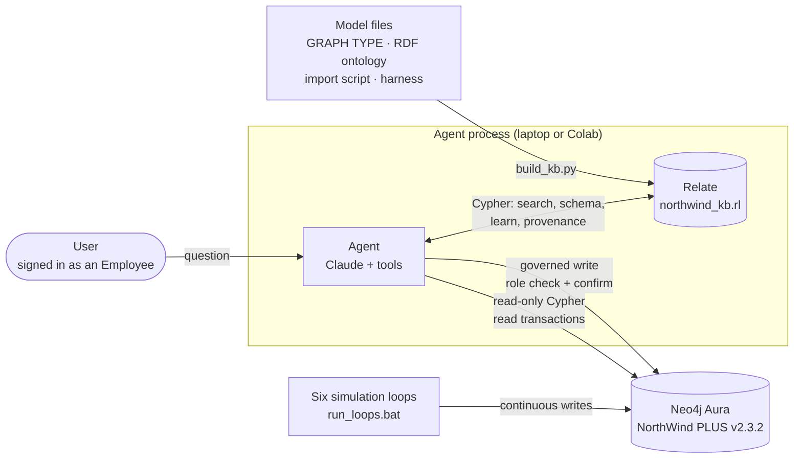

# NorthWind PLUS × Relate by Neo4j

**An AI agent that learns its way around a live graph database.**

[](https://colab.research.google.com/github/Flyer-Boy/NewApproach/blob/main/NorthWindPLUS/Neo4jRelate/NorthWind_PLUS_Agent_Colab.ipynb)

Part of [A New Approach to Application Development using Graphs](../../README.md) · built on the [NorthWind PLUS](../README.md) proof of concept.

A business agent answers questions about a *live* NorthWind PLUS simulation running on Neo4j Aura. It makes one
governed change while the simulation runs (the L1/L2/L3 purchase-order approval limits), and it **learns**: every
question is remembered, and new queries a person approves become reusable knowledge that later questions find.

Neo4j Aura stays the system of record. The agent's knowledge (the ontology, a library of proven Cypher, the question
history, everything it has learned) lives in **[Relate by Neo4j](https://relatedb.ai/)**, an embedded graph database
that runs inside the agent's own Python process.

> Proof of concept. Relate 1.0.1 · Neo4j Aura with GRAPH TYPE (Cypher 25) · Claude through the Anthropic SDK ·
> NorthWind PLUS model v2.3.2

---

## Why Relate

Production graphs and agents need different things. Aura holds the business: six simulation loops write orders,
purchase orders, quotes, deliveries and payments to it continuously. An agent needs a place of its own to *think*:
what the model means, which queries work, what was asked before and what answered it. It shouldn't clutter the system
of record or wait on it.

Relate fits that role well:

- **Embedded, no server.** `pip install relate-db`, then `relate.connect("kb/northwind_kb.rl")`: one file, in-process.
  The same notebook runs on a Windows laptop and on Google Colab.
- **The same Cypher on both sides.** The agent writes Cypher 25 against relate to search its knowledge, and Cypher
  against Aura to answer questions, in one language and one mental model.
- **A graph, not a vector store.** Templates are linked to the ontology concepts they touch, the workflow steps they
  belong to, and the questions they answered. Retrieval can *traverse*, not only match text.
- **Search built in.** Full-text (`SEARCH ... FULLTEXT INDEX ... SCORE AS`) and vector indexes, combined in a single
  Cypher statement, and updated as soon as the agent writes. A template saved a moment ago is searchable at once.
- **Cheap to rebuild, safe to keep.** The knowledge store is generated from the model files in seconds, and what the
  agent learned is carried over on every rebuild.

## Architecture



1. **Build:** `kb/build_kb.py` turns the model files into a knowledge graph in relate. It reads the GRAPH TYPE
   (exact names and types), the RDF/Turtle ontology (Entity vs. Collection), curated business meanings, 53 queries
   from the import script and 19 actions from the simulation harness.
2. **Ask:** the agent rewrites the question into the model's vocabulary, searches relate, and then runs a matching
   template, adapts one, or writes new Cypher from the ontology. It runs the query on Aura and answers.
3. **Learn:** every question is stored in relate with the templates it used. A new query that worked can be saved
   as a template once the user approves it.

## What Relate does in this project

| Relate capability | How the project uses it | Where |
|---|---|---|
| Embedded store, single `.rl` file | The agent's knowledge graph lives next to the code; on Colab it's kept on Google Drive between sessions | `kb/build_kb.py`, notebooks |
| Python API (`relate.connect`, `execute`, parameters, `autocommit=False`, `commit`) | The whole build runs as one transaction; every query is parameterized | `kb/` |
| Cypher 25 (`MERGE`, `UNWIND`, `COUNT {}` subqueries, `CALL () { ... UNION ALL ... }`) | Ontology, templates, links and scoring are plain Cypher | `kb/kb_query.py` |
| Uniqueness constraints | Template, node-type and relationship-type names are keys | `build_kb.py` |
| Full-text indexes + `SEARCH ... SCORE AS` | BM25 search over templates, the ontology and past questions | `kb_query.search_templates` |
| Vector indexes (`vector(...)`, cosine) | Optional semantic search over template embeddings (voyage-4-nano) | `kb/embeddings.py` |
| Indexes updated on write | A template saved mid-conversation is found by the very next search | learning loop |
| `read_only=True` connections | Search-only tools open the store read-only | `KnowledgeBase(read_only=True)` |
| Single-writer lock | Stops two processes from writing the store at once (see *Lessons*) | notebooks close the old session first |
| Graph traversal for retrieval | Question → matched concepts → templates that `USE`/`TRAVERSE` them, scored by specificity | `kb_query.search_templates` |
| Provenance as a graph | `(:Interaction)-[:USED\|CREATED]->(:QueryTemplate)`: which question used or created which query | learning loop |

Relate also has `relate pull` (Aura → local subgraph), `relate push` (local → Aura, merging on keys) and
`relate serve` (Bolt/HTTP/MCP). This project doesn't use them yet; pushing learned templates to Aura is on the
[parking lot](#status-and-parking-lot).

## The knowledge graph

```
(:NodeType {name, category: Entity|Collection, description})-[:HAS_PROPERTY]->(:Property {name, type, notNull, isKey})
(:NodeType)-[:SOURCE_OF]->(:RelType {name, pattern, description})-[:TARGETS]->(:NodeType)
(:WorkflowStep {name, description})-[:INVOLVES]->(:RelType)

(:QueryTemplate {title, description, cypher, params, governance, source, status, useCount, embedding?})
    -[:USES]->(:NodeType)
    -[:TRAVERSES]->(:RelType)
    -[:PART_OF {via: keyword|relationship}]->(:WorkflowStep)

(:Interaction {question, answer, employeeId, model, modelCalls, inputTokens, outputTokens, newQueries})
    -[:USED]->(:QueryTemplate)
    -[:CREATED]->(:QueryTemplate)

(:ModelPrinciple {text})   (:KnowledgeBase {ontologyVersion, embeddingModel, embeddingDims})
```

Seeded from model v2.3.2: **47 node types, 86 relationship types, 151 properties, 12 workflow steps, 72 templates**.
The templates are 51 read queries, 1 governed action, 1 admin-only write and 19 simulation actions.

| Template governance | Meaning |
|---|---|
| `read` | The agent may run it, always in a read transaction |
| `governed` | The approval-limit change: role checked, user confirms, audit node written |
| `admin` | Maintenance writes (e.g. the restock "cheat"); never offered to the agent |
| `simulation` | The loops' own actions; background knowledge only |

Business meanings live in `kb/semantics.json`, written from the import script's comments (for example *"SupplierNewPoS
answers the Supplier's question 'Do I have any new POs?'"*). Editing that file is how you teach the agent more about
the business.

## How the agent answers

```
question
  └─ rewrite into the model's vocabulary ("quotes rejected" -> "Supplier RFQ rejection rate")
      └─ search_templates (required before any query)
          ├─ a template fits      -> run it (or adapt it) on Aura
          └─ nothing fits         -> get_schema -> write new Cypher -> run it on Aura
                                      └─ worked and reusable? -> save_template (user approves)
  └─ answer in business language, say it's a live snapshot, name the template or "new query"
```

| Tool | What it does | Guard rails |
|---|---|---|
| `search_templates` | Hybrid search in relate | — |
| `get_schema` | Exact properties and relationship patterns for given node types | — |
| `run_read_query` | Runs Cypher on Aura; returns rows and any Neo4j warnings | refused until a search ran for the question · write keywords rejected · read transaction · 20 s timeout · 500-row cap (50 to the model) |
| `save_template` | Saves a new query as a template | read queries only · must have run successfully this question · user approval · one per question |
| `preview_approval_bands` | How proposed limits would route the POs waiting for approval | read-only template |
| `change_approval_bands` | Changes the L1/L2/L3 limits together, with no gaps | role taken from the session · user confirmation · the Cypher re-checks role and limits · `PolicyChange` audit node |

The full ontology (~17,000 characters) sits in the system prompt with prompt caching, so it's paid for once per
session. Neo4j warnings (for example *"property `Date` does not exist"*) go back to the model so it can fix its own
Cypher, and counts and totals must come from Cypher rather than the model's arithmetic.

### Governance: who decides what

- **Identity comes from the session, never from the model.** `--as-employee 25` (or `EMPLOYEE_ID` in the notebooks)
  stands in for a login. The agent checks that person's roles in Aura.
- **Writes are fixed templates, not model-written Cypher.** The approval-limit change is a tested Cypher statement
  that checks the `ProcurementPolicyAdmin` role *inside the database transaction*, rejects limits that would leave a
  gap between levels (a gap strands POs forever), and records a `PolicyChange` node with before/after values and the
  justification.
- **A person confirms every write**: approval-limit changes and saved templates alike.

## The learning loop

1. Every question becomes an `Interaction` in relate, linked to the templates it `USED`, and each template's
   `useCount` goes up.
2. When no template fits, the agent writes Cypher from the ontology. If the query worked and others are likely to ask
   the same thing, the agent offers to save it, generalized with `$parameters`. **The user approves or declines.**
3. A saved template is linked to the ontology concepts and workflow steps it touches, embedded (if embeddings are on),
   and tied to the `Interaction` that `CREATED` it.
4. Later questions find it **two ways**: through the template itself, and through the past question it answered
   (*"questions like this were answered by…"*).
5. **Rebuilds keep it.** `build_kb.py` exports learned templates and the history, rebuilds from the model files, and
   re-links everything to the current ontology. A learned template that names something the model no longer declares
   is kept, marked `needs-review`, and hidden from search.

To look at it, use the notebook's *What the agent learned* section, run `python kb/kb_query.py learned`, or query
relate directly:

```cypher
MATCH (i:Interaction)-[:CREATED]->(q:QueryTemplate {source:'agent'})
RETURN q.title, q.createdBy, i.question, q.useCount ORDER BY q.useCount DESC
```

## Retrieval

Four ranked lists, blended on normalized scores, all computed in relate:

| Path | How | Weight |
|---|---|---|
| Template text | Full-text (BM25) over title, description, name | 1.0 |
| Meaning | Vector search over template embeddings (only if built with embeddings) | 0.8 |
| Past questions | Full-text over `Interaction.question` → the templates those questions used or created | 0.6 |
| Concepts | Full-text over the ontology, then traversal to templates that use those concepts, scored by specificity | 0.35 |

**Measured baseline, without embeddings:** the expected template is in the top 3 for **9 of 12** test business
questions (`kb/eval_search.py`). The three misses are vocabulary gaps: "quotes" vs. "RFQ", "negative" vs. "below
zero", "approve" vs. "approval". Rewritten into the model's terms, the same questions hit #1, which is why the agent
rewrites before it searches.

**Embeddings (optional).** `voyage-4-nano` is Voyage AI's open-weight model (Apache-2.0, ~346M parameters), run
locally through sentence-transformers. It needs no API key, but the first run downloads ~700 MB. `voyage-api` uses
the hosted API instead. Anthropic doesn't offer an embedding model. The effect on the 12 questions hasn't been
measured yet. To measure it, run `python kb/eval_search.py --compare voyage-4-nano`, which takes several minutes on a
CPU and is much faster on a GPU.

## What the live runs taught us

A proof of concept is worth its surprises. These came from running against the live simulation:

- **The agent found a real bug in the simulation.** Asked how many POs were waiting for approval, it reported one
  PO worth 0.00 and flagged it as odd. The cause was the `po_resubmit` action. When effective stock sat exactly at its
  eligibility limit, the quantity formula (with integer division in `StockThreshold / 2`) produced a line of **0
  units**. A 0-cost PO matches no vetting action, not even rejection, so it would have sat in the queue forever. Both
  PO-creating actions now skip non-positive lines. The six loops had run for a long time without surfacing this.
- **A rule in the prompt isn't a guarantee.** The model once skipped the template search and claimed "no template
  fit". Searching first is now enforced in code: `run_read_query` refuses until a search has run.
- **Counts belong in the database.** The model once summarized 28 rows as 29 by adding up groups itself. Totals now
  have to come from Cypher.
- **Relate allows one writing connection per store, even inside one process.** Re-running a notebook's sign-in cell
  hit `storage locked` until the cell learned to close the previous session first. Don't run the terminal agent and a
  notebook on the same store at once.
- **Environment details matter.** The Neo4j Python driver rejects `Query(..., timeout=...)` objects inside managed
  transactions, so timeouts go through `@unit_of_work`. Anaconda's older `brotli` broke the Anthropic SDK's HTTP
  client, so `brotli>=1.2.0` is pinned. Newer Aura instances may use the instance ID as both user and database name.

## Quick start

### 0. Load the model into Neo4j Aura (Aura Query console)

1. `model/NorthWind_PLUS_Graph_Data_Model_Import_v2.3.2.cypher`, **lines 95–1171**. This wipes the database and
   builds NorthWind PLUS v2.3.2. Optional: the Recommendation Engine, lines 1271–1334. To keep an existing v2.3.1
   database instead, run `model/NorthWind_PLUS_v2.3.2_Upgrade_from_v2.3.1.cypher`.
2. `model/NorthwindPlusGraphType_v2.3.2.cypher` (the GRAPH TYPE schema).
3. Start the six loops. On Windows, `run_loops.bat` opens all six, reads credentials from `.env`, and uses rates that
   let vetting and fulfillment keep up with new orders. Elsewhere, run `python model/NorthwindPlus_Stress_Test.py --loop <name> --rate <per minute>`, once per loop.

### 1a. Google Colab

Click **Open in Colab** above, or open `NorthWind_PLUS_Agent_Colab.ipynb` in Colab yourself. Add the Colab Secrets it
lists (🔑 sidebar, with *Notebook access* on): `ANTHROPIC_API_KEY`, `NEO4J_URI`, `NEO4J_PASSWORD`, plus `NEO4J_USER` or
`NEO4J_USERNAME`, and `NEO4J_DATABASE`. Then choose *Run all*. The notebook clones this repository (about 14 MB) and
uses this folder; to run your own copy, set `REPO_URL` to your fork, or to `""` to upload a zip instead. The knowledge
store is kept on Google Drive between sessions.

### 1b. Local (terminal or Jupyter)

```
cp .env.example .env                      # fill in ANTHROPIC_API_KEY and the NEO4J_* values
pip install -r requirements.txt           # + requirements-embeddings.txt for voyage-4-nano
python kb/build_kb.py                     # add --embeddings voyage-4-nano for semantic search
python agent/agent.py --as-employee 25    # Olivia Bennett, ProcurementPolicyAdmin: can change the limits
python agent/agent.py --as-employee 12    # Gloria Gaynor, Level1Approver: can ask, can't change them
```

Or open `NorthWind_PLUS_Agent.ipynb` from the project folder (Jupyter, e.g. from Anaconda). It shares its question,
governance and learning cells with the Colab notebook (both are generated by `tools/make_notebooks.py`) and has been run
end to end offline, but **not yet against a live database; Colab is the tested path.** If it fails, first check that the
notebook's kernel is the Python environment where you ran `pip install -r requirements.txt`.

The Anthropic API is billed through a Claude Console
account; it isn't included in a Claude Pro chat subscription.

### Things to ask

- *Which suppliers get their quotes rejected most often?* Tests the rewording step and template reuse.
- *How many POs are waiting for approval?* No template exists, so the agent writes new Cypher and offers to save it.
- *What is the number and value of purchase orders still waiting to be vetted?* Should find the template you just saved.
- *Raise L1 to 8000 and L2 to 20000 to speed up vetting.* Preview, confirmation, `PolicyChange` audit.
- *Who changed the approval limits, when and why?* Reads the audit trail back.

## Project layout

```
model/                       NorthWind PLUS v2.3.2
  NorthWind_PLUS_Graph_Data_Model_Import_v2.3.2.cypher   import script + query examples
  NorthwindPlusGraphType_v2.3.2.cypher                   GRAPH TYPE schema
  NorthwindPlusGraph_RDF-turtle_v2.3.2.ttl               RDF/OWL ontology
  NorthWind_PLUS_v2.3.2_Upgrade_from_v2.3.1.cypher       in-place upgrade
  NorthwindPlus_Stress_Test.py                           the six simulation loops
kb/                          the knowledge store (Relate)
  semantics.json             curated business meanings -- edit to teach the agent
  build_kb.py                builds northwind_kb.rl; keeps learned knowledge on rebuild
  kb_query.py                hybrid search, schema context, learning-loop writes
  kb_write.py                shared template writing (seed and learned templates get the same shape)
  embeddings.py              none | voyage-4-nano (local) | voyage-api | hash (tests)
  eval_search.py             retrieval check; --compare <provider> for with/without embeddings
agent/
  agent.py                   the agent (Anthropic SDK tool use)
  aura.py                    Neo4j side: read transactions with warnings, identity, governed write
tests/                       offline tests (no API, no Aura)
NorthWind_PLUS_Agent.ipynb         local Jupyter front end
NorthWind_PLUS_Agent_Colab.ipynb   Google Colab front end
run_loops.bat                      Windows: starts the six simulation loops (credentials read from .env)
tools/make_notebooks.py            generates both notebooks
```

## Testing

```
python tests/test_agent_offline.py     # 27 checks
python tests/test_aura_driver_path.py  # 8 checks
python kb/eval_search.py               # retrieval: 9/12 without embeddings
```

The offline tests use relate twice: as the agent's knowledge store, and as a stand-in for Aura holding a tiny
NorthWind PLUS graph, which works because both speak Cypher. A scripted client stands in for Claude, issuing real
tool calls and reading real results. The tests cover search-first enforcement, write rejection, role checks,
confirmations, the approval-limit change and its audit node, saving and re-finding a learned template, learning that
survives a rebuild, `needs-review` flagging, and vector search. The driver test runs the real `aura.py` against a
stand-in that enforces the Neo4j driver's transaction rules.

## Relate notes and limits we hit

- One writing process per store (and one writing connection per process, as we found).
- No APOC, so the simulation's `apoc.lock.nodes` calls run only on Aura; templates are stored in relate but executed
  only on Aura.
- Full-text search matched whole words only ("rejected" didn't match "Rejection"). We didn't find a stemming
  analyzer, so embeddings or query rewriting cover that.
- `pip install relate-db` installs the Python library; the `relate` command-line tool (`pull`, `push`, `serve`) is a
  separate install.
- `datetime()` comes back as a relate `Temporal` object in Python.

## Status and parking lot

| Stage | What | State |
|---|---|---|
| 1 | Model v2.3.2: ProcurementPolicyAdmin role, PolicyChange audit node, governed approval-limit change, query fixes | Applied to Aura |
| 2 | Knowledge store + template search | Run live |
| 3 | Agent with read queries and the governed change | Run live (terminal and Colab) |
| 4 | Learning loop, provenance, warnings to the model, search-first enforcement, embeddings | Tested offline; in live testing |

**Parking lot**
- Copy saved templates (and possibly the question history) into the Aura graph, so they can be queried next to the
  business data: write-on-approve from the agent, or `relate push`. Open decisions: model version, and scope.
- A governed action to reject stuck zero-quantity POs (roles to decide).
- Measure voyage-4-nano against the 9/12 baseline.

## Changelog

- **Stage 4:** learning loop (`save_template` with approval, `Interaction` provenance, `useCount`, learning survives
  rebuilds, `needs-review` flagging); past questions as a retrieval path; optional embeddings with a vector index;
  Neo4j warnings returned to the model; search-first enforced in code; counts from Cypher; workflow tags from keywords
  *and* relationships; notebooks close the previous session before signing in; Colab keeps the store on Drive;
  `run_loops.bat`.
- **Harness fix:** `po_resubmit` and `po_creation` skip PO lines of 0 units or fewer, and skip empty POs;
  `po_resubmit`'s eligibility applies the same rule. Found by the agent on its first live run.
- **Agent:** query timeout through `@unit_of_work`; sign-in errors reported instead of hidden; token usage summed
  over every model call.
- **requirements.txt:** `brotli>=1.2.0`.
- **Model v2.3.2:** `ProcurementPolicyAdmin` role and employee 25; `PolicyChange` node with `REQUESTED_BY` and
  `CHANGED_ROLE`; governed approval-limit change with preview and history queries; fixes to the "last 1 hour" profit
  query and the "fulfillable open orders" query; approval-band contiguity check.

## Links

- Relate by Neo4j: [relatedb.ai](https://relatedb.ai/) · [github.com/relatedb/relate](https://github.com/relatedb/relate)
- Announcement: [Meet Relate by Neo4j: An Embedded Database for AI Agents](https://neo4j.com/blog/news/meet-relate-by-neo4j-an-embedded-database-for-ai-agents/)
- Voyage AI open-weight embeddings: [voyageai/voyage-4-nano](https://huggingface.co/voyageai/voyage-4-nano)
