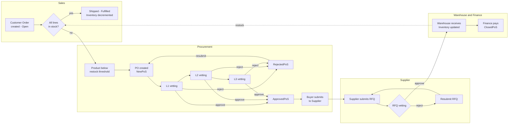

# NorthWind PLUS

**A full Line-of-Business application running natively on a Labeled Property Graph — ported to Neo4j, Memgraph, FalkorDB and Quine.**

NorthWind PLUS rebuilds the classic Northwind database as a *Graph-Native* application and extends it into a complete, 360-degree business cycle: customer orders, low-stock detection, purchase orders with three levels of approval, supplier RFQs, warehouse receiving, finance closure and order fulfillment — all expressed in Cypher, inside the graph.

It is the proof of concept behind the article **[A Labeled Property Graph (LPG) Masterpiece](https://marcospinedo.substack.com/p/a-labeled-property-graph-lpg-masterpiece)**, and part of the broader [New Approach](../README.md) to building business applications *around* the graph rather than putting graphs around applications.

The ultimate test: six independent business processes, launched as separate OS processes, hammering the same live graph concurrently — and the model holding up.

---

## Contents

- [Why this exists](#why-this-exists)
- [The business cycle](#the-business-cycle)
- [Engine support at a glance](#engine-support-at-a-glance)
- [Repository layout](#repository-layout)
- [Quick start — Neo4j](#quick-start--neo4j)
- [Quick start — Memgraph](#quick-start--memgraph)
- [Quick start — FalkorDB](#quick-start--falkordb)
- [Quick start — Quine](#quick-start--quine)
- [The simulation loops](#the-simulation-loops)
- [Schema and ontology](#schema-and-ontology)
- [Engine differences worth knowing](#engine-differences-worth-knowing)
- [AI agents — food for thought](#ai-agents--food-for-thought)
- [Further reading](#further-reading)

---

## Why this exists

Most attempts to run business applications on a graph carry over a table mindset: *one record = one node*, with state stored in properties. NorthWind PLUS takes the opposite route and follows a small set of rules:

| Principle | In practice |
|---|---|
| **Proper Noun Nodes** | Nodes hold only what defines the identity of the thing they represent. State, category and context are *never* properties. |
| **Relationships drive the system** | A business event is a change in relationships — a node moves from one *Collection* to another (e.g. `NewPoS` → `ApprovedPoS`). State = position. |
| **Lean Nodes / Collections** | Hub nodes act as explicit sets (Superset, Subset, Element of) representing domain states and contexts. |
| **Read-only nodes, "isotopes" for the exceptions** | Properties don't change after creation. The few genuinely mutable values (inventory counts, thresholds) are isolated in their own small nodes, such as `InventoryLevel`. |
| **Never delete nodes** | Nothing is deleted, only relinked and timestamped, so the full history stays traceable. |

A consequence shows up in the simulation harness: there are no approval thresholds, state-machine definitions or validation rules in the Python code. Every limit (e.g. who can approve what amount) lives on role nodes in the graph and is read at query time. The application code is reduced to orchestration — pick a rate, run a Cypher statement, retry on contention, log the result.

The full reasoning is in the header of each import script and in the [article](https://marcospinedo.substack.com/p/a-labeled-property-graph-lpg-masterpiece).

---

## The business cycle



Approval routing depends on the PO amount and on the `ApprovalBase` / `ApprovalLimit` values stored on the role nodes. Rejected items are always eligible for resubmission, so nothing gets permanently stuck.

---

## Engine support at a glance

| | Neo4j | Memgraph | FalkorDB | Quine |
|---|---|---|---|---|
| Model version | v2.3.1 | v2.3.1 port | v2.3.1 port | v2.4 (no edge properties) |
| Import | `.cypher` in Query console | `.cypher` in Query console | `.sh` via `redis-cli` | `.sh` via Quine REST API |
| Simulation harness | `NorthwindPlus_Stress_Test.py` | `NorthwindPlus_Stress_Test_MemGraph.py` | `NorthwindPlus_Stress_Test_FalkorDB.py` | `NorthwindPlus_Stress_Test_Quine.py`, **or** the `northwind-plus-simulation.yaml` recipe (no Python) |
| Python dependency | `neo4j` driver | `neo4j` driver (Bolt) | `falkordb` | none (standard library) |
| GRAPH TYPE schema | ✅ | — | — | — |
| Business logic in the graph | Cypher | Cypher | Cypher | Cypher + **Standing Queries** (+ ingest streams in the recipe) |
| Windows launcher | `PySetup.bat` | `MPySetup.bat` | — | — |

---

## Repository layout

```
NorthWindPLUS/
├── Import/                                               Cleaned Northwind CSV files (see note below)
├── NorthWind_PLUS_Graph_Data_Model_Import_v2.3.1.cypher   Neo4j import + full 360° initialization + query examples
├── NorthWind_PLUS_Graph_Data_Model_Import_v2.31 (MemGraph).cypher   Memgraph port
├── NorthWind_PLUS_FalkorDB_Import_v2.3.1.sh               FalkorDB port (import | recommend | report | checks | all)
├── NorthwindPlusGraphType_v1.cypher                       Neo4j GRAPH TYPE schema enforcement
├── NorthwindPlusGraph_RDF-turtle_v1.ttl                   RDF/OWL equivalent of the schema
├── NorthwindPlus_Stress_Test.py                           Concurrency harness — Neo4j
├── NorthwindPlus_Stress_Test_MemGraph.py                  Concurrency harness — Memgraph
├── NorthwindPlus_Stress_Test_FalkorDB.py                  Concurrency harness — FalkorDB
├── PySetup.bat                                            Windows: opens 8 loop windows against Neo4j
├── MPySetup.bat                                           Windows: opens 8 loop windows against Memgraph
├── AI_Agents_Food_For_Thought.md                          Ideas for an agentic layer (not yet built)
└── Quine/
    ├── README.md                     Streaming "business day" demo — full walkthrough
    ├── northwind-plus-streaming.yaml Quine recipe: seed + business streams + standing queries
    ├── run-demo-docker.sh            Launcher (Docker, Windows + WSL)
    ├── run-demo.sh                   Launcher (local Quine jar)
    ├── feeds.json                    Graph feeds for the Exploration UI
    ├── DEMO_PLAN.md                  Design decisions and verification runs
    ├── tap-queries-api (3).md        Reference for Quine's tap-query API
    └── Full_NorthWindPLUS/
        ├── Readme.md
        ├── NorthWind_PLUS_Graph_Data_Model_Import_v2.4 (Quine).cypher   The edge-property-free v2.4 model
        ├── northwind-plus-quine-batch.sh                               Builds the full graph through the REST API
        ├── register-standing-queries.sh                                Moves the company's own rules into Standing Queries
        ├── northwind-plus-quine-recommendations.sh                     Optional recommendation layer
        ├── NorthwindPlus_Stress_Test_Quine.py                          Simulation loops (sq | loops | auto modes)
        └── Recipe_Version/
            ├── Readme.md                       The simulation as a recipe — full walkthrough
            ├── northwind-plus-simulation.yaml  Quine recipe: 7 ingest streams, 11 standing queries, 47 sample + 26 quick queries
            ├── northwind-plus-quine-batch.sh   Batch loader with --import-only (load, then switch the simulation on)
            └── register-standing-queries.sh    Standing queries over the REST API (for running without the recipe)
```

> **About the CSV files.** The original Northwind CSVs published in [neo4j-graph-examples/northwind](https://github.com/neo4j-graph-examples/northwind) contain unescaped commas in some fields (mainly addresses for Brazil, France and Belgium, and some notes), which shifts columns during import. The files in `Import/` are fixed. The import scripts load them directly from this repo's raw GitHub URLs, so you don't need to download them for Neo4j or FalkorDB.

---

## Quick start — Neo4j

Tested by the author on **Neo4j Aura**. The harness uses `apoc.lock.nodes`, so APOC must be available on the target database.

**1. Build the graph**

Open `NorthWind_PLUS_Graph_Data_Model_Import_v2.3.1.cypher`, read the **Quick Run Instructions** block near the top, and run the import/initialization section in the Neo4j Query console. It:

- clears the database (`MATCH (n) DETACH DELETE n` — **use an empty or disposable database**)
- loads the CSVs and builds every Collection, role and employee
- executes one pass of every workflow step, so the graph starts in a realistic state

The script also contains an optional **Recommendation Engine** layer (customer ratings + cosine similarity) and a set of **query examples and data-quality checks** to run while the loops are going.

**2. (Optional) Apply the GRAPH TYPE schema**

Run `NorthwindPlusGraphType_v1.cypher` to enforce the model's structure at the database level. This uses Neo4j's newer `ALTER CURRENT GRAPH TYPE` syntax — check that your Neo4j version/edition supports it.

**3. Run the loops**

```bash
pip install neo4j

export NEO4J_URI="neo4j+s://<your-instance>.databases.neo4j.io"
export NEO4J_USER="neo4j"
export NEO4J_PASSWORD="<password>"
export NEO4J_DATABASE="neo4j"

# one terminal per loop
python NorthwindPlus_Stress_Test.py --loop customer-order    --rate 6
python NorthwindPlus_Stress_Test.py --loop po-creation       --rate 2
python NorthwindPlus_Stress_Test.py --loop po-vetting        --rate 4
python NorthwindPlus_Stress_Test.py --loop rfq-vetting       --rate 4
python NorthwindPlus_Stress_Test.py --loop warehouse-finance --rate 4
python NorthwindPlus_Stress_Test.py --loop order-fulfillment --rate 4
```

**On Windows:** fill in the four `SET NEO4J_...` lines at the top of `PySetup.bat` and run it. It opens eight console windows (two of them duplicate loops for extra contention), each waiting for you to press Enter.

Then go back to the Query console and watch the graph change in real time.

---

## Quick start — Memgraph

1. Run `NorthWind_PLUS_Graph_Data_Model_Import_v2.31 (MemGraph).cypher` in the Memgraph query console (see its Quick Run Instructions block).
2. Run the loops with `NorthwindPlus_Stress_Test_MemGraph.py`. It connects over Bolt using the same `NEO4J_*` environment variables as the Neo4j harness:

```bash
pip install neo4j
export NEO4J_URI="bolt://127.0.0.1:7687"
export NEO4J_USER="<user>"
export NEO4J_PASSWORD="<password>"
export NEO4J_DATABASE="memgraph"

python NorthwindPlus_Stress_Test_MemGraph.py --loop customer-order --rate 6
# ...same six loops as above
```

**On Windows:** edit and run `MPySetup.bat`, which opens the same eight windows against Memgraph.

---

## Quick start — FalkorDB

Requires `redis-cli` on your path and a running FalkorDB instance. The import script and the Python harness read the same environment variables, so you only set them once:

```bash
export FALKORDB_HOST=localhost
export FALKORDB_PORT=6379
export FALKORDB_GRAPH=northwind
# optional: FALKORDB_USERNAME, FALKORDB_PASSWORD, FALKORDB_SSL=1
```

**1. Build the graph**

```bash
./NorthWind_PLUS_FalkorDB_Import_v2.3.1.sh            # import (default)
./NorthWind_PLUS_FalkorDB_Import_v2.3.1.sh all        # import + recommend + report + checks
```

Sub-commands: `import`, `recommend`, `report` (Inventory Level Report), `checks` (data-quality checks), `all`. CSVs are read from GitHub by default; for local files, place them in FalkorDB's import folder and set `CSV_BASE=file:/`. The import script also accepts `QUERY_TIMEOUT_MS` and `REDIS_CLI`, and still understands the older `FALKOR_*` / `GRAPH` names.

**2. Run the loops**

```bash
pip install falkordb
python NorthwindPlus_Stress_Test_FalkorDB.py --loop customer-order --rate 6
# ...same six loops as above
```

---

## Quick start — Quine

Quine is a streaming graph, and it does not support properties on relationships. The Quine version therefore uses **model v2.4**, where every edge that carried data becomes an intermediate node — line items (`OrderItem`, `POItem`, `RFQItem`), decision traces (`VettingDecision`, `WarehouseDelivery`, `FinancePayment`) and so on. The principle "state = position" is unchanged.

There are three ways to run it.

| | Option | Who drives the business |
|---|---|---|
| **A** | [The full model as a recipe](#a-the-full-model-as-a-recipe-quinefull_northwindplusrecipe_version) | Quine alone: ingest streams + standing queries, no Python |
| **B** | [The full model with the Python harness](#b-the-full-model-with-the-python-harness-quinefull_northwindplus) | Python loops, with or without Standing Queries |
| **C** | [The streaming "business day" demo](#c-the-streaming-business-day-demo-quine) | Quine alone, a self-contained five-minute day |

### A. The full model as a recipe (`Quine/Full_NorthWindPLUS/Recipe_Version/`)

The whole simulation runs from one Quine recipe, `northwind-plus-simulation.yaml`:

- **Ingest streams** play the outside world: a Sales Rep entering customer orders, the warehouse shipping them, the Procurement Assistant raising POs, suppliers sending and resubmitting RFQs, goods arriving at the dock, and a slow threshold recalibration.
- **Standing queries** apply the company's rules the moment a pattern appears: L1/L2/L3 PO vetting, buyer submission, RFQ vetting, on-order bookkeeping, LowStock re-evaluation and finance closure.

Start Quine **with the recipe first**, then load the data:

```bash
cd Quine/Full_NorthWindPLUS/Recipe_Version

# window 1 -- Quine with the recipe (the streams wait until the data is in)
docker run --rm --name northwind-quine -p 8080:8080 -v "$PWD":/demo thatdot/quine -r /demo/northwind-plus-simulation.yaml

# window 2 -- load the graph; its last step switches the simulation on
bash ./northwind-plus-quine-batch.sh --import-only

# window 3 -- watch the company act
docker logs -f northwind-quine 2>&1 | grep --line-buffered -o '"alert":"[^"]*"'
```

Then explore at http://localhost:8080, using the 47 sample queries (live dashboards, gross profit, the Northwind sales reports, data-quality checks) and the right-click quick queries. The recipe runs on a throwaway store, so every run starts from empty. See the [Recipe_Version README](Quine/Full_NorthWindPLUS/Recipe_Version/Readme.md) for the streams, the standing queries, how to change the pace, and troubleshooting on Windows.

### B. The full model with the Python harness (`Quine/Full_NorthWindPLUS/`)

```bash
# Quine running WITHOUT a recipe (from WSL on Windows, or any Linux/macOS shell)
docker run -d --name quine -p 8080:8080 thatdot/quine

cd Quine/Full_NorthWindPLUS
./northwind-plus-quine-batch.sh --reset          # builds the whole graph via the REST API
./register-standing-queries.sh                   # optional: let the graph run the company's own rules
./northwind-plus-quine-recommendations.sh        # optional: recommendation layer

python3 NorthwindPlus_Stress_Test_Quine.py --check
```

The harness has three modes:

| Mode | What runs in Python | What runs inside Quine |
|---|---|---|
| `--mode sq` | The *outside world* only: customer orders, order fulfillment, supplier RFQ submission, goods arriving, a slow threshold-recalibration job | Reordering on low stock, L1/L2/L3 vetting, Buyer submission, RFQ vetting, Finance closure — as **Standing Queries** |
| `--mode loops` | The original six loops | Nothing extra |
| `--mode auto` (default) | `sq` if the standing queries are registered, otherwise `loops` | |

Without `--loop`, all loops of the chosen mode run in one process with a combined log. `--check` runs the data-quality invariants when you stop it; `--check-only` runs only those. See `Full_NorthWindPLUS/Readme.md` for every option.

### C. The streaming "business day" demo (`Quine/`)

A self-contained recipe where the business runs as a live stream — one tick per second, 300 ticks per business day — and standing queries react the moment a pattern appears, including writing the next business step back into the graph.

```bash
cd Quine
./run-demo-docker.sh            # one ~5-minute business day, then the graph stays up to explore
./run-demo-docker.sh --loop     # a fresh day every ~5½ minutes until Ctrl-C
```

Then open http://localhost:8080. `Quine/README.md` explains what to watch for at each point of the day, the sample queries, graph feeds and the four automations.

---

## The simulation loops

Each loop is one workflow step running as an independent, rate-limited process, simulating a real-world actor (Sales, Procurement, Supplier, Warehouse, Finance) working on the same graph at the same time.

| Loop | Actor | What one execution does |
|---|---|---|
| `customer-order` | Sales | Creates one random Open customer order with 1–11 lines |
| `po-creation` | Procurement | Creates one PO per supplier with products below their restock threshold |
| `po-vetting` | Approvers | Picks one eligible step: L1/L2/L3 approve, reject or pass through, or resubmit a rejected PO |
| `rfq-vetting` | Buyer ↔ Supplier | Buyer submits a PO, supplier submits an RFQ, buyer approves/rejects/resubmits it |
| `warehouse-finance` | Warehouse, Finance | Receives a delivered PO (updates inventory), then Finance pays and closes it |
| `order-fulfillment` | Warehouse | Ships the oldest open order whose lines are all in stock, decrementing inventory |

**Common options**

| Option | Meaning |
|---|---|
| `--loop NAME` | Which loop to run (required for the Neo4j, Memgraph and FalkorDB harnesses) |
| `--rate N` | Executions per minute (default 6) |
| `--duration S` | Stop after S seconds (default: run until Ctrl+C) |

Ctrl+C stops a loop cleanly and prints a summary: executions, retries, errors and achieved rate.

Vetting loops pick one eligible action per execution, weighted so that approvals and resubmissions dominate over rejections. When two processes race for the same item, the loser re-checks the item's eligibility, finds it already handled, and logs a harmless "lost the race" no-op instead of corrupting data. On Neo4j this is done by locking the chosen node with `apoc.lock.nodes` and re-checking the guard condition under the lock; the harness docstrings explain the bugs this closes (negative inventory, contradictory vetting outcomes, duplicate deliveries).

Play with the rates to simulate different loads — for example, the Windows launchers run customer orders at 60/min against two fulfillment and two vetting loops.

---

## Schema and ontology

- **`NorthwindPlusGraphType_v1.cypher`** — a Neo4j `GRAPH TYPE` declaring every node label, relationship type, key and required property in the model, so the database itself rejects structurally invalid writes.
- **`NorthwindPlusGraph_RDF-turtle_v1.ttl`** — the same schema expressed in RDF/OWL. Two top-level classes, `:Entity` and `:Collection`, make the *Proper Noun Nodes vs. Collections* principle explicit, and `owl:hasKey` stands in for `REQUIRE … IS KEY`.

Both files start with a "known issues" header that documents modeling decisions, such as non-singleton per-supplier Collections and the sentinel date used for unshipped orders.

**Naming convention:** Collection (hub) node labels are PascalCase with a capitalized final letter — `ApprovedPoS`, `OrderStatusOpeN`, `RoleS` — so they can be distinguished from entity nodes like `PurchaseOrder` or `Product`.

---

## Engine differences worth knowing

The model is the same everywhere (v2.4 on Quine only removes edge properties). What changes is how each engine handles the Cypher and the concurrency:

- **Neo4j** — multi-statement transactions with `ZONED DATETIME` throughout; concurrency is protected with `apoc.lock.nodes` plus a re-check under lock; deadlocks are retried automatically as `TransientError`.
- **FalkorDB** — write queries on a graph execute one at a time and each query is atomic, so the APOC locks are removed (the re-checks stay as a safety net). There are no multi-statement transactions, so eligibility checks run as parallel read-only queries and the action as a single write. Dates use `localdatetime()` (no zoned datetimes). The header of the import script lists every Cypher adaptation, including a workaround for an `OPTIONAL MATCH` bug reproduced on FalkorDB 4.22.1.
- **Quine** — no edge properties (hence v2.4), identity through `idFrom()`, mutable counters updated with atomic adds, and part of the business logic moved into Standing Queries. In the recipe version, even the simulation runs inside Quine: the outside world arrives as ingest streams, and no Python is involved.

---

## AI agents — food for thought

[`AI_Agents_Food_For_Thought.md`](AI_Agents_Food_For_Thought.md) explores what changes when an AI agent becomes another actor that reads graph context and writes decisions back — assisting PO vetting within the existing approval bands, learning from the `Comment` already recorded on every approval/rejection, and tuning approval levels. It also includes an example that turned out *not* to need AI (order-fulfillment fairness). None of it is built yet.

---

## Further reading

- [A Labeled Property Graph (LPG) Masterpiece](https://marcospinedo.substack.com/p/a-labeled-property-graph-lpg-masterpiece) — the article this POC accompanies
- [A new approach to application development using Cypher/GQL (Graphs)](https://medium.com/@marcospinedo/a-new-approach-to-application-development-using-cypher-gql-graphs-7d191e0c55d3) — the original concept
- [How Graphs simplify Business Processes and Workflows](https://medium.com/@marcospinedo/how-graphs-simplify-business-processes-and-workflows-like-moving-balls-between-baskets-c9606c9e973f)
- [Rethinking Line of Business Applications](https://medium.com/@marcospinedo/rethinking-line-of-business-applications-graphs-cypher-as-an-alternative-to-rdbms-sql-fd1d204f99b7) and the [video presentation](https://youtu.be/ExupBmmH1Rs)
- [Tender Workflow](../TenderWorkflow) — a sibling POC with multi-supplier support

Questions and discussion are welcome: [LinkedIn](https://www.linkedin.com/in/marcospinedo/).
