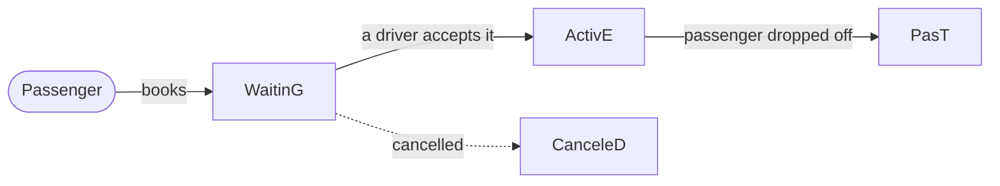
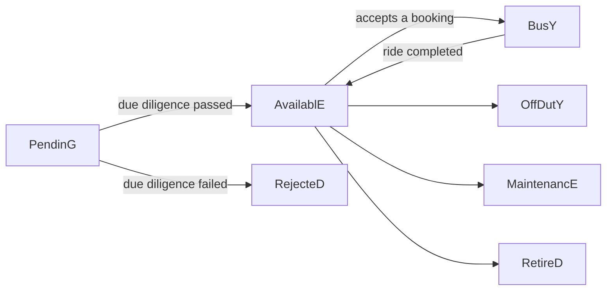

# Ride-Hailing — a Graph-Native application prototype

**The core ideas of the [New Approach](../README.md), applied to a domain everyone knows: passengers, drivers, cars and bookings.**

This is the first proof of concept in the repository. It models a ride-hailing service entirely on a Labeled Property Graph, and it comes with a working **React + TypeScript** prototype that runs directly on that graph. The graph holds both the data and the application's state: a car becoming available, a booking being accepted or a ride finishing is never a property update. Instead, a node moves from one *Collection* to another.

It accompanies the article **[Ride-Hailing Graph App Prototype Explainer](https://medium.com/@marcospinedo/ride-hailing-graph-app-prototype-explainer-071a89543a90)**.


---

## Contents

- [The idea in one picture](#the-idea-in-one-picture)
- [The model](#the-model)
- [Files](#files)
- [Quick start — explore the model in Neo4j](#quick-start--explore-the-model-in-neo4j)
- [Quick start — run the prototype app](#quick-start--run-the-prototype-app)
- [Memgraph](#memgraph)
- [Things to try](#things-to-try)
- [Notes and limitations](#notes-and-limitations)

---

## The idea in one picture

A booking's life is just a node changing which Collection it belongs to:



(The `CanceleD` Collection is part of the model, but the scripts don't include a cancellation command yet.)

The car follows a parallel path:



Each transition is a handful of relationship changes in a single transaction: delete the edge from the old Collection and create one to the new Collection. No `status` property is ever set, and no node is ever deleted. A finished booking stays in `PasT` and in the passenger's and driver's `HistorY`, so the full record remains queryable.

---

## The model

The script builds two layers, and its comments label them explicitly.

### 1. Information Architecture — the Graph Data Model

**Proper Noun nodes**, each with a uniqueness constraint on the property that identifies it:

| Node | Identified by | Notes |
|---|---|---|
| `Passenger` | `Phone` | Has a personal `WalleT` (payment methods), `AddressBooK` (favourite addresses) and `HistorY` |
| `Driver` | `ID` | Has a `WalleT` (credit methods), a `HistorY`, and is linked to their `Car` |
| `Car` | `Plate` | Its current position is a separate `Loc` node holding a GeoHash — one of the few nodes whose values change |
| `Booking` | `BookingID` | Linked to its passenger, origin and destination `Address`, payment method and, once accepted, the car |
| `Address` | `GeoHash` | Shared by everyone: the same physical address is one node, whoever uses it |

**Domain Collections** — hub nodes that represent states and contexts:

| Collection | Members |
|---|---|
| `FleeT` | the car-state Collections: `PendinG`, `AvailablE`, `BusY`, `OffDutY`, `MaintenancE`, `RejecteD`, `RetireD` |
| `BookingS` | the booking-state Collections: `WaitinG`, `ActivE`, `PasT`, `CanceleD` |
| `PassengerS`, `DriverS`, `AddresseS` | every passenger, driver and known address |
| `WalleT`, `AddressBooK`, `HistorY` | per-person Collections |

Collection labels are written in PascalCase with a capitalized final letter (`AvailablE`, `WaitinG`), which distinguishes them at a glance from entity nodes like `Car` or `Booking`.

### 2. Interaction Architecture — what the applications do

The same script then *plays* the business. It creates 19 drivers and their cars (approving most, rejecting one), 13 passengers and a set of real Denver-area addresses with their GeoHashes. Then it runs bookings through their lifecycle:

1. **Passenger books a ride.** The booking is created and connected to the passenger, origin, destination and payment method, and placed in `WaitinG`, all in one transaction.
2. **Driver accepts.** The booking moves to `ActivE`, the car moves from `AvailablE` to `BusY`, and the car is linked to the booking.
3. **Pick-up** is recorded as a timestamped relationship.
4. **Drop-off.** The booking moves to `PasT` and is linked into both people's `HistorY`, and the car returns to `AvailablE`.
5. **Rating.** The passenger rates the ride.

Several bookings are deliberately left in `WaitinG`, so the database starts in a realistic, mixed state.

One car, `ABF-5678`, is intentionally left in `PendinG`, so the demo always has a pending application to query and approve.

> **About this POC.** This was the first proof of concept in the series, and it has no ontology layer. Every node "inside" a Collection is connected with the same generic `[:HAS]` relationship, a trade-off made at the time to keep UI components reusable. Later models in this repository ([TenderWorkflow](../TenderWorkflow) v7.1 and [NorthWindPLUS](../NorthWindPLUS)) replace it with ontology-specific relationship types and add schema enforcement. Read this one as the clearest introduction to the core concepts, not as the most refined model.

---

## Files

| File | Description |
|---|---|
| `RideHailing.cypher` | Builds the whole model and initial data: constraints, Collections, drivers, cars, passengers, addresses and sample bookings. Run it all at once or command by command. |
| `neo4j-RideHailingDB.backup` | A Neo4j backup of a database with the initial nodes and some bookings already made — an alternative to running the script. |
| `RideHailing_Queries.cypher` | Example queries: Collection membership, cars and bookings near a GeoHash (push vs. pull dispatch), cardinalities, dynamic fares, booking-time audits, and history with and without the `HistorY` Collection. Some include the database accesses and memory measured, for comparison. |
| `RideHailing_Templates.cypher` | The parameterized Cypher commands behind the three applications — **Passenger App**, **Driver App** and **Back-office App**. Replace the `<placeholders>` with real values. |
| `RideHaining-MemGraph.cypher` | The model script adapted for Memgraph. |
| `The RideHailingGraphModel.png` | The graph model diagram. |
| `RideHailingGraphApp/` | The React + TypeScript prototype application. |

---

## Quick start — explore the model in Neo4j

1. Create a database — a free [Neo4j Aura](https://neo4j.com/cloud/aura-free/) instance or Neo4j Desktop.
2. Either:
   - **run `RideHailing.cypher`** in Neo4j Browser or the Aura Query console. ⚠️ It starts with `MATCH (n) DETACH DELETE n`, so use an empty or disposable database. Or
   - **restore `neo4j-RideHailingDB.backup`** into Neo4j Desktop.
3. Explore the graph — a good first query is everything in the fleet, whatever its state:

   ```cypher
   MATCH path = (:FleeT)-[:HAS]->()-[:HAS]->(:Car)
   RETURN path;
   ```

4. Work through `RideHailing_Queries.cypher`, then try the commands in `RideHailing_Templates.cypher` to act as a passenger, a driver or the back office yourself.

Some queries and the app use `apoc.temporal.format`, so **APOC** must be available. It is on Neo4j Aura.

---

## Quick start — run the prototype app

The app is a Vite + React 18 + TypeScript project (Chakra UI, TanStack Query). It talks to Neo4j directly from the browser through `neo4j-driver` and the `use-neo4j` hooks. You choose to be a **passenger** or a **driver**, then request, accept, start and complete rides against the live graph.

**Prerequisites:** Node.js and npm (or Yarn), plus a Neo4j database already loaded with `RideHailing.cypher` or the backup.

1. Copy the app folder and install its dependencies:

   ```bash
   cd RideHailing/RideHailingGraphApp
   npm install
   ```

2. Copy `.env.example` to `.env` in that folder and fill in your connection (`.env` is ignored by git):

   ```env
   VITE_APP_NEO4J_URI=neo4j+s://<your-instance>.databases.neo4j.io
   VITE_APP_NEO4J_USERNAME=neo4j
   VITE_APP_NEO4J_PASSWORD=<your-password>
   VITE_APP_NEO4J_DATABASE=neo4j
   ```

3. Start it:

   ```bash
   npm run dev
   ```

   The dev server runs on **port 3031** and opens your browser.

Other scripts in `package.json`: `npm run build` (type-check and production build) and `npm run preview` (serve the build on port 3031). A `web.config` is included for hosting the built app on IIS / Azure App Service.

> 🔒 **Demo only.** Vite embeds `VITE_*` variables into the JavaScript sent to the browser, so the database credentials are visible to anyone using the app. That's fine for a local prototype, but a real deployment needs a backend or API layer in between. Never commit a `.env` containing real credentials.

---

## Memgraph

`RideHaining-MemGraph.cypher` builds the same model in Memgraph. The differences are syntax only:

- `DROP ALL CONSTRAINTS` / `DROP ALL INDEXES`
- `CREATE CONSTRAINT ON … ASSERT … IS UNIQUE`
- `localDateTime()` in place of `localdatetime.transaction()`

The model itself is unchanged. The prototype app has only been used with Neo4j.

---

## Things to try

- **Push vs. pull dispatch.** Compare finding available cars near a booking's origin (the system chooses) with finding waiting bookings near a driver (the driver chooses). Both are in `RideHailing_Queries.cypher`, and both use GeoHash prefixes for proximity.
- **Dynamic pricing.** Compare the number of members of `AvailablE` with the number in `WaitinG` to compute a surge fare. A version is in both the main script and the queries file.
- **History with and without the `HistorY` Collection.** The last two queries in the queries file retrieve a passenger's past bookings both ways. Compare their profiles to see the trade-offs of *Lean Nodes*.
- **Back-office flows.** Approve or reject a pending car, send one to maintenance, or retire it. Each is just a move between Collections, using commands from the templates file.

---

## Notes and limitations

- This is a **prototype for demonstrating concepts**. Booking IDs are generated with `randomUUID()`, fares are random, and a car's GeoHash is set by hand. A real system would use microservices for these, and the script's comments point out where.
- **All sample data is fictitious.** That includes the people, phone numbers, IDs and payment details. The addresses are real Denver-area addresses, used only to make the GeoHashes realistic.
- The prototype is released under the **GNU GPL v3** (see `RideHailingGraphApp/COPYING`).

For the reasoning behind the model, read the [explainer article](https://medium.com/@marcospinedo/ride-hailing-graph-app-prototype-explainer-071a89543a90). Questions and feedback are welcome on [LinkedIn](https://www.linkedin.com/in/marcospinedo/).
