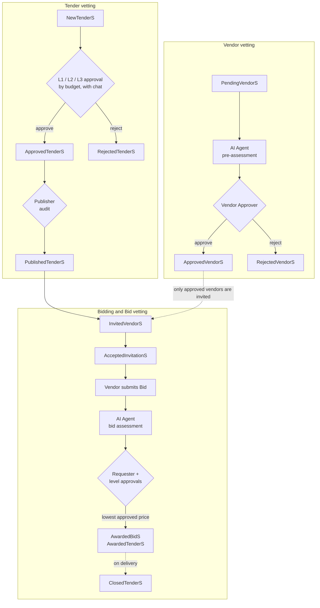

# Tender Workflow — a Graph-Native workflow application

**A tendering system in which the graph is both the data layer and the execution engine — with a full ontology enforced by Neo4j GRAPH TYPE.**

This proof of concept simulates a simplified tendering system with three intertwined workflows: **Vendor vetting**, **Tender vetting** and **Bid vetting**. It covers multi-level approvals, conversations between stakeholders, and AI-agent assessments, all running in Cypher, inside the graph.

It shows that the approach generalizes beyond a single app. Most Line-of-Business applications (HR, CRM, ERP, customer support, compliance) are workflows at heart, and a workflow is a graph.

It accompanies two articles:

- [A Graph-Native Workflow Application using Neo4j/Cypher](https://medium.com/@marcospinedo/a-graph-native-workflow-application-using-neo4j-graph-a4406e51b4e5) — the original Tender Workflow
- [Graph-Native Business Applications with a Full Ontology — a practical use case of Neo4j's new GRAPH TYPE Schema enforcement](https://medium.com/@marcospinedo/graph-native-business-applications-with-a-full-ontology-a-practical-use-case-of-neo4js-new-graph-216c9bf20d22) — v7.1, the ontology and the schema


---

## Contents

- [What it simulates](#what-it-simulates)
- [The workflows](#the-workflows)
- [How the model is built](#how-the-model-is-built)
- [Files](#files)
- [Quick start — Neo4j](#quick-start--neo4j)
- [The Random Test Generator](#the-random-test-generator)
- [Memgraph and FalkorDB](#memgraph-and-falkordb)
- [Things to try](#things-to-try)
- [Version history](#version-history)
- [Notes](#notes)

---

## What it simulates

`TenderWorkflow v7.1.cypher` starts from an empty graph and plays out about 130 interactions — the Cypher commands that some 20 users would normally trigger from their own screens. It creates **19 employees**, **6 roles**, **10 vendors** with their contact persons, **13 tenders** and **6 bids**, then takes them through every vetting step, including the approval chats and the AI-agent assessments.

You can run the whole script at once (it takes roughly 30 seconds) to study the final graph. Or run it step by step to watch the graph *execute the logic* as relationships change. The comments explain every phase.

---

## The workflows



**Approval levels come from the graph.** Each approver role node carries its own `ApprovalBase` and `ApprovalLimit`:

| Role | Approves budgets |
|---|---|
| `Level1Approver` | up to 200,000 |
| `Level2Approver` | 200,001 – 300,000 |
| `Level3Approver` | 300,001 – 2,000,000 |

A tender or bid needs every level up to the one whose band contains its amount. No threshold is hardcoded outside the model: change the values on the role nodes, and the workflow and the Python generator follow.

**AI agents are simulated.** Before vendor approval and bid approval, the script runs the queries an AI agent would use to gather documents, chats and context. It then writes an `AIVendorAssessment` / `AIBidAssessment` node with a rating and a summary, for the human approver to read before deciding. For the demo, the ratings are random and the texts are Lorem ipsum. The comments mark where a well-tuned agent could assist, or fully automate, each step by issuing the same Cypher commands the UI would.

---

## How the model is built

The model follows the [key principles](../README.md#the-key-principles) of the New Approach and adds a **mathematical set ontology**:

- **Super-Collections** (e.g. `TenderS`, `VendorS`) are universal sets.
- **Collections** (e.g. `NewTenderS`, `ApprovedVendorS`) are subsets that represent states.
- **Entities** (e.g. a `Tender`, a `Vendor`) are elements of those sets.

So: **Entity ∈ Collection ⊆ Super-Collection.** An entity's lifecycle is visible in the graph's structure, not hidden in a status property, which gives both people and LLMs a precise way to reason about it.

What changed in v7.1:

- **Ontology-specific relationship types.** Earlier versions used one generic `[:HAS]` for every Collection membership (v6 added a `RelType` property to carry the meaning). v7.1 removes `[:HAS]` entirely, in favour of types such as `HAS_NEW_TENDER_STATE`, `IS_PUBLISHED_TENDER_STATE` or `HAS_L1_TENDER_APPROVAL`. This restores semantic clarity and improves edge indexing at scale.
- **GRAPH TYPE schema enforcement.** `TenderGraphType v1.cypher` declares every node label, property type, key and relationship, so the database rejects anything that doesn't fit the ontology.
- **An RDF/OWL equivalent** of the schema, in Turtle. Almost every relationship type has exactly one domain and one range.

**Naming convention:** Collection labels start and end with a capital letter (`ApprovedTenderS`, `RoleS`, `EmployeeDirectorY`), so they're easy to tell apart from entity nodes. There is only one instance of each Domain Collection. When Neo4j warns that a `MATCH` on several of them could produce a Cartesian product, it won't.

**Roles are incoming relationships.** An employee holds a role because the role node points to them (`(:RolE)-[:IS_ACTIVE_ROLE]->(:Employee)`), not the other way round. Roles are assigned by another system, so the employee has no "right" to change them. This also avoids many-to-many links. When a role changes, the old assignment becomes a `WAS_PAST_ROLE` relationship with start and end dates, so the history is never lost.

---

## Files

| File | Description |
|---|---|
| `TenderWorkflow v7.1.cypher` | **Current version.** The full simulation, with ontology-specific relationship types (Neo4j). |
| `TenderGraphType v1.cypher` | GRAPH TYPE schema for v7.1. Run it after the simulation script. |
| `TenderGraph RDF-turtle v1.ttl` | The same ontology in RDF/OWL (Turtle). |
| `Tender_Workflow_Random_Test_Generator.py` | Python generator that runs random tender lifecycles against the graph (Neo4j). |
| `Tender_Workflow_Random_Test_Generator_MemGraph.py` | The generator adapted for Memgraph. |
| `TenderWorkflow v7.1 MemGraph.cypher` | v7.1 adapted for Memgraph. |
| `TenderWorkflow v7.1 FalkorDB (beta).cypher` | v7.1 adapted for FalkorDB — beta. |
| `Neo4j Aura ScriptOutputFile.txt`, `Neo4j Local ScriptOutputFile.txt`, `MemGraph Local ScriptOutputFile.txt` | Sample generator runs (20 tenders each). |
| `Tender Model v7.1 visualisation.png` / `.svg` | The v7.1 graph model. |
| `TenderWorkflow v5.cypher`, `TenderWorkflow v6.cypher`, `TenderWorkflow v6 - MemGraph.cypher`, `TenderWorkflow v6 Graph Model.png` | Earlier versions — see [Version history](#version-history). |

---

## Quick start — Neo4j

1. Create a database — a free [Neo4j Aura](https://neo4j.com/cloud/aura-free/) instance or Neo4j Desktop.
2. Run **`TenderWorkflow v7.1.cypher`** in the Query console or Neo4j Browser. ⚠️ It begins with `MATCH (n) DETACH DELETE n`, so use an empty or disposable database.
3. *(Optional, recommended)* Run **`TenderGraphType v1.cypher`** to enforce the ontology. It uses `ALTER CURRENT GRAPH TYPE`, the GRAPH TYPE schema enforcement introduced as a preview in **Neo4j 2026.02 / Cypher 25**. Check that your Neo4j version supports it.
4. Explore. For example, every tender and the state it's in:

   ```cypher
   MATCH (:TenderS)-[]->(state)-[]->(t:Tender)
   RETURN labels(state)[0] AS State, t.Title AS Tender
   ORDER BY State;
   ```

---

## The Random Test Generator

`Tender_Workflow_Random_Test_Generator.py` adds new tenders and bids on top of the graph built by the script, and runs each one through the complete lifecycle:

1. A random requester creates a tender with a random type and budget.
2. The tender is vetted through the approval levels its budget requires. Each level has a 15% chance of rejection.
3. A publisher publishes it and invites approved vendors. Each vendor accepts with 70% probability.
4. Accepting vendors submit bids, and the simulated AI agent assesses them.
5. Each bid is vetted by the tender's requester and the required approval levels.
6. The **lowest-priced approved bid** wins, the tender is awarded, and the other bidders are notified.

It doesn't create employees, vendors or roles — it reuses the ones the script created. It reads the approval thresholds from the role nodes at runtime, and it counts and times every Cypher command it issues.

```bash
pip install neo4j

export NEO4J_URI="neo4j+s://<your-instance>.databases.neo4j.io"
export NEO4J_USERNAME="neo4j"
export NEO4J_PASSWORD="<password>"

python Tender_Workflow_Random_Test_Generator.py --tenders 20 --seed 42
```

| Option | Meaning |
|---|---|
| `--tenders N` | Number of tender lifecycles to run (default 10) |
| `--seed N` | Random seed, for reproducible runs |

**Sample runs** (20 tenders each, from the output files in this folder):

| Environment | Cypher commands | Total time | Avg per tender |
|---|---|---|---|
| Neo4j Aura, cloud instance (~167 ms network latency), GRAPH TYPE enforced | 285 | 49.8 s | 2.49 s |
| Neo4j Desktop, local, no constraints | 263 | 3.2 s | 0.16 s |
| Memgraph, local Docker, no constraints | 324 | 0.98 s | 0.05 s |

These are single illustrative runs in very different environments, not a benchmark. The command counts differ because each run takes different random paths (rejections, acceptances, number of bids), and the Aura timings are dominated by network round trips.

---

## Memgraph and FalkorDB

**Memgraph.** Run `TenderWorkflow v7.1 MemGraph.cypher`, then the generator:

```bash
export MEMG_URI="bolt://localhost:7687"
export MEMG_USERNAME="<user>"
export MEMG_PASSWORD="<password>"

python Tender_Workflow_Random_Test_Generator_MemGraph.py --tenders 20 --seed 42
```

The Memgraph port changes only syntax (for example, `duration({day: …})` instead of `duration({days: …})`). The GRAPH TYPE schema is Neo4j-specific and is not used there.

**FalkorDB (beta).** `TenderWorkflow v7.1 FalkorDB (beta).cypher` mainly replaces `datetime()` with `localdatetime()`, since FalkorDB has no zoned datetimes. There is no FalkorDB generator yet.

---

## Things to try

- **Step through it.** Re-run the script in batches and watch tenders, vendors and bids move between Collections.
- **Read the conversations.** Approval chats are part of the graph, attached to the tender or bid they belong to. They're ready-made context for an AI agent or an auditor.
- **The role-change exercise.** Near the end of the script there are three commented-out commands that promote Juliet, Keneth and Nelson from Requester to L1, L2 and L3 Approver:
  1. Run the generator a few times.
  2. Run the three role-change commands.
  3. Run the generator again.
  4. Use the queries that follow them to look for a **potential conflict of interest**: an employee who, as a requester, worked with a vendor on awarded tenders and, as an approver, later approved that vendor's winning bids. A follow-up query checks whether such decisions overlooked cheaper alternatives. You may need several runs before such a case appears.
- **Change the rules in the data.** Change `ApprovalLimit` on a role node and run the generator again. The routing changes without touching any code.

---

## Version history

| Version | Change |
|---|---|
| **v5** | The original Tendering System POC (Neo4j) |
| **v6** | Adds a `RelType` property on the generic `[:HAS]` Collection relationships to record their ontological meaning; Memgraph port |
| **v7.1** | Replaces `[:HAS]` with ontology-specific relationship types; adds the GRAPH TYPE schema, the RDF ontology, the Random Test Generator, and the Memgraph and FalkorDB (beta) ports |

---

## Notes

- This is **not a complete tendering solution**. It is a conceptual demonstration, originally developed in about four days, and there is room for improvement. All people, vendors and documents are fictitious.
- The AI-agent assessments are **simulated** with random ratings and placeholder text.
- Questions and feedback are welcome on [LinkedIn](https://www.linkedin.com/in/marcospinedo/).
